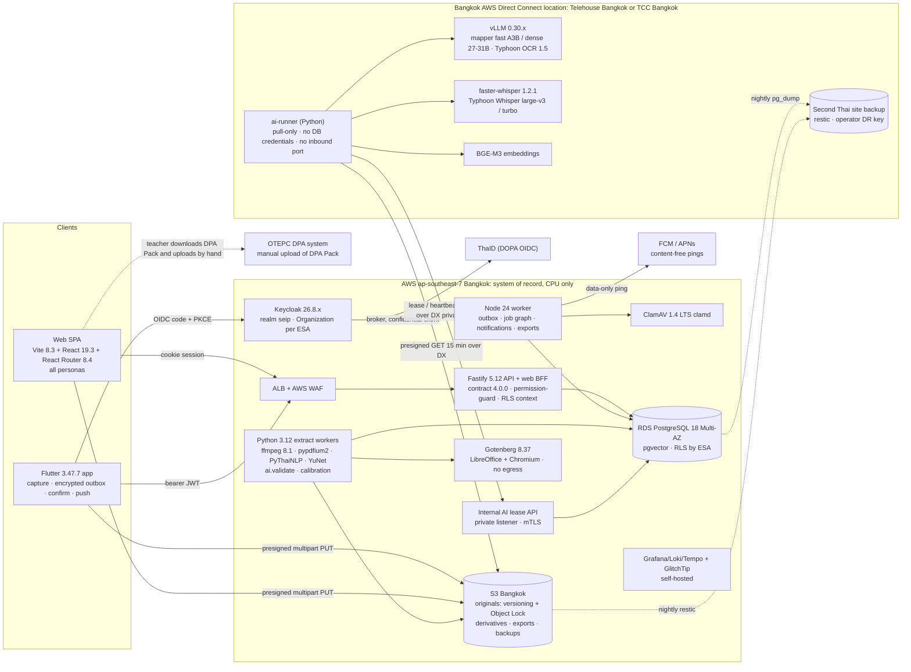

# SEIP v1 Design Brief (2026-10-12)

> **Status:** input to `docs/project/plan.md` and ADR-0010 – ADR-0018 (all *Proposed*). This is the detailed technical source; `plan.md` is the Thai summary and roadmap.
> **How it was produced:** two research rounds (8 + 5 topics, each with an adversarial fact-check), three competing architectures (EVOLVE / Re-Platform / Sovereign Appliance), four lens judges (purpose, compliance, delivery, feasibility-cost), and one synthesis that corrected every factual error the judges found. Many Thai regulatory sources could not be fetched (proxy 403); every such claim is marked unverified or secondary.
> **Owner decisions applied:** D1 all AI in Thailand on self-hosted open models · D2 ESA buyer/controller, school tenant, person-owned portfolio · D3 v1 = evidence hub, scoring deferred · D4 Flutter mobile + web in parallel · D5 nothing existing is precious.

# SEIP v1 design brief: decision (2026-10-12, BE 2569)

**Decision.** Evolve `origin/feat/cleanup-L2-e2e-depth` @ `ff9293c` (proposal "SEIP EVOLVE") into the v1 evidence hub. Keep the contract-first TypeScript core: Fastify 5.12 API, Prisma 7.10, Vite 8 + React 19 SPA, the Node worker and outbox, the fail-closed `permission-guard`, the fail-closed ClamAV scanner, the 792 rubric rows, and PA1 + ประเด็นท้าทาย. Change only what D1–D5 or a documented defect forces.

1. **Database.** Move from MySQL 8 to PostgreSQL 18 + pgvector (RDS Multi-AZ, ap-southeast-7).
   - Reason: the MySQL trigger design is why CI never passed. All 18 of 18 runs failed, with ERROR 1419 at `20260718210100_constraints` query 11 (verified in job log 88290602232).
   - v1 also needs partial unique indexes, vectors, `SKIP LOCKED` leases and an RLS backstop.
2. **Object storage.** S3 API only.
   - Production: Amazon S3 Bangkok, with versioning and Object Lock.
   - Dev, CI and the Thai-owned profile: SeaweedFS 4.48.
   - MinIO's image no longer exists on Docker Hub. That alone breaks three CI gates on both branches today (PR #3 run 38219874189).
3. **AI under D1.**
   - A Python extract tier runs in AWS Bangkok.
   - **One** pull-only GPU node (1× RTX PRO 6000 Blackwell Server Edition, 96 GB) sits in a Bangkok AWS Direct Connect location: Telehouse Bangkok or TCC Bangkok. It is leased or bought only after a November pre-bake-off.
   - It runs self-hosted open-weight models:
     - a fast MoE mapper (Qwen3.6-35B-A3B first) with a dense 27–31B cascade;
     - Typhoon OCR 1.5;
     - Typhoon Whisper;
     - BGE-M3.
   - The contract is async (OpenAPI **4.0.0**). Nothing is ever auto-confirmed.
4. **Identity.**
   - Keycloak 26.x brokers ThaID.
   - The person key is a KMS HMAC of the citizen ID.
   - Web uses BFF cookies; Flutter uses PKCE.
   - Privileged roles need step-up MFA.
   - Authorisation stays in SEIP's database.
5. **Ownership (D2).**
   - The person owns the portfolio.
   - The ESA is the controller and holds custody.
   - Schools are tenants and get access through grants.
   - Mapping has two tiers: the teacher sets `owner_confirmed`, then the director or committee sets `validated` or `returned`.
6. **Clients (D4).**
   - Flutter 3.47.7 and the Vite/React SPA are built from one contract, with generated TS and Dart (swagger_parser) clients.
   - Encrypted offline outbox.
   - S3 multipart upload sessions.
   - Push notifications carry no content.
7. **Scope (D3).**
   - In: evidence hub, committee per-indicator view (validate/return), DPA Pack ZIP, PA2 workbook, signed PA3 upload.
   - Scoring code is frozen behind `FEATURE_SCORING=false`; its tests keep running.

**Judges' fixes applied to EVOLVE:**
- **Pilot size.** 20–40 schools on a ≤500k THB specific-method contract, not 200 schools.
- **P0 split into steps with green CI between them.** First PostgreSQL 18 + SeaweedFS + lockfile refresh, then Prisma 7. Keycloak moves to P1.
- **GPU capex gated on evidence.** One card; the lease-or-buy decision is due 27 Nov 2026. A second card comes only after the P5 gates pass, and only for the ESA-wide rollout in FY2571.
- **ffmpeg licence contradiction resolved.**
- **ASR moved off MIG quarter-slices.**
- **Prompt prefix holds all 18 indicators**, instead of a hard top-8 shortlist.
- **Dense-throughput arithmetic corrected.**

**Facts verified today that shape the design:**
- AWS Direct Connect serves ap-southeast-7 from Telehouse Bangkok and TCC Bangkok. A hosted 200 Mbps port costs $0.08/h, and outbound transfer over Direct Connect costs $0.041/GB. So the AWS-to-GPU path stays in Thailand by construction.
- ClamAV cannot scan files larger than 2 GB (`clamd.conf.sample`).
- `sqlite3_flutter_libs` and `sqlcipher_flutter_libs` are end-of-life. The encrypted store is therefore drift + `sqlite3` 3.7 hooks with SQLite3MultipleCiphers.
- swagger_parser 1.45 supports OpenAPI 3.1 for Dart.

**Milestones:**

| Milestone | Date |
|---|---|
| P0: green CI on PostgreSQL 18 | 30 Oct 2026 |
| Identity | 20 Nov 2026 |
| GPU decision | 27 Nov 2026 |
| Capture and upload | 11 Dec 2026 |
| In-country AI v0 | 22 Jan 2027 |
| Committee view | 12 Feb 2027 |
| Friendly alpha, 3 schools | from 15 Feb 2027 |
| DPA export + model gate | 12 Mar 2027 |
| Hardening | 23 Apr 2027 |
| **Pilot go-live (20–40 schools)** | **17 May 2027** |
| First real peak | Aug – 30 Sep 2027 |
| ESA-wide rollout | via FY2571 e-bidding |

## Round-1 contradictions resolved

| # | Contradiction | Binding resolution |
|---|---|---|
| C1 | System of record: Supabase Singapore vs Thai hosting | Thailand only (D1). AWS ap-southeast-7 is the default. The Thai-owned profile (NT/NIPA/GDCC VMs + PG18 + SeaweedFS) stays deployable and is tested weekly in CI. Supabase is rejected. |
| C2 | Which Claude platform | Moot: D1 forbids foreign and cloud AI. ai-pipeline's validation design (schema, quote checks, gold-set evals) is kept, but runs on vLLM + xgrammar with SEIP's own jobs. Nothing depends on Batches or Files. |
| C3 | Pass rule: ≥70% from each evaluator vs DPA 2-of-3 at 65/70/75/80 | Rules become effective-dated `pass_rule` data with `verified` flags. The hard-coded 70 leaves the DDL. Only v2 consumes it. 2-of-3 rests on secondary sources. The 65/70/75/80 split is unverified and may be stale. |
| C4 | Committee composition | Stored as `committee_eligibility_rule` data: same-school members are allowed if their วิทยฐานะ is ≥ ชำนาญการพิเศษ and ≥ the evaluatee's (ก.ค.ศ. meeting 2/2567, effective 1 Oct 2567; secondary). v1 warns at committee set-up. Access is granted per assignment. |
| C5 | Video length and capture | No fixed 10-minute auto-stop. Limits come from slot-profile data (teaching video ≤60 min, inspiration clip ≤10 min; both unverified). Default is 720p (~0.7–0.9 GB/h) with a "send original" option. Audio uploads first. DPA renditions are re-encoded only when a size cap forces it. |
| C6 | Greenfield vs existing code | Salvage the L2 branch. New ADRs start at ADR-0010. ADR-0007 is superseded by ADR-0010. |
| C7 | Next.js BFF vs PostgREST from the client | Neither. A static Vite SPA plus a Fastify BFF with httpOnly cookies. The API is the only data path; RLS is a backstop. |
| C8 | `school_id` tenancy vs person-owned portfolio | The person owns evidence. The ESA (`controller_area_id`) holds custody. Schools, directors and committees get grants. A transfer changes employment and grants, not ownership. |
| C9 | Who confirms a mapping | Two tiers: the teacher sets `owner_confirmed`; the director or committee sets `validated` or `returned`. AI suggestions live in `ai_suggestion`, never in the governed mapping table. |
| C10 | AI summaries for committees | The committee sees teacher-attested links, verified quotes, locators and provenance. It sees no AI confidence, level hints, rationale or AI-written summary in v1. |
| C11 | Committee scoring vs the official DPA system | No scoring in v1 (D3). SEIP feeds DPA (DPA Pack, PA2 workbook, signed PA3). OTEPC DPA remains the submission system. Scoring is frozen for v2. |
| C12 | Multi-agent process | Retired by ADR-0004. Sole developer working in vertical slices. Retired files are deleted. |
| C13 | ว23/2564 salary evaluation | Out of v1. A `programme` row is reserved. Externally scored PA results are stored as records a later ว23 module can use. |
| C14 | Thai ASR residency (Chirp in Singapore) | Self-hosted Typhoon Whisper on the Bangkok GPU node. No managed ASR. |
| C15 | Upload protocol: TUS vs S3 multipart | S3 multipart only, with single PUT for files ≤16 MiB. The server completes uploads via ListParts. Works on both S3 and SeaweedFS. |
| C16 | Encrypted local store | drift 2.35.2 + `sqlite3` 3.7.0 with the SQLite3MultipleCiphers hook option. The `*_flutter_libs` packages are end-of-life (EOL). |

## Chosen base

**Base: Proposal 1, "SEIP EVOLVE"** (salvage the TypeScript/Fastify core, PostgreSQL 18 on AWS Bangkok, a pull-only GPU runner in Thailand).

| Judge lens | EVOLVE | Re-Platform | Appliance |
|---|---|---|---|
| Purpose | 29 | **32** | 26 |
| Compliance | 28 | **32** | 31 |
| Delivery | **27** | 16 | 20 |
| Feasibility / cost | **26** | 23 | 18 |
| **Total** | **110** | 103 | 95 |

**Why EVOLVE wins**

1. It has the highest total and wins two lenses outright: delivery and feasibility/cost. Both of those judges named it the base.
2. The purpose judge scored Re-Platform higher, but still recommended "take Proposal 1's base and graft Proposal 2's AI and UX designs". Re-Platform's lead in purpose and compliance comes from ideas that can be grafted, and all of them are grafted here:
   - all-18-indicator prompt prefix and segment-ID enum;
   - fast-to-dense cascade and audio-first upload;
   - committee shielded from AI confidence;
   - RLS backstop, mandatory MFA and Object Lock.
3. Re-Platform's Python backend rewrite scored 3/10 for reuse and 3/10 for buildability by a sole developer. Its only justification was one shared Thai normaliser for extraction and quote validation. That is met by doing extraction and validation (`ai.validate`) in a Python tier while the API stays TypeScript. Under D5, the rewrite discards tested domain logic without sufficient cause.
4. The Appliance's sovereignty and procurement strengths are adopted as controls:
   - an ESA-held exit key;
   - an egress-deny test;
   - signed releases with SBOMs;
   - time-boxed support windows;
   - a 48-hour breach clause;
   - a TOR template.

   Its bare-metal k3s/CloudNativePG/SeaweedFS fleet is rejected. It puts platform engineering on the critical path, needs two hires that are not budgeted, and its ASR sizing was wrong (24 versus 90 videos/h).

**Kept from EVOLVE unchanged**
- Pull-only GPU runner with no database credentials and no inbound port.
- Two-tier mapping.
- 5% blind holdout and suggest-on-request fallback.
- Scoring frozen, not deleted.
- Learner originals cross controllers only as blurred derivatives.
- Explicit sub-processor list.
- Zero-tolerance gate on injection-caused indicator changes.
- Pino log-redaction test.
- Thai-owned profile tested in CI.

**EVOLVE defects corrected in this brief**

| Defect | Correction |
|---|---|
| 200-school ESA-wide pilot | Impossible to procure in FY2570; pilot is 20–40 schools |
| P0 bundled PostgreSQL, Prisma 7 and Keycloak | Split into separate steps, each ending on green CI |
| 2.3M THB GPU order before any evidence | Gated on a pre-bake-off; one card first |
| LGPL ffmpeg vs libx264 contradiction | Resolved |
| Overstated dense-model capacity | Corrected |
| Top-8 hard shortlist capped recall | All-18-indicator prompt prefix |
| ASR on a 1g.24gb MIG slice | Moved to a time-shared full card |
| Unverified "RDS PG18 + pgvector 0.8.7" | Verification moved to P1; fallback defined |
| No MFA for privileged roles | Step-up MFA added |
| LANTA not declared as a sub-processor | Declared |

## Grafted ideas

- From Re-Platform: the stable prompt prefix holds all 18 scored indicators of the role family at the evaluatee's rank, expected-level text only (about 1.3-2.7k Qwen tokens). That gives 10 real prefixes per framework version. The BGE-M3 shortlist is used only for ranking and calibration, never to drop indicators.
- From Re-Platform: xgrammar json_schema constrains segment_id to an enum of the segment IDs actually sent, and indicator_code to the role family's scored codes.
- From Re-Platform + Appliance: every item gets a fast MoE first pass. A dense 27-31B quality cascade runs when confidence is low, a locator is invalid, an injection flag is set, or the video is longer than 30 min. The cascade auto-pauses when queue age exceeds 10 min. Overnight, the dense tier re-maps untouched suggestions and records the change with superseded_by.
- From Re-Platform, gated as the purpose judge asked: one-tap 'ยอมรับทั้งหมดที่ชัดเจน' (accept all clear) pre-ticking. It is enabled per indicator only after high-band precision reaches >= 0.85 on >= 50 pilot items and the blind holdout shows acceptance drift <= 10 points.
- From Re-Platform + Appliance: audio-first video upload. Order: on-device AAC 64 kbps proxy, then up to 16 keyframes, then the video (Wi-Fi only above 50 MB by default). Compliance fix: provisional suggestions are regenerated from audio extracted server-side from the verified original.
- From Re-Platform: committee members never see AI confidence, rubric-level hints or the AI rationale. They see only teacher-attested links with verified quotes, locators and provenance labels.
- From Re-Platform: launch gates per evidence type, so a failing modality ships with AI off. Combined with EVOLVE's per-indicator suppression and suggest-on-request fallback.
- From Re-Platform + EVOLVE: an exact SHA-256 duplicate reuses the earlier analysis with no new AI call. A near-duplicate triggers a 'reuse the item you already uploaded' prompt.
- From Re-Platform: near_misses and Buddhist-era date candidates are part of the output schema. Dates are re-checked by regex against the cited segment and stored with performed_date_source provenance.
- From Re-Platform: an RLS backstop keyed by ESA (controller_area_id), with a non-owner app role, a non-superuser migrator and raw-SQL RLS tests in CI.
- From Re-Platform: mandatory step-up MFA (ThaID, passkey or TOTP) for director, committee, school admin, ESA admin, DPO and operator roles. Web sessions time out after 30 min idle and 8 h absolute, for shared school PCs. Double-submit CSRF protection.
- From Re-Platform: S3 versioning and Object Lock (governance mode) on evidence originals. An S3 legal hold covers items in an exported DPA Pack until the outcome plus the appeal window.
- From Re-Platform + EVOLVE: the GPU tier persists nothing. vLLM request logging is off, the tmpfs scratch area is wiped after each job, and inputs arrive by presigned GETs valid for 15 min.
- From Re-Platform: EXIF is stripped from all derivatives. pikepdf removes PDF JavaScript and attachments. A text-layer vs OCR diff detects hidden text and raises instruction_like_text.
- From Re-Platform: traffic logs are kept >= 90 days (Computer-related Crime Act s.26) through a log pipeline that scrubs personal data. Restore drills run weekly, automated.
- From Re-Platform: renting peak-season GPUs from a vetted Thai provider is kept as a cost lever. It applies only with ISO 27001, a sub-processor DPA and a legal view on any export-control probe.
- From Re-Platform: an explicit, dated kill-switch and cut list is written into the roadmap (triggers T1-T5).
- From Appliance: locators shown to users always come from the stored segment (page, bbox, time span), never from coordinates the model wrote.
- From Appliance: egress from the AI tier is denied by default (nftables). A scheduled staging/CI probe and a ruleset-hash drift alarm prove it, as executable evidence of D1.
- From Appliance, adapted to multi-tenant: a monthly controller-exit export per ESA, encrypted to an age key the ESA holds, so the controller can leave the operator with all its data.
- From Appliance: each release ships cosign-signed images with a Syft SBOM and a Trivy report, bundled into a per-release control-evidence pack for NCSA and ESA acceptance.
- From Appliance: break-glass access to production is ESA-visible, time-boxed (<= 8 h) and recorded, instead of standing access. Operator staff access production only from Thailand (PRD NFR-Res-08).
- From Appliance: a 48-hour processor breach-notification clause in the s.40 data processing agreement.
- From Appliance: labelling copies for the gold set have learner faces blurred and names masked. Krippendorff's alpha is computed per indicator, with a 4th rater to adjudicate. Injection canaries sit in the gold set, and an alert fires on unusually high acceptance by one teacher.
- From Appliance: a vLLM fixture-replay stub in dev compose and CI, so the whole AI loop runs on a GPU-less Laragon/Windows machine and in GitHub Actions.
- From Appliance: a 'frozen' CI job keeps the v2 scoring tests green while the scoring routes stay unregistered.
- From Appliance: a friendly 3-school alpha from 15 Feb 2027, while semester 2 is still in session.
- From Appliance, corrected: two model packs behind one quality gate. Pack Q is the Qwen lineage. Pack G uses weights of non-Chinese origin end to end: Gemma 4 mapper, Whisper-lineage ASR, e5 embeddings, and Gemma 4 or Tesseract/EasyOCR for OCR.
- From Appliance: a generic-spec GPU TOR template (>= 96 GB ECC, server edition, no brand, no GeForce) and a pilot of <= 500k THB, with an explicit warning against splitting the purchase.
- From Appliance: a device-code / QR fallback for when the ThaID app-switch cannot return to the system browser.

## Corrected errors

- Brief said 'OpenAPI contract 3.1.0 with 35 operations'. The L2 contract has 49 operationIds: info.version 3.1.0, written in OpenAPI 3.1.0. The figure of 35 is develop's (contract 2.6.0). The permission sweep covers 43 of the 49 (git show origin/feat/cleanup-L2-e2e-depth:docs/contracts/openapi.yaml vs origin/develop).
- Brief called the code 'working, tested domain logic'. Nothing on L2 has ever passed CI: all 18 of 18 runs on PR #1 failed the 4 DB gates. Migration validation fails with MySQL ERROR 1419 ('You do not have the SUPER privilege and binary logging is enabled') on 20260718210100_constraints, query 11 (run 29723268894, job 88290602232). The tests pass only on Laragon as MySQL root.
- New since the brief: CI is red on both branches for external reasons. The minio/minio image is gone from Docker Hub (its API returns 'object not found'), so the integration, permission and e2e gates fail at 'Start MinIO'. The dependency-audit gate also fails (PR #3 run 38219874189, 2026-10-12). In the same run, develop's PostgreSQL migrations pass migration validation.
- Brief said '792 level rows' of real rubric text. Of those, 72 rows (the ครูผู้ช่วย tier) are structural placeholders. Only the level-3 anchor per (indicator, rank) is verbatim; levels 1, 2 and 4 are derived framings of it (prisma/data/README.md).
- EVOLVE overstated dense-mapper capacity. At its own 4-6 GPU-s per item, 1.5 cards give about 900-1,350 items/h at 100% utilisation and 630-950/h at 70%, not 1,100-1,400. The 900/h design hour is not reliably covered by a dense-only mapper, hence the fast-tier-first cascade.
- EVOLVE contradicted itself on ffmpeg: an 'LGPL build, no x264' that then encodes with libx264. Resolution: a GPL ffmpeg 8.1 build with libx264 runs only inside the operator-run service, which is not distribution, so there is no source-offer duty. Any image ever shipped to an ESA switches to libopenh264 or h264_nvenc, or ships the source offer. Counsel to confirm.
- EVOLVE planned an ESA-wide 200-school pilot for 17 May 2027, contradicting its own cost section: anything over 500k THB needs e-bidding, and FY2570 has no budget line. Corrected to 20-40 schools at <= 500k THB (specific method or MOU). ESA-wide goes through FY2571.
- EVOLVE asserted 'RDS PostgreSQL 18 Multi-AZ' in ap-southeast-7 with 'pgvector 0.8.7'. RDS for PostgreSQL 18 went GA in Nov 2025 (18.1 with pgvector 0.8.1; 0.8.2 from 18.4). Availability in ap-southeast-7 is unverified, and the fallback is PG17. 0.8.7 is the self-hosted pgvector Docker image (2026-10-01), not the RDS version.
- EVOLVE put ASR, BGE-M3 and VL embeddings on a 1g.24gb MIG slice (about 1/4 of the SMs) while quoting full-card realtime factors. Corrected: ASR runs time-shared on a full card, with Whisper turbo in peak season.
- EVOLVE's hard top-8 BGE-M3 shortlist enum, combined with a shortlist-only rubric prefix, makes any shortlist miss unrecoverable. Corrected: all 18 indicators go in the prefix (the measured cost is small), and the shortlist is used only for ranking.
- EVOLVE and the brief said 'ClamAV's 25 MB cap blocks video today'. That holds only with SCAN_PROVIDER=clamav; the default 'none' serves video unscanned. The 25 MiB is SEIP's own CLAMAV_MAX_BYTES default. The apps/worker/src/env.ts comment that clamd's StreamMaxLength defaults to 25 MB is outdated: the ClamAV 1.4 clamd.conf.sample says 'Default: 100M'.
- Appliance proposed raising StreamMaxLength to 4 GB and scanning only the head and tail of large video, calling it fail-closed. clamd.conf.sample (rel/1.4 and main) states 'Technical design limitations prevent ClamAV from scanning files greater than 2 GB at this time', and a partial scan is not fail-closed. Replaced by the ADR-0018 CDR policy: strict ffprobe plus server transcode, and only server renditions are served to non-owners.
- Appliance's Pack G was not free of Chinese-origin weights end to end. Typhoon OCR 1.5 is built on Qwen3-VL-2B, Pathumma-vision on Qwen-VL, and the image embedder on Qwen3-VL-Embedding. Also BGE-M3 is from BAAI (Beijing) and PaddleOCR from Baidu. Corrected Pack G: Gemma 4 mapper, Gemma-4 or Tesseract/EasyOCR for OCR, Typhoon/Thonburian Whisper (Whisper lineage), multilingual-e5-large.
- Appliance mis-sized ASR: 10% of 900 items/h is 90 videos/h, about 37.5 audio-hours per hour, not 24 videos/h. Its '150-300 audio-hours/h at 30-60x realtime' contradicts itself, and its normal-season dense capacity (~700/h) is below the 900/h design hour.
- Appliance cited PDPA s.26 for ordinary learner images. These are not sensitive data unless processed as biometrics, and s.20 governs minors' consent. Its 3 May 2027 go-live also falls in the school vacation; the real start is about 17 May 2027.
- Appliance's cost table budgets 0.5 FTE SRE, while its roadmap assumes a full SRE plus a Flutter hire.
- Re-Platform said the branch's web app runs 'Vite 7'. apps/web/package.json has vite ^6.0.7, react ^18.3.1 and react-router-dom ^6.28.1.
- Re-Platform counted '11 prefixes system-wide'. The real count is 10 per framework version (5 teacher ranks with PA 2/ส text + 5 administrator ranks). ครูผู้ช่วย has only placeholder rows and belongs to the separate ว19/2568 track.
- Re-Platform said the shortlist sets the schema enum, while its schema enumerates every code. Resolved: the enum is the role family's full scored code set, and the shortlist only ranks.
- Re-Platform claimed '~60% of the TS routes and repositories must be rewritten anyway'. The round-2 existing-system audit does not support this: it recommended keeping and modifying most routes and repositories.
- Re-Platform's AWS line items sum to about $1,780/month, not about $1,700. Egress was also assumed at $0.12/GB. The verified ap-southeast-7 price is $0.108/GB for the first 10 TB (AWSDataTransfer list, 2026-09-16), and Direct Connect egress to Telehouse/TCC Bangkok is $0.041/GB (AWSDirectConnect list, 2026-10-05).
- EVOLVE quoted LANTA at '~11 THB per GPU-h'. That is the government/education rate. A private operator pays 33.75 THB per GPU card-hour (ThaiSC price sheet; minimum project budget 5,000 THB) unless jobs run under the ESA's account.
- EVOLVE's gold set covered '15 teacher and 15 administrator indicators'. The seed has 18 scored indicators per role family (15 in Part 1 plus 3 Part-2 challenge indicators), and the gold set and prompts must cover all 18.
- Round 2 and proposals listed SEA-LION v4.5 27B as MIT. AI Singapore's own card lists Apache-2.0, inherited from Qwen3.6 (github.com/aisingapore/sealion models/sea-lion-v4.5/qwen-sea-lion-v4.5.md).
- EVOLVE wrote 'Keycloak 26.8.1 lands'. Keycloak 26.8.0 shipped on 2026-10-01 (Docker Hub; the 26.8.0-1 image was rebuilt 2026-10-10), and 26.7.5 on 2026-09-30. Pin 26.7.5 now; move to 26.8.x in P1 after a soak period.
- Brief said 'DPA pass rule is 2 of 3 evaluators with thresholds by target วิทยฐานะ (ล679/2566)'. Only the 2-of-3 rule for ด้าน 1-2 is supported, and by secondary summaries only. The 65/70/75/80 split is unverified: the only 2026-10-12 search hit with those exact numbers is a pre-PA article from 2008, so it may be stale.
- Brief's committee rule, refined: ก.ค.ศ. meeting 2/2567 (29 Feb 2567) amended clause 3.2 so that same-school teachers may sit if their วิทยฐานะ is >= ชำนาญการพิเศษ and not lower than the evaluatee's. Effective 1 Oct 2567 (secondary: starfishlabz, komchadluek). The PRD's ล1144/2567 is the implementing letter (also secondary).
- Brief said 'Android developer verification enforced in Thailand from 30 Sep 2026'. Correct, but phase 1 covers installs from 7 app stores, and unregistered apps can still be sideloaded via adb or an advanced flow (Google developer blog, June 2026). 'No APKs over LINE' is therefore a support and security policy, not a hard technical block.
- The round-1 mobile research left drift encryption ambiguous ('avoid sqlcipher_flutter_libs'). sqlite3_flutter_libs (0.6.0+eol) and sqlcipher_flutter_libs (0.7.0+eol) are both end-of-life. sqlite3 3.7.0 bundles SQLite via build hooks and supports SQLite3MultipleCiphers (pub.dev, 2026-10-12).
- Proposals assumed openapi-generator dart-dio as the Dart generator for a 3.1 contract, which is unproven. swagger_parser 1.45.0 (2026-09-25) documents OpenAPI v3.1 support and is now primary; openapi-generator is the fallback. A P0 spike must prove it compiles.
- Brief: the NCSA Cloud Security Standard B.E. 2567 is now corroborated, though only by secondary sources (TechRepublic, Digital Policy Alert). It was adopted in Sep 2567 and published in the Royal Gazette on 10 Sep 2567, and it is in force from 10 Sep 2569 (2026). High-impact systems need a primary DC in Thailand with backup in Thailand or ASEAN, and providers need ISO 27001. The Gazette text itself could not be read (proxy 403).

## 1. Target architecture: v1 pilot, operator-run, multi-tenant at ESA level



## 2. Components, versions and hosting

Versions were checked on 2026-10-12 against npm, PyPI, pub.dev, Docker Hub and the Flutter release index. Pin each one at the newest patch that is at least 14 days old when the phase starts.

| Component | Technology and version | Responsibility | Runs where |
|---|---|---|---|
| Web SPA | Vite 8.3.x, React 19.3.0, React Router 8.4.0, TanStack Query 5.104, openapi-typescript 7.13.0 + openapi-fetch 0.17.0, pdfjs-dist 6.4.299 (lazy), Uppy 6.2 (`@uppy/aws-s3` pointed at SEIP endpoints), Playwright 1.64 + axe-core 4.14 | Desktop work for every persona, committee split view, admin, exports | nginx static task behind ALB, Bangkok |
| BFF | Fastify plugin in `apps/api`: openid-client 6.8.8, @fastify/cookie 11.1, @fastify/session 11.1 with a PostgreSQL store, cookie `__Host-seip` | Web OIDC code flow; tokens never reach browser JS | Same tasks as the API |
| API | Node 24 LTS, Fastify 5.12.5, Prisma 7.10.0 (pin the CLI explicitly: npm's `latest` tag for `prisma` points at 8.0.0-rc.22), zod 3.x, jose 6.2.12 (JWKS), pino 10 with a redaction list, TypeScript 5.x (TS 7.0, the Go port, is evaluated after the pilot) | Contract 4.0.0, permission-guard, RLS context, upload sessions, suggestions, exports | ECS Fargate ARM, 2 tasks × (1 vCPU, 2 GB) |
| Internal AI API | Same app, separate listener behind an internal NLB reachable only over DX; mTLS with operator CA certificates rotated every 30 days | AI job leases, heartbeats, results; hands off to `ai.validate` | Bangkok, private subnets |
| Identity | Keycloak 26.7.5 today, 26.8.x from P1 (26.8.0 released 2026-10-01). Realm-as-code; own database on the RDS instance | OIDC authorization server, ThaID broker, LoA step-up, passkeys/TOTP, device and offline sessions | Fargate ARM, 2 tasks × (1 vCPU, 2 GB) |
| Orchestrator | Node 24, extended `apps/worker`: leases via `SKIP LOCKED`, reaper, backoff, dead-letter; archiver 8, exceljs 4.4, Gotenberg HTTP | Outbox consumer, job graph, SHA-256 verify, notifications, DPA Pack/PA2 assembly, GC | Fargate ARM (0.5 vCPU, 1 GB) |
| Extract tier | Python 3.12 with uv 0.13, plus:<br/>• ffmpeg/ffprobe 8.1 (GPL build with libx264; operator-run only)<br/>• pypdfium2 5.14.0, pdfplumber 0.11.10, pikepdf 10.x<br/>• PyThaiNLP 5.3.8 → 5.4.x after soak; PaddleOCR 3.7.0 PP-OCRv5 th (CPU fallback, Pack Q only)<br/>• OpenCV YuNet (MIT), scenedetect 0.7, openpyxl 3.1.5, imagehash 4.3.2, datasketch 2.0, rapidfuzz 3.14.6, psycopg 3.3.6 | Probe, transcode, keyframes, Thai text-layer gate, Office→PDF, blur/redaction derivatives, dedup hashes, `ai.validate`, calibration | Fargate x86, 1 × (4 vCPU, 8 GB); bursts to 4 tasks in the 8 peak weeks |
| Document render | Gotenberg 8.37.0 (LibreOffice + Chromium); NetworkPolicy/SG with no egress, read-only rootfs, non-root, 60 s timeout, TH Sarabun New + Noto Sans Thai | DOCX/PPTX → PDF; HTML → PDF for the DPA checklist, index and PA forms | Fargate x86 (2 vCPU, 4 GB) |
| Malware scan | ClamAV 1.4.6 LTS (clamd) through the existing fail-closed `clamav.ts` | Scans documents, images and archives up to 1.9 GB; media go through CDR (ADR-0018) | Fargate x86 (1 vCPU, 4 GB) |
| Database | RDS PostgreSQL 18.x Multi-AZ, db.m7g.large ($0.398/h), gp3 Multi-AZ at $0.248/GB-month, pgvector (RDS bundles 0.8.x), PITR 14 days. Fallback PG17 if 18 is not offered in ap-southeast-7. Dev/CI: postgres 18.6 + pgvector 0.8.7 images | System of record, job queue, outbox, vectors, Keycloak DB | 2 AZs, Bangkok |
| Objects | S3 Standard $0.0225/GB-month, Standard-IA $0.01242, Glacier IR $0.0045. SSE-KMS, versioning, Object Lock (governance, 30 days) on originals, legal holds, compliance-mode lock (35 days) on the backup bucket. Dev/CI/Thai-owned: SeaweedFS 4.48 (Garage v2.4.1 as fallback) | Originals, derivatives, exports, backups | Bangkok |
| GPU node | 2U, 2-GPU-capable chassis with 1 × NVIDIA RTX PRO 6000 Blackwell Server Edition 96 GB ECC, 256–512 GB RAM, NVMe, LUKS + TPM; Ubuntu 24.04, NVIDIA datacentre driver, Docker Compose (no Kubernetes). Leased or bought; decision due 27 Nov 2026 | All model inference | Telehouse Bangkok or TCC Bangkok, both AWS DX locations for ap-southeast-7 |
| Model serving | vLLM 0.30.0 pinned (0.31.0 from 2026-10-05 after soak), xgrammar 0.2.8 guided JSON, FP8; faster-whisper 1.2.1 + CTranslate2 4.8.2 + silero-vad 6.2; BGE-M3 via vLLM pooling or FlagEmbedding 1.4.2. Weights mirrored and pinned by revision + sha256 | Mapping, OCR, ASR, embeddings, captions | GPU node |
| ai-runner | Python 3.12 pull loop: leases over HTTPS + mTLS, inputs via presigned GET, tmpfs scratch wiped per job, no DB credentials | Executes `ai.ocr`, `ai.asr`, `ai.caption`, `ai.embed_map` | GPU node |
| Network | Hosted DX connection at 200–500 Mbps ($0.08–0.20/h), private VIF to the SEIP VPC, DX egress $0.041/GB; Site-to-Site VPN backup at $0.05/h; host nftables egress allowlist | In-country AWS↔GPU path | Bangkok |
| Mobile | Flutter 3.47.7 (Dart 3.13.5); flutter_appauth 12.1.0, flutter_secure_storage 11.2.0, drift 2.35.2 + sqlite3 3.7.0 (SQLite3MultipleCiphers), background_downloader 9.6.4, firebase_messaging 16.7.0, go_router 18.0.2, flutter_riverpod 3.4.3, camera 0.12.1, cunning_document_scanner 3.0.3, receive_sharing_intent 1.9.0, video_player 2.14.1, pdfrx 2.6.5, dio 5.11.1; client generated by swagger_parser 1.45.0; native `seip_media` plugin (Media3 Transformer / AVAssetExportSession) | Capture, outbox, resumable upload, suggestion inbox, coverage, notifications | Play Store and App Store |
| Observability | OpenTelemetry → Grafana/Loki/Tempo; GlitchTip (Sentry protocol) for web and Flutter crashes; CloudWatch only for ALB access and VPC flow logs | Metrics, logs, traces, crashes; no foreign SaaS | Fargate ARM, Bangkok |
| IaC / CI | OpenTofu for AWS; Ansible for the GPU node; GitHub Actions on synthetic data only, plus a self-hosted runner in Thailand for the nightly AI evaluation; ECR in ap-southeast-7; cosign, Syft SBOM, Trivy | Repeatable deploys and supply-chain evidence | GitHub (code only) and Bangkok |

## 3. Request and processing flow

1. Upload. The client calls `POST /uploads`, sends presigned multipart parts straight to S3, then calls `complete`. The server assembles the parts from ListParts.
2. `file.verify` (Node) recomputes SHA-256 and size.
3. `file.scan` runs ClamAV for files up to 1.9 GB. Media take the CDR path instead.
4. `media.probe` runs ffprobe; its duration is authoritative.
5. `media.derive` produces the 720p rendition, 16 kHz audio, keyframes and blurred copies.
6. `doc.extract` runs the text-layer gate, segments the document and redacts it.
7. Leases go to the GPU node: `ai.ocr`, `ai.asr`, `ai.caption`, `ai.embed_map`.
8. `ai.validate` (Python, Bangkok) checks quotes and locators, calibrates, and writes `ai_suggestion`.
9. The teacher accepts a suggestion, creating `owner_confirmed`. The director or committee then sets `validated` or `returned`.
10. `export.build` produces the DPA Pack or the PA2 workbook.

Every transition writes an `outbox_event`. The GPU node never sees the database, credentials or originals beyond the derived inputs of one job.

## 4. Deployment profiles

- **Default: operator-run on AWS ap-southeast-7.** RDS, S3, Fargate and KMS sit in Bangkok. The GPU node is in a Bangkok DX location. A second backup site is in Thailand.
- **Thai-owned profile.** The same images run with PostgreSQL 18 (provider-managed or CloudNativePG), SeaweedFS and Keycloak.
  - Hosting is on NT Cloud, NIPA Cloud or the ESA's GDCC tenancy. GDCC has no GPU, so the GPU node stays in the colocation site.
  - NT says its cloud meets the NCSA standard (Sep 2026, secondary source).
  - CI runs the full integration and e2e suite weekly against `docker-compose.thai-owned.yml`, which is the same stack as dev and CI.
  - Getting it production-ready (HA database, 3-node SeaweedFS, backups) takes about 3–4 weeks. It is triggered only if the pilot ESA's DPIA puts SEIP at NCSA "high" impact with a Thai-owned requirement, or if ESA policy requires it (AQ-02).
- **Rejected:** per-school on-premises deployment (ADR-0005 §2), per-ESA bare-metal appliances, Supabase, Next.js SSR, Flutter Web, and any managed AI API.

## Data residency: where each data class lives, who processes it, and the controls

Roles (D2): the **ESA (สพป./สพม.) is the PDPA controller**, the **school is a tenant**, and the **SEIP operator is the processor** under one s.40 data processing agreement per ESA. Two items are working positions that still need a legal check: whether the school is a joint controller (PRD OQ-30), and the s.24(4) lawful basis (PRD OQ-01).

| Data class | Location | Processors that touch it | Controls and retention |
|---|---|---|---|
| Evidence originals (photos, PDF, Office, video, audio) | S3 Bangkok, key `esa/{areaId}/p/{personKey}/ev/{evidenceId}/original/{fileId}`. `personKey` is a random UUID, never the citizen ID | AWS (Bangkok); extract workers (Bangkok). The GPU node receives only derived inputs: page rasters, 16 kHz audio, keyframes ≤1280 px and redacted text, via presigned GETs valid 15 min over DX | SSE-KMS, versioning, Object Lock governance mode for 30 days. Legal hold on items in an exported DPA Pack until the outcome plus the appeal window. Readable only by the owner and by the director or committee holding a grant. Retention follows ESA policy (AQ-10) |
| Derivatives: 720p review copy, blurred, redacted, audio_16k, audio_proxy, keyframes, OCR-PDF, DPA-ready | S3 Bangkok `.../deriv/` | Same as originals | EXIF stripped. Regenerable. Moved to Standard-IA after 90 days. Blurred copy is the default for wide roles. `audio_proxy` is deleted once the original is verified |
| Extracted text, transcripts, OCR, segments, embeddings | RDS Bangkok (`content_segment`, `halfvec(1024)`) | API, workers; GPU node in RAM only | RLS by ESA. `text_redacted` masks national IDs and learner names. Deleted with the evidence |
| AI inputs in transit | DX private VIF Bangkok ↔ Telehouse/TCC Bangkok, TLS 1.3 + mTLS; VPN over a Thai ISP as backup | GPU node (transient) | Nothing persists: vLLM request logging off, tmpfs scratch wiped per job, no swap, LUKS-encrypted disk |
| AI outputs | RDS: `ai_run` (raw JSON encrypted, deleted after 90 days), `ai_suggestion`, `ai_suggestion_locator` | API, workers | Prompts are never stored. Only template version, `input_sha256` and segment IDs are kept |
| Teacher decisions and feedback | RDS `ai_feedback` | API | Reused for training only with `consent_record.purpose=ai_improvement` and ESA DPO approval. Text only, de-identified |
| Gold set and evaluation data | S3 Bangkok `eval/` holding labelling copies with blurred faces and masked names; self-hosted Label Studio in Bangkok; GPU node or ThaiSC LANTA (de-identified copies only) | Operator; labellers under confidentiality; NSTDA/ThaiSC listed as sub-processor if LANTA is used | Kept until the model is retired. Never in git, GitHub or CI logs |
| Citizen ID | RDS `person.cid_hmac` (KMS HMAC key) + `person.cid_enc` (KMS envelope) | API (HR import, first login); Keycloak (transient `pid` claim only) | Every access logged. Raw pid purged from Keycloak after linking. DPIA item |
| Identity and sessions | Keycloak DB on the RDS instance | AWS | Sessions expire; offline sessions end after 30 days idle |
| System-of-record DB | RDS Multi-AZ, Bangkok (2 AZs) | AWS | PITR 14 days, KMS |
| Backups | (a) RDS snapshots + S3 backup bucket with Object Lock compliance mode, 35 days, Bangkok. (b) Nightly `pg_dump` + `restic` to encrypted disks at the GPU colocation site: second Thai site, operator DR key. (c) Monthly controller-exit export per ESA, encrypted to the ESA-held `age` key | AWS; colocation provider (physical access only) | Weekly automated restore drill; monthly DR drill from the colocation copy |
| Logs, traces, metrics | Loki, Tempo, Prometheus on ECS; CloudWatch for ALB and VPC flow logs; all Bangkok | AWS | Identifiers only (pino redaction list is tested). Traffic logs ≥90 days (Computer-related Crime Act s.26); application logs 90 days |
| Events / outbox | RDS `outbox_event` | Workers | IDs only (`events.yaml`). Deleted 30 days after dispatch |
| Push payloads | FCM / APNs (Google, Apple; outside Thailand) | Google, Apple | Data-only `{t:"sync", n:<id>}`. iOS alert text is generic. Device token encrypted in Bangkok and deleted when the session is revoked. Listed as sub-processor. An ESA may disable push (AQ-01; PRD OQ-27) |
| Email | Thai SMTP relay or the ESA's relay | Relay provider | Links only, never evidence content |
| Source code, CI, development agent | GitHub (US); Claude Code / Anthropic (US) | GitHub, Anthropic | **Synthetic fixtures only.** gitleaks scanning. No production personal data in repositories, CI logs or agent prompts. Production debugging only by operator staff located in Thailand (NFR-Res-08, AQ-15) |
| Model weights | Operator mirror (S3 Bangkok) → GPU node | — | Inbound only; pinned by revision + sha256 |

**Sub-processor list for the ROPA:**
- AWS (Thailand region)
- Colocation provider: Telehouse Bangkok or TCC (physical only)
- GPU lessor, if leased
- NSTDA/ThaiSC, only if LANTA is used with de-identified data
- Google and Apple (push only)
- Thai SMTP provider
- LINE (v1.1, opt-in)
- DOPA (ThaID) acts as an independent identity provider

### How D1, D2 and NCSA/DGA expectations are met

**D1: AI and the system of record stay in Thailand**
- Every model runs on a GPU physically in Bangkok. Inference and outputs are never handled by a foreign provider.
- No managed AI API (Bedrock, Vertex, Azure OpenAI, Claude) appears in the code or in any egress allowlist.
- The GPU node's nftables policy allows only the internal AI API and the S3 interface endpoint over DX. A staging probe and a ruleset-hash alarm prove it (scheduled CI job).
- AWS ap-southeast-7 has no GPU instances. The EC2 price list (2026-10-09) contains CPU families only, so the GPU tier cannot live in AWS.
- Whether US-owned AWS located in Thailand satisfies "system of record in Thailand", and whether leased dedicated GPU servers count as "self-hosted", needs owner confirmation (AQ-01 = PRD OQ-34).

**In-country network path**
- AWS Direct Connect serves ap-southeast-7 from **Telehouse Bangkok** and **TCC Bangkok** (AWSDirectConnect price list, 2026-10-05).
- Hosted connections: 50 Mbps $0.03/h, 200 Mbps $0.08/h, 500 Mbps $0.20/h, 1 Gbps $0.33/h. Egress over DX: $0.041/GB.
- Placing the GPU node in one of those facilities keeps AI traffic off the public internet and inside Thailand.
- The backup VPN path is traceroute-audited monthly.

**D2: controller and processor**
- One s.40 DPA per ESA, with a 48-hour breach notice from processor to ESA so the ESA can meet the PDPC's 72-hour deadline.
- `area` holds `dpo_contact`, `dpa_agreement_version`, `thaid_rp_ref`, `retention_policy` and `exit_key_recipient`.
- Portability:
  - Within the platform, a transfer changes employment and grants only.
  - Across ESAs, a custody transfer needs a controller-to-controller agreement. Learner-identifying originals move only as blurred derivatives unless the releasing ESA approves.
  - Teachers get a PDPA s.31 export package.

**NCSA Cloud Security Standard B.E. 2567** (secondary sources: TechRepublic, Digital Policy Alert; Royal Gazette text not readable from here)
- In force from 10 Sep 2026. High-impact systems need a primary DC in Thailand and a backup in Thailand or ASEAN.
- Cloud providers serving low- to high-impact systems need ISO/IEC 27001.
- SEIP meets the strictest location reading: primary is AWS Bangkok (3 AZs) and backup is the colocation site in Bangkok.
- To verify:
  - AWS's ISO 27001 scope includes ap-southeast-7 (check in AWS Artifact; the ISO 50001 certificate already lists the region).
  - The colocation provider's ISO 27001 certificate.
- The operator starts an ISO 27001 ISMS in 2027. A control-evidence pack ships with each release: SBOM, Trivy report, encryption inventory, restore records, access-log samples.
- Disclosed residual risk: AWS is US-owned (CLOUD Act exposure). The Thai-owned profile removes it without code changes.

## AI pipeline: in-country, self-hosted, async, governed

### 1. Contract integration (OpenAPI 4.0.0, a breaking change from 3.1.0)

**Public operations**

| Operation | Call | Behaviour |
|---|---|---|
| `requestEvidenceAnalysis` | `POST /evidence/{id}/analysis` | Returns `202 {analysis_id}`. Triggered automatically after verify + scan/CDR. Manual re-run at most once per 10 min. |
| `getEvidenceAnalysis` | `GET /analyses/{id}` | Returns `status` (queued, extracting, perceiving, mapping, validating, succeeded, degraded, failed), plus `stage`, `provisional`, `eta_seconds`, `queue_position`. |
| `listEvidenceSegments` | `GET /evidence/{id}/segments?kind=&cursor=` | Returns locator targets for viewers. |
| `listEvidenceSuggestions` | `GET /evidence/{id}/suggestions` | Returns `indicator_code`, `support`, `band`, `locators[{segment_id, kind, page \| t_start_ms..t_end_ms \| frame_ms \| bbox, quote, match_span}]`, `provisional`, `model_label`, `prompt_version`, `status`. `calibrated_p` and `rationale_th` are returned to the **owner only**. |
| `acceptSuggestion` | `POST /suggestions/{id}/accept` | Creates the mapping with status `owner_confirmed` and source `ai_accepted`. |
| `acceptSuggestions` | batch accept | Backs "ยอมรับทั้งหมดที่ชัดเจน" (accept all clear). Allowed only for indicators whose pre-tick gate has passed. |
| `rejectSuggestion` | `POST /suggestions/{id}/reject` | Body: `reason_code` (not_relevant, wrong_indicator, weak_evidence, wrong_period, duplicate, other) and optional `note`. |

- `createMapping` (manual add) is kept. `actOnMapping` gains `owner_confirm`/`revoke` for the owner, and `validate`/`return` for the director or committee (step-up auth required).
- **Removed in 4.0.0:** synchronous `suggestMappings`. It has no external consumers. `local_heuristic` becomes a provider inside the pipeline, used in degraded mode and as the evaluation floor. ADR-0007's "never auto-confirm" rule and the MAP-003 workload-gate exclusion carry over.

**Internal contract.** `docs/contracts/internal-ai.yaml` has a private listener, mTLS, is reachable only over DX, and is excluded from client bundles. Operations: `leaseAiJobs {capabilities, max}`, `heartbeatAiJob`, `submitAiJobResult`, `failAiJob {retryable}`. The GPU node **pulls** work. It holds no DB credentials and needs no inbound port.

**Events:** `evidence.file.verified`, `evidence.file.scan_completed` (exists), `analysis.completed|failed`, `ai.suggestion.created` (exists), `mapping.owner_confirmed|validated|returned`, `export.ready`.

### 2. Job graph and queue (fixes stranded "running" jobs)

**Queue table.** `worker_job` becomes `job`, with:
- `lease_until` (visibility timeout 10 min; heartbeat every 60 s);
- `priority`, `attempts ≤ 5`;
- `available_at` for backoff (30 s × 2^n, capped at 1 h), then `dead_at`, an alert, and the UI message "ประมวลผลไม่สำเร็จ แตะเพื่อลองใหม่" (processing failed, tap to retry);
- `area_id`;
- idempotency key `(evidence_file_id, kind, input_sha256, model_revision, prompt_version)`.

**Claim and reaper.** Jobs are claimed with `FOR UPDATE SKIP LOCKED`. A reaper returns expired leases to `pending`.

**Priorities:** 0 interactive upload, 3 teacher re-run, 5 bulk import, 9 re-map or nightly pass. **Fairness:** at most 4 GPU jobs in flight per school, with round-robin leasing by school.

**Per-file state:**

`uploaded → verified → scanned|sanitised → probed → derivatives_ready → extracted → redacted → perceived → mapped → validated → suggestions_ready`

Failure states: `blocked_malware`, `unsupported`, `failed_retryable`, `dead`.

**Placement:**
- Node worker: orchestration, verify, scan, exports.
- Python extract tier (Bangkok): extract, derive, `ai.validate`, calibration.
- GPU ai-runner: only `ai.ocr`, `ai.asr`, `ai.caption`, `ai.embed_map`.

### 3. Per evidence type

| Type | Extraction (CPU, AWS Bangkok) | Perception (GPU node) | Segments |
|---|---|---|---|
| PDF with text layer | pypdfium2 text + pdfplumber word boxes; pikepdf strips JavaScript and attachments. **Thai text-layer gate:** remap PUA U+F700–F71A → PyThaiNLP `normalize`, then measure PUA %, dangling-mark % and newmm OOV % (starting thresholds 1% / 2% / 25%, tuned on pilot uploads). A failing page goes to OCR. Hidden-text checks run here. | none (OCR only for failing pages) | `page_block {page, block, bbox}` |
| Scanned PDF or photo of a document | Raster at 200 DPI | Typhoon OCR 1.5 2B with its official prompt only. PP-OCRv5 th on CPU supplies line boxes and is the fallback when the GPU is down (Pack Q). | `page_block` |
| Photos (1–20) | HEIC→JPEG; EXIF date becomes a performed-date candidate; EXIF stripped from derivatives; pHash; YuNet face boxes → blurred derivative; resized to 1280 px | Mapper VLM caption in Thai (≤80 words: objects, activity, visible text); OCR if text-dense | `image_caption {file_id, idx}` |
| DOCX / PPTX | Gotenberg 8.37 → PDF (no network, macros off, 60 s timeout, Thai fonts) → PDF path | same as PDF | `page_block` (one slide = one page) |
| XLSX | openpyxl → rows per sheet (≤2,000) | — | `sheet_range {sheet, A1}` |
| Video, 10–60 min | ffprobe duration is authoritative; 16 kHz mono audio; scene keyframes plus one every 30 s (≤40); 720p H.264/AAC faststart review rendition; blurred rendition | Typhoon Whisper large-v3 (turbo during peak) through faster-whisper with Silero VAD, `condition_on_previous_text=False`, segment timestamps; OCR on slide/whiteboard keyframes; captions for ≤16 keyframes | `transcript {t_start_ms, t_end_ms}`, `keyframe {frame_ms}` |
| Audio-first proxy | AAC 64 kbps uploaded first by the app | ASR, marked `provisional`. Re-run on audio the server extracts from the verified original; quotes re-anchored; any confirmed mapping whose quote no longer validates becomes `needs_reconfirm`. | `transcript` (`source_rendition`) |
| Link | URL, oEmbed title and thumbnail, teacher description. YouTube/Drive are **not** downloaded (ToS and residency). Allowlisted .go.th/.ac.th pages are snapshotted to PDF in v1.1. | — | `link_text` / `note` |
| Note / voice memo | Text as entered; voice goes through ASR | ASR | `note` / `transcript` |

**Excluded:**
- WhisperX: no Thai alignment.
- Diarisation: deferred to v2.
- PyMuPDF: AGPL.
- InsightFace weights: non-commercial licence.
- Face recognition: **prohibited**.

**Dedup ladder**, applied only within the owner's portfolio:
1. Exact SHA-256 match: reuse the existing analysis, no AI call.
2. MinHash over 5-token newmm shingles, J ≥ 0.85.
3. pHash for photos and keyframes.
4. BGE-M3 cosine ≥ 0.92: a "same activity" hint.

**Redaction before mapping:**
- 13-digit IDs (mod-11 check) are redacted.
- Learner names are masked: title patterns (ด.ช./ด.ญ./เด็กชาย/เด็กหญิง), thainer-v2, and an optional class roster.
- The teacher's own name is kept.

### 4. The mapping call

- **Rank context.** PA uses the evaluatee's current วิทยฐานะ. An item being prepared for a declared DPA submission uses the target วิทยฐานะ.
- **Stable prefix (prefix-cached, ≈4–5.5k tokens):**
  - system rules (≈1.2k tokens);
  - **all 18 scored indicators** of the role family at the rank context, expected-level text only. Measured at 1,329–2,689 Qwen tokens on `prisma/data/level-description-anchors.mjs`, at 1.92 Thai characters per token;
  - 3 worked Thai examples (≈1.5k tokens).

  This gives **10 real prefixes per framework version**: 5 teacher ranks with PA 2/ส text plus 5 administrator ranks. ครูผู้ช่วย has placeholder rows only. The prefix is block-aligned, so the hybrid Gated-DeltaNet prefix-cache risk does not matter at this size.
- **Shortlist.** BGE-M3 cosine against indicator anchors is used for ranking, calibration features and UI ordering only. It never removes an indicator from the prompt or from the enum.
- **Variable part.** Evaluatee context, evidence metadata, and segments as `<seg id="P3-B2">…</seg>` inside `<evidence nonce="…">`, up to ≤12k tokens. Long transcripts are reduced by embedding top-k, plus map-reduce chunks that keep segment IDs.
- **Decoding.**
  - vLLM `response_format: json_schema` with the xgrammar backend, temperature 0.
  - Thinking disabled inside the JSON (Qwen chat-template `enable_thinking=false`, or a reasoning parser).
  - `logprobs` (top 5) on the constrained tokens.
  - On schema failure, one retry; otherwise the job falls back to the heuristic and is marked `degraded`.

Output schema (flat; stays inside the xgrammar subset):

```json
{"type":"object","additionalProperties":false,
 "required":["mappings","near_misses","dates","flags"],
 "properties":{
  "mappings":{"type":"array","maxItems":6,"items":{"type":"object","additionalProperties":false,
    "required":["indicator_code","support","rationale_th","locators"],
    "properties":{
      "indicator_code":{"enum":["<18 scored codes of the role family for this framework_version>"]},
      "support":{"enum":["strong","partial"]},
      "rationale_th":{"type":"string","maxLength":300},
      "locators":{"type":"array","minItems":1,"maxItems":3,"items":{"type":"object","additionalProperties":false,
        "required":["segment_id","quote"],
        "properties":{"segment_id":{"enum":["<segment ids sent in THIS request>"]},
                      "quote":{"type":"string","maxLength":200}}}}}}},
  "near_misses":{"type":"array","maxItems":3,"items":{"type":"object","additionalProperties":false,
    "required":["indicator_code","reason_th"],
    "properties":{"indicator_code":{"enum":["…"]},"reason_th":{"type":"string","maxLength":200}}}},
  "dates":{"type":"array","maxItems":3,"items":{"type":"object","additionalProperties":false,
    "required":["iso_date","segment_id"],
    "properties":{"iso_date":{"type":"string","pattern":"^\\d{4}-\\d{2}-\\d{2}$"},"segment_id":{"enum":["…"]}}}},
  "flags":{"type":"array","maxItems":4,"items":{"enum":["contains_learners","instruction_like_text","low_quality_input","off_topic"]}}
 }}
```

**Server rules after decoding:**
- More than 4 `strong` mappings on one item: flag it and send it to the dense cascade.
- Workload-gate indicators are excluded.
- Wrong-family codes are impossible, because of the enum.

### 5. Locator and quote validation (`ai.validate`, Python, in Bangkok, never on the GPU node)

1. **Normalise both sides.** Quote and segment text go through the same PyThaiNLP pipeline used in extraction: `normalize`, zero-width removal, whitespace collapse, Thai digits → Arabic, NFC.
2. **Test.** A locator is valid if the quote is an exact substring of the segment, or if rapidfuzz `partial_ratio` ≥ 92. The match span is stored.
3. **Display.** The UI renders the **stored segment locator** plus that span. Model-written coordinates are never used.
4. **Zero valid locators.** The suggestion gets band `low`, is cascaded to the dense tier, and is hidden by default.
5. **Dates.** Each date is re-checked by regex against the cited segment, with BE → CE conversion. It becomes a `performed_from/to` candidate with `performed_date_source=ai_suggested` until the teacher confirms it.

### 6. Calibration and display

- **Features:**
  - logprob of the support token and of the indicator code;
  - BGE-M3 cosine between the cited segments and the indicator anchor;
  - shortlist rank;
  - number of valid locators;
  - OCR/ASR confidence;
  - evidence type;
  - fast/dense agreement.
- **Model:** logistic regression, then isotonic calibration per (indicator family × evidence type), fitted on the calibration split. Target ECE ≤ 0.08. `calibrator_version` is stored.
- **Bands:**
  - แนะนำ (high);
  - อาจเกี่ยวข้อง (medium);
  - low, hidden behind "ดูทั้งหมด" (see all).

  At most 5 suggestions are shown per item.
- **Pre-tick (accept all clear):** off at launch. It is enabled per indicator only when:
  - high-band precision is ≥ 0.85 on ≥ 50 pilot items, **and**
  - the 5% blind holdout shows acceptance drift ≤ 10 points.

### 7. Prompt-injection defence (enforced in code, not only in the prompt)

- Evidence goes in nonce-delimited data blocks. The system rule says the content is untrusted.
- The model gets **no tools**. Both the indicator code and the segment ID are enums. Every quote is verified.
- **Hidden-text detection** looks for:
  - text-layer vs OCR differences;
  - white or < 2 pt text;
  - text outside the CropBox;
  - annotations and metadata.

  Hits raise `instruction_like_text`, which is shown to the teacher.
- A regex plus a classifier catch instruction-like Thai and English ("ให้จับคู่กับทุกตัวชี้วัด", "ignore previous").
- **Per-teacher anomaly alert:** fires when a teacher accepts more than 5 suggestions per item on more than 20 items.
- **CI injection gate:** a 200-item adversarial set plus 30 gold canaries run on every prompt, model or vLLM change. The gate is **0 indicator changes caused by injection**.
- Nothing is ever auto-confirmed.

### 8. Tiers, profiles, model packs

**Cascade:**
- The fast MoE tier runs on every item.
- The dense tier also runs when any of these hold:
  - calibrated p < 0.60;
  - any locator is invalid;
  - an injection flag is set;
  - the item is video longer than 30 min.
- Nightly, the dense tier re-maps untouched suggestions, linked by `superseded_by`. Items the teacher has already acted on are never superseded.
- The dense tier auto-pauses when queue age exceeds 10 min.

**Pilot, one card:** the fast tier runs by day. The dense tier runs in a 01:00–05:30 model-swap window. If the bake-off picks the dense model as the only mapper, that also fits the pilot load.

**ESA-wide, two cards:**
- Card 0 runs the fast tier.
- Card 1 runs OCR, ASR (turbo from 15 Aug), embeddings and the dense tier.
- Cards are time-shared by separate processes with memory caps (CUDA MPS optional). **No MIG quarter-slices for ASR.**

| Role | Pack Q (default candidates) | Pack G (non-Chinese-origin weights end to end) | Licence notes |
|---|---|---|---|
| Fast mapper (VLM) | Qwen3.6-35B-A3B FP8 (released 2026-04-16) | Gemma 4 26B-A4B | Qwen3.6 repo licence is Apache-2.0; weight licence still to be checked on the HF card (AQ-06). Gemma 4 is Apache-2.0 (the AISG Gemma-4 derivative card cites ai.google.dev/gemma/apache_2). |
| Dense mapper (VLM) | Qwen3.6-27B (2026-04-22) / Qwen-SEA-LION-v4.5-27B-IT (Apache-2.0 per the AISG card) / Qwen3.8-27B (2026-08-14; licence to verify) / OpenThai 2.0 (vendor says Apache-2.0) | Gemma 4 31B-it | Choose by bake-off; public Thai scores are within about 1 point of each other |
| OCR | Typhoon OCR 1.5 2B (Qwen3-VL-2B base; repo code Apache-2.0; checkpoint plus OpenTyphoon terms need legal review) vs Pathumma-vision 3.0; PP-OCRv5 th CPU fallback | Gemma 4 vision OCR prompt vs Tesseract 5 `tha` / EasyOCR (Apache-2.0, JaidedAI); evidence types that fail the OCR gate run with AI off | PaddleOCR (Baidu) is excluded from Pack G |
| ASR | Typhoon Whisper large-v3 / turbo (MIT plus OpenTyphoon terms) | same, or Thonburian Whisper (MIT) | Whisper lineage (OpenAI) in both packs |
| Embeddings | BGE-M3 (MIT, BAAI) | multilingual-e5-large (MIT, Microsoft) | Choose by recall@10 on the shortlist |

**Serving:**
- vLLM 0.30.0, FP8, request logging off.
- faster-whisper 1.2.1 / CTranslate2 4.8.2 in fp16.
- Weights mirrored and pinned by revision and sha256. Models stay resident (cold start ≤ 5 min).

**Memory on one 96 GB card:**

| Component | Approx. memory |
|---|---|
| Fast tier, FP8 weights + KV cache | ≈35 GB + ≈25 GB |
| OCR 2B | ≈9 GB |
| Whisper large-v3 | ≈6 GB |
| BGE-M3 | ≈3 GB |
| **Total** | **≈78 GB** (≈15 GB headroom) |

Dense FP8 weights (≈28–31 GB) need the night swap on one card, or card 2.

### 9. Throughput and sizing

These are planning figures. Replace them with `vllm bench serve` and faster-whisper benchmarks on the target card, plus alpha telemetry.

**GPU-seconds per item:**
- A3B mapping ≈2.4 (round-2 F19/F20);
- dense 27–31B ≈4.5–6 (estimate);
- OCR ≈0.3 average;
- embeddings + caption ≈0.4;
- ASR, averaged over all items (10% video × 25 min = 150 audio-seconds per item):
  - ≈1.5–3.0 with large-v3, at 50–100× realtime on a full card (unmeasured);
  - ≈0.5–1.0 with turbo.

| Scenario | Load | GPU-seconds per hour | Card-hours per hour | Plan |
|---|---|---|---|---|
| Pilot design hour (20–40 schools ≈1,200 staff) | ≈180 items/h | ≈830–1,100 | 0.23–0.31 | 1 card, ≤45% utilised |
| ESA-wide design hour (6,000 staff) | 900 items/h | ≈3,200–3,700 (turbo) + ≈1,100 dense cascade (≈25% of items) | 1.2–1.3 | 2 cards, ≤70% |
| ESA stress hour (last night) | 1,800 items/h | ≈2× | 2.4–2.6 | Dense paused, ASR on turbo; backlog drains in ≈1 h, or rent a burst card |

**Corrections to the proposals:**
- EVOLVE's dense-only figure of 1,100–1,400 items/h is really 630–950/h at 70% utilisation.
- The Appliance's "24 videos/h" is really 90 videos/h, about 37.5 audio-hours per hour.

**Warm latency:**
- PDF or photo: 10–40 s.
- Scanned 10-page PDF: 30–60 s.
- 60-min video: 1.5–3 min of GPU time after the audio arrives.

**SLOs:**
- p95 ≤ 15 min from upload-complete to suggestions, in the design hour.
- p95 ≤ 3 min for documents and photos off-peak.
- Provisional video suggestions: p95 ≤ 10 min after the audio proxy arrives.

### 10. Quality strategy and launch gates

**Gold set: 600 items.**

| Dimension | Split |
|---|---|
| Evidence type | 40% native PDF, 15% scanned, 25% photo sets, 10% video (20 of them 50–60 min), 5% Office, 5% notes/links |
| Framework | ว9 75%, ว10 25% |
| Coverage | all 18 scored indicators per family, every rank, 4 regions including Isan audio |

- **Sources:**
  - consented pilot-ESA items under a DPIA-recorded research purpose;
  - staged look-alike items made by paid teachers, with no real learners.
- **Labellers:** 3 independent evaluators at ≥ ชำนาญการพิเศษ with committee experience, at least one of them a ศึกษานิเทศก์.
- **Labels:** indicator set, support level and segment IDs.
- **Agreement:** Krippendorff's α ≥ 0.667 per indicator for inclusion in automatic gates. Indicators below that are reported only. A 4th rater adjudicates.
- **Labelling copies:** faces blurred, names masked.
- **Split:** dev / calibration / frozen test = 60 / 20 / 20. Teacher confirmations never feed the frozen test.

**Auxiliary sets:**
- 5 h of classroom audio (Central, Isan, North, South);
- 300 OCR pages, including handwriting and legacy-font PDFs;
- 50 Office files;
- 200 adversarial items.

**Launch gates**, per evidence type. A type that fails ships with AI off; an indicator that fails is suppressed; if broad failure occurs, the whole product runs in suggest-on-request mode.

| Gate | Threshold |
|---|---|
| Precision of shown suggestions (macro, indicators with ≥20 positives) | ≥ 0.70 |
| Recall@5 (macro) | ≥ 0.80 |
| Any indicator shown | precision ≥ 0.50, else suppressed |
| Locator validity | ≥ 98% |
| Schema conformance | ≥ 99.5% first pass, 100% after one retry |
| ECE after calibration | ≤ 0.08 |
| Injection-caused indicator changes | 0 |
| Margin over `local_heuristic` | ≥ +25 macro-F1 points |
| Teacher-speech CER / printed OCR CER | ≤ 15% / ≤ 5% |
| p95 latency at 3× the pilot design hour on one card | ≤ 15 min |
| Pre-tick enablement (per indicator) | high-band precision ≥ 0.85 on ≥ 50 pilot items; blind-holdout drift ≤ 10 points |

**Regression gate:**
- Runs nightly on the GPU node through a self-hosted GitHub runner in Thailand, against a frozen 200-item subset.
- It blocks a change if macro-F1 drops by more than 2 points or any indicator's recall drops by more than 5 points.
- Model and calibrator changes run in shadow mode for 1 week first.

**Learning loop:**
- Log every action as `ai_feedback`, tied to model, prompt, framework and calibrator versions:
  - accept;
  - reject, with a reason chip;
  - locator edit;
  - manual add.
- 5% blind holdout: suggestions stay hidden until the teacher has tagged the item.
- Recalibrate monthly.
- LoRA on the language layers (vision tower frozen; Unsloth or LLaMA-Factory) only when all of these hold:
  - at least 1,500 consented items exist;
  - the ESA DPO has approved;
  - the training data is **text only and de-identified**. No learner images or audio, ever.
- An adapter ships only if it gains ≥ 2 macro-F1 on the frozen test, with no indicator falling more than 3 points.
- Adapters are per ESA unless the ESAs sign a data-sharing agreement.

### 11. Development and evaluation compute

- **vLLM fixture-replay stub** in dev compose and CI. The full upload→suggest→accept loop runs without a GPU, on Laragon/Windows or in GitHub Actions.
- **RTX 5090 workstation:** development on synthetic data only. The GeForce EULA forbids datacentre deployment.
- **Pre-bake-off, November:** public Thai benchmarks plus about 100 synthetic SEIP-like items, run on **ThaiSC LANTA**.
  - LANTA price sheet: 11.25 THB per GPU card-hour for government/education (via the ESA's account); 33.75 THB for domestic enterprises; minimum budget 5,000 THB.
- **Full bake-off (P5):** de-identified gold copies, with NSTDA listed as a sub-processor. Throughput is benchmarked separately on a 1-week rented RTX PRO 6000 (A100 numbers do not transfer).

## Clients: web and Flutter from one contract (D4)

### Persona split

Web and Flutter are designed in parallel against one OpenAPI 4.0.0 contract.

| Persona | Flutter (v1) | Web (v1) |
|---|---|---|
| Teacher or administrator being evaluated (ว9/ว10) | **Capture:**<br/>• photo<br/>• document scan → PDF (cunning_document_scanner)<br/>• video: 720p by default, with a "ส่งต้นฉบับ" (send original) option; slot-driven duration warnings, no hard stop<br/>• voice note<br/>• gallery/file import<br/>• share-in from LINE, Drive and Photos<br/>• link and note<br/>**Then:** encrypted offline outbox and background resumable upload; suggestion inbox (accept/reject with reason chips; "ยอมรับทั้งหมดที่ชัดเจน" only where enabled); work-performed date confirmation; coverage ring per indicator; deadlines; notifications; read-only PA1 | Everything on mobile, plus:<br/>• bulk upload (Uppy)<br/>• evidence × indicator matrix<br/>• PA1 + ประเด็นท้าทาย editing (existing `AgreementPage`)<br/>• transcript view and correction<br/>• DPA Pack builder with pre-flight and download<br/>• PA2 workbook<br/>• portability export<br/>• device sessions |
| Director / school admin | Validation inbox (validate/return with step-up MFA), staff coverage summary, notifications | Members, roles and HR corrections; cycles and committee set-up with eligibility warnings; split-view per-indicator review; PA2 workbook export; signed PA3 upload; school DPA-pack status |
| Committee member (scoped to assignments) | Read-only list of assigned evaluatees and their evidence per indicator; video playback with locator jumps; notifications | **Split view per indicator:** rubric text at the evaluatee's rank beside a pdf.js page highlight or `<video>` seek to `t_start`; validate, return or comment. No scores. No AI confidence or AI rationale. |
| ESA admin / ESA HR / DPO | — | Schools; HR import with dry-run diff; framework versions and amendment chain; slot profiles; retention policy; readiness dashboards (counts only); consent statistics; rights requests; ROPA and audit exports; controller-exit export; custody transfers |
| Operator | — | Queues, dead jobs, model registry, gate reports. No evidence content. |

### Web framework: Vite 8 SPA (not Next.js, not Flutter Web)

**Stack:**
- Vite 8.3.x, React 19.3.0
- React Router 8.4.0: an incremental upgrade from the existing react-router-dom 6.28 pages, which also clears the npm-audit findings
- TanStack Query 5.104
- openapi-typescript 7.13 + openapi-fetch 0.17 (generated)
- pdfjs-dist 6.4.299, lazy-loaded
- Uppy 6.2 (`@uppy/aws-s3` pointed at SEIP's upload-session endpoints)

**Why this stack:**
- Nothing needs SSR or SEO.
- Official forms are rendered on the server (Gotenberg Chromium).
- There is no internet-facing Node SSR runtime, so the Next/RSC CVE-2025-55182 class does not apply.
- It keeps about 3.6k lines of tested pages and the tested `lib/` logic.
- Measured bundle: 112 KB gzipped vs 187 KB for Next (round-1 web F3).

**Rejected:**
- Flutter Web: 15–30× heavier, canvas-rendered text, no Ctrl+F, weak a11y and printing.
- TanStack Router: a routing rewrite with no requirement React Router cannot meet. Review state is URL-addressable as `/review/:cycle/:person/indicators/:code?ev=&page=&t=`.

**Budgets:** ≤300 KB gzipped JS on the critical path; LCP < 2.5 s in Lighthouse CI (Fast-3G, 4× CPU throttle).

### Flutter app

**Platform:** Flutter 3.47.7 (2026-10-08) / Dart 3.13.5. Android minSdk 24 / targetSdk 36 (check Play's current target requirement). iOS 15+.

**Packages** (pub.dev, 2026-10-12):
- flutter_appauth 12.1.0, flutter_secure_storage 11.2.0
- drift 2.35.2 + sqlite3 3.7.0
- background_downloader 9.6.4, firebase_messaging 16.7.0
- go_router 18.0.2, flutter_riverpod 3.4.3
- camera 0.12.1, cunning_document_scanner 3.0.3, receive_sharing_intent 1.9.0
- video_player 2.14.1, pdfrx 2.6.5, dio 5.11.1

**API client:**
- Generated by **swagger_parser 1.45.0**, which documents OpenAPI 3.1 support.
- openapi-generator dart-dio is the fallback.
- The P0 spike must compile it against the contract.

**Native media plugin `seip_media`:**
- Android uses Media3 Transformer; iOS uses AVAssetExportSession. FFmpegKit is retired.
- It produces a 720p H.264 re-encode, a 64 kbps AAC audio proxy, and up to 16 keyframes.
- If it slips, cut T2 moves audio-first to v1.1.

### Offline outbox and sync

**Encrypted store:**
- drift + sqlite3 3.7 using the SQLite3MultipleCiphers hook option.
- `sqlite3_flutter_libs` and `sqlcipher_flutter_libs` have been EOL since Feb 2026.
- The key lives in flutter_secure_storage (Android Keystore / iOS Keychain).

**Tables:**
- `outbox_item(client_uuid UUIDv7, op, payload, file_path, state, attempts, next_at)`
- `upload_part(session_id, n, state)`
- `pending_decision(suggestion_id, action, reason)`
- `sync_cursor`

**Write rules:**
- Every create sends a `client_uuid` and an `Idempotency-Key`. The server keeps keys for 24 h, enforced by `UNIQUE(owner_person_id, client_uuid)`.
- Updates send `If-Match`. A mismatch returns 412 → `RES-002`.

**Sync:**
- `GET /sync/changes?cursor=` returns evidence, suggestions, mappings, notifications and tombstones, ordered by `(updated_at, id)`.
- On conflict the server wins, and the app shows "แก้ไขจากอุปกรณ์อื่น" (edited on another device).

**Local cleanup:** a local file is deleted only after its scan status is `clean` or `sanitised` and `sha256_verified_at` is set.

### Resumable upload protocol (S3-storage agnostic; resolves C15)

1. `POST /uploads {evidence_id, filename, mime, bytes, sha256}` returns `{session_id, protocol: single_put|s3_multipart, part_size: 16 MiB, expires_at: +7 d}`. Single PUT is used for files ≤16 MiB.
2. `POST /uploads/{id}/parts:sign {part_numbers[]}` returns presigned UploadPart URLs valid 15 min. Each part requires `x-amz-checksum-sha256`.
3. `GET /uploads/{id}` returns the parts already received (server-side ListParts), so a resume starts at the first missing part.
4. `POST /uploads/{id}/complete {part_count}`. The **server lists the parts and supplies their ETags** to CompleteMultipartUpload.
   - The client never has to read ETag headers. This removes the background-transfer limitation EVOLVE flagged.
   - `DELETE` aborts. A lifecycle rule aborts incomplete uploads after 7 days.
5. The worker streams the stored object to recompute SHA-256 and size. This fixes the declared-but-never-verified checksum.

**Transport:**
- Flutter: one background_downloader UploadTask per part (URLSession background on iOS, WorkManager/UIDT on Android). Files over 50 MB are Wi-Fi-only by default, with a per-item override.
- Web: Uppy multipart against the same endpoints.

### Video capture rules (resolves C5)

- **No hard 10-minute auto-stop.** Duration and size warnings come from `dpa_slot_profile` and category data. Limits not yet verified warn but never block.
- **Default recording:** 720p H.264 at about 1.5–2 Mbps (about 0.7–0.9 GB/h).
- **"ส่งต้นฉบับ" (send original):** uploads the camera file without re-encoding (Wi-Fi only), for DPA slots that may require an unedited single-camera recording (AQ-13).
- **Upload order:** audio proxy, then keyframes, then the video. Provisional suggestions carry the badge "รอยืนยันไฟล์ต้นฉบับ" (awaiting original file).

### Notifications

The outbox consumer replaces the no-op `outbox-dispatch.ts`. Channels, by user preference:

1. **In-app inbox:** the source of truth.
2. **FCM HTTP v1 / APNs:** data-only `{t:"sync", n:<id>}`. iOS shows the generic alert "มีอัปเดตใหม่ใน SEIP" (new update in SEIP).
3. **Email** via a Thai SMTP relay, for admins and digests.
4. **LINE OA (v1.1):** opt-in, content-free with a deep link. About 1,780 THB/month ex VAT per OA (secondary source).

- Quiet hours are 21:00–07:00.
- Triggers:
  - suggestions ready;
  - processing failed;
  - validation returned;
  - deadline T-14 and T-3;
  - export ready;
  - transfer approved.
- Device tokens are bound to the Keycloak session and deleted when the session is revoked.
- An ESA can turn push off entirely (AQ-01).

### Distribution

- Public Play Store and App Store listings under the operator's verified identity.
  - Google developer verification is enforced in Thailand from 30 Sep 2026 for installs from 7 app stores; sideloading through an advanced flow remains possible.
  - Apple requires a D-U-N-S number.
- Alpha and pilot testing go through Play internal/closed testing and TestFlight.
- Managed Google Play / Apple Business Manager is used only where an ESA runs MDM.
- No APKs circulate in LINE groups.

### Accessibility and Thai typography

**Accessibility:**
- Target WCAG 2.1 AA, the DGA's reference standard.
- axe-core runs in Playwright; manual NVDA, TalkBack and VoiceOver passes each release.
- Flutter: Semantics labels, 200% text scale, 48 dp targets.

**Fonts and layout:**
- Bundled OFL fonts: Noto Sans Thai or Sarabun for UI, TH Sarabun New for documents. No runtime fetch from fonts.gstatic.com.
- `lang="th"`, line-height ≥1.6, no letter-spacing or justify on Thai text.
- Render tests use stacked marks (ปั้น, ผู้ใหญ่, น้ำ).

**Dates, numbers and copy:**
- พ.ศ. dates on display, ISO in storage. Fiscal year runs from 1 Oct.
- Thai digits are accepted and normalised.
- Thai-first ICU MessageFormat catalogue, exported to ARB for Flutter.

## Identity, authentication and onboarding (ESA B2G, mobile-friendly)

### Authorization server: Keycloak
- Version: pin 26.7.5 now. Move to 26.8.x in P1, once 26.8.0 (shipped 2026-10-01; image rebuilt 2026-10-10) has had a 2-week soak.
- Realm `seip`, with one Keycloak Organization per ESA.
- Keycloak has its own database and role on the shared RDS instance.
- The realm is kept as code (export JSON or keycloak-config-cli) and applied by CI.

| Client | Type | Flow | Tokens and session |
|---|---|---|---|
| `seip-web-bff` | Confidential, held by Fastify | Authorization Code + PKCE, server side (openid-client 6.8) | The browser holds only `__Host-seip` (HttpOnly, Secure, SameSite=Lax). Session expires after 30 min idle or 8 h absolute. Mutations need a double-submit CSRF header. Session rows live in PostgreSQL. |
| `seip-mobile` | Public | Authorization Code + PKCE S256 in the system browser (flutter_appauth 12.1.0, RFC 8252). Redirect via claimed HTTPS App Links / Universal Links. | Access token: 5 min, ES256. Refresh tokens rotate, with "revoke refresh token" and max reuse = 1; this absorbs the retry race that today revokes every session. One offline session per device, ended after 30 days idle. Tokens stored in flutter_secure_storage 11.2. DPoP-bound refresh is optional in v1.1. |
| `seip-api` | Audience | — | The API validates JWTs against Keycloak's JWKS (jose 6.2), checking audience and `acr`. |

### ThaID for identity proofing
- ThaID (DOPA) is a standard OIDC provider. Issuer `imauth.bora.dopa.go.th`; sandbox `imauthsbx.bora.dopa.go.th` (ETDA reference RP code).
- Keycloak brokers it as a confidential client with scopes `openid pid given_name family_name name ial`.
- The **ESA holds the RP registration** as controller, naming SEIP as the system its processor operates. DOPA's announcement (Royal Gazette vol. 141, special 176 ง, 27 Jun 2567) reportedly allows private RPs as well. Fees, terms, IAL semantics and whether `sub` is stable are unknown (AQ-04).
- MOE-family systems teachers already use accept ThaID: DMC/OBEC69, the MOE inspector system, Khuru Platform, and OTEPC's S7 records. Teachers therefore already know the QR / app-switch flow.

### Citizen-ID (pid) handling — a P1 sandbox spike picks the option

**Default: no Java.**
1. A Keycloak IdP mapper imports `pid` once (sync mode IMPORT) into an admin-only user attribute, exposed only as a claim for `seip-api`.
2. On first login the API computes `cid_hmac` with an AWS KMS HMAC key (GenerateMac; the key never leaves KMS).
3. The API links the `person` row created by HR import, and stores `cid_enc` (KMS envelope encryption) if it is missing.
4. The API deletes the attribute through the Keycloak Admin API and sets `seip_person_id`.

The raw pid exists in Keycloak for seconds.

**Alternative: a ~150-line Keycloak IdP-mapper SPI** that hashes pid in flight. Use it if ThaID's `sub` is not stable per person and RP (pid would then be needed on every login), or if the DPO rejects even transient storage.

### Other logins
- **Secondary logins (link-only):** an ESA's own Google Workspace or Microsoft Entra tenant, and LINE Login (v1.1). These can only be linked to an account already proofed by ThaID or activation. They never create accounts.
- **Fallback for staff without ThaID** (for example foreign teachers, or a lost phone):
  1. The school admin checks ID in person and issues a single-use 8-digit activation code (existing `packages/auth/src/invite-token.ts`), valid 72 h.
  2. Redeeming it creates the Keycloak user via the Admin API, with required actions: password plus TOTP or passkey.
  3. Accounts without ThaID, passkey or TOTP cannot hold privileged roles.
- **Break-glass:** two accounts per ESA, each with passkey + TOTP. Any use alerts the ESA.

### Step-up MFA for privileged roles
- Keycloak Level-of-Authentication flows:
  - LoA1 = password or ThaID.
  - LoA2 = ThaID, passkey (WebAuthn) or TOTP. ThaID's own AAL is to be confirmed.
- `permissions.yaml` gains a `min_acr` per operation.
- These operations require `acr ≥ 2`:
  - validate / return;
  - committee set-up;
  - member and role changes;
  - exports of other people's data;
  - DPO and ESA-admin tools;
  - operator consoles.
- Otherwise the API answers `403 AUTH-STEP_UP`, and the client re-authenticates with `acr_values`.

### Device sessions
- `device_session` stores the Keycloak session id and the encrypted FCM/APNs token.
- Revoking a device in SEIP, or in Keycloak, kills its offline session and deletes its push token.
- Revocation takes effect within 60 s: the API also checks a short revocation list, because access tokens live 5 min.

### Authorization stays in SEIP
- Keycloak says who the user is and how strongly they authenticated. SEIP decides what they may do, using:
  - `role-resolution.ts`;
  - memberships;
  - `evidence_grant`;
  - `permissions.yaml`, enforced fail-closed by `permission-guard.ts`.
- Roles: teacher, deputy, director, school_admin, committee_member (scoped to assignments), area_admin, area_hr, dpo, operator.
- Every request also sets `seip.area_ids` so RLS can apply.

### Onboarding
1. ESA HR uploads an XLSX/CSV in the SEIP template, aligned to MOE's TEACHER data standard: citizen ID, title, names, position line, วิทยฐานะ, OBEC school code, status and effective date.
2. SEIP shows a dry-run diff: new, changed, transferred, left.
3. Applying it creates `person`, `employment` and default grants.
4. The teacher signs in with ThaID and is matched by HMAC. No email invite is needed.
5. The director or school admin approves elevated roles, as DMC does.

HRMS.OBEC and the ก.พ.7 register have no public API. An adapter is built only if OBEC grants access.

**Transfers:** the HR import closes one `employment` row and opens another. Evidence stays with the person and grants are recomputed. A move to a different ESA runs the custody-transfer workflow (ADR-0015).

### Resilience and watch-list
- **If ThaID is down:** existing sessions and offline tokens keep working, and the activation-code path still works.
- **If the ThaID app-switch cannot return to the system browser on a phone:** fall back to the OAuth device-authorization (QR/code) flow.
- **Watch:** MOE–INET "EduPass / Education ID" (MOU 27 Jul 2569; no go-live date). A Keycloak IdP slot is reserved for it.

### Existing auth code
- **Retired** after the P1 Keycloak e2e passes: `packages/auth/src/{password,jwt,refresh-token}.ts` and their tests.
- **Kept:**
  - `role-resolution.ts`;
  - `invite-token.ts`;
  - `apps/api/src/lib/login-rate-limit.ts`, now guarding the BFF and activation endpoints.
- The web app's tokens in sessionStorage (the SEC-AUTH-4 violation noted in `useAuth.tsx`) disappear.

## Data model delta (PostgreSQL 18, Prisma 7.10 + raw-SQL migrations)

### Engine and conventions

**Keys and columns**
- Primary keys are `uuidv7`, using PG18's `uuidv7()`. If the database falls back to PG17, the app generates them.
- Editable rows carry `created_at`, `updated_at` and `version int`; `version` is the ETag.

**Migrations and Prisma**
- Raw SQL migrations hold everything the Prisma schema cannot express: partial unique indexes, RLS policies, triggers and pgvector columns. This follows develop's `20260716234600_constraints` approach, with a schema-alignment test.
- Vector columns are `Unsupported("halfvec(1024)")` and are queried through Prisma TypedSQL.

**Database roles**

| Role | Rights |
|---|---|
| `seip_migrator` | Owns all objects; **not** a superuser |
| `seip_app` | DML only; RLS enforced |
| `seip_worker` | DML; RLS with area context taken from the job |
| `seip_readonly` | DPO and BI exports |

- Extensions (`vector`, `pgcrypto`, `pg_trgm`) are created once at bootstrap: by the RDS master user in production, and by a Postgres init script in CI.

**RLS**
- Person-data tables use: `USING (controller_area_id = ANY (string_to_array(current_setting('seip.area_ids', true), ',')::uuid[]))`.
- The setting is applied per request by a Prisma client extension that wraps each query in a batch transaction.

### Identity and tenancy

| Table | Change |
|---|---|
| `area` (ESA = controller) | Add `dpo_contact`, `dpa_agreement_version`, `thaid_rp_ref`, `retention_policy jsonb`, `exit_key_recipient` (age public key) |
| `person` (new) | `cid_hmac bytea UNIQUE` (KMS HMAC), `cid_enc bytea` (KMS envelope), `title_th`, `given_name_th`, `family_name_th`, `status` |
| `user_account` | Add `person_id` (1:1) and `keycloak_sub UNIQUE`; `email` becomes nullable; `password_hash` is dropped after the Keycloak cutover |
| `employment` (evolves `personnel_profile`) | `person_id`, `school_id`, `position_line`, `rank_level_code`, `classroom_type`, `valid_from`, `valid_to`, `source (hr_import\|manual)`, `hr_import_row_id` |
| `school_membership` | Kept, with new roles `area_hr`, `dpo`, `operator`; `committee_member` is scoped to an assignment |
| `personnel_import_batch` / `personnel_import_row` (new) | Dry-run diff, `applied_by`, `applied_at`, file SHA-256 |
| `device_session` (new) | `user_id`, `kc_session_id`, `platform`, `push_token_enc`, `app_version`, `last_seen` |
| `consent_record` (new) | `person_id`, `purpose (ai_improvement\|showcase\|cross_school_share\|research)`, `notice_version`, `granted_at`, `withdrawn_at` |
| `notification`, `notification_preference` (new) | In-app inbox and channel preferences |

### Evidence (person-owned portfolio)

**`evidence`**
- `owner_person_id` replaces `owner_personnel_id`.
- `controller_area_id` records custody (the controlling ESA). `origin_school_id` records where the evidence was created.
- `kind (file|link|note)`.
- Dates:
  - `performed_from`, `performed_to` (required at owner-confirm);
  - `performed_date_source (teacher|exif|ai_suggested_confirmed)`;
  - `academic_year_be`, `semester`.
- `contains_learners (unknown|yes|no)`.
- `client_uuid`, with `UNIQUE(owner_person_id, client_uuid)`.
- `version`, `updated_at`, `deleted_at`.

**Other evidence tables**

| Table | Columns / purpose |
|---|---|
| `evidence_grant` (new; replaces "school owns the row") | `subject (evidence\|portfolio)`, `grantee_type (school\|director\|assignment\|committee_member\|area)`, `grantee_id`, `scope (view_original\|view_derivative)`, `purpose`, `granted_by`, `expires_at` |
| `evidence_link` (new) | `url`, `host`, `oembed jsonb`, `snapshot_file_id` |
| `evidence_file` | **Add:** `role (original\|review_720p\|audio_16k\|audio_proxy\|keyframe\|poster\|ocr_pdf\|blurred\|redacted\|dpa_ready)`, `parent_file_id`, `sha256_declared`, `sha256_verified_at`, `probed_duration_ms`, `page_count`, `width`, `height`, `media_state`, `legal_hold`, `object_lock_until`. **Keep:** `scan_status`, `scanned_at` |
| `upload_session` (new) | `evidence_file_id`, `protocol (single_put\|s3_multipart)`, `s3_upload_id`, `part_size`, `byte_size`, `checksum_sha256`, `expires_at`, `status` |
| `idempotency_key` (new) | `actor_user_id`, `key`, `request_hash`, `response jsonb`, `expires_at` (24 h) |

- **Object key:** `esa/{areaId}/p/{personKey}/ev/{evidenceId}/{role}/{fileId}`. `personKey` is a random UUID, never the citizen ID.

### Content and AI

| Table | Purpose / key columns |
|---|---|
| `content_segment` (new) | `evidence_file_id`, `kind (page_block\|transcript\|keyframe\|image_caption\|sheet_range\|note\|link_text)`, `locator jsonb`, `text_raw`, `text_norm`, `text_redacted`, `tokens text[]` (newmm), `confidence`, `extractor`, `extractor_version`, `source_rendition (original\|audio_proxy)`, `embedding halfvec(1024)` (HNSW index) |
| `ai_model` (registry) | `role (mapper_fast\|mapper_dense\|ocr\|asr\|embed\|caption)`, `pack (Q\|G)`, `hf_repo`, `revision_sha`, `licence`, `quantization`, `status`, `gate_report_key` |
| `prompt_template` | `version`, `sha256`, `schema_version`, `framework_version_id`, `rank_context` |
| `job` (generalises `worker_job`) | `lease_until`, `priority`, `attempts`, `max_attempts`, `available_at`, `dead_at`, `area_id`, idempotency key; `analysis` aggregates per-file status for `getEvidenceAnalysis` |
| `ai_run` | `job_id`, `model_id`, `tier (fast\|dense\|heuristic)`, `tokens_in`, `tokens_out`, `cached_tokens`, `gpu_ms`, `latency_ms`, `raw_output_enc` (deleted after 90 days), `status`, `blind_holdout` |
| `ai_suggestion` | `run_id`, `evidence_id`, `framework_version_id`, `indicator_id`, `support`, `raw_score`, `calibrated_p`, `band`, `calibrator_version`, `rationale_th`, `provisional`, `status (open\|accepted\|rejected\|superseded\|needs_review)`, `superseded_by`, `decided_by`, `decided_at`, `reject_reason_code` |
| `ai_suggestion_locator` | `segment_id`, `quote`, `match_span`, `match_score`, `valid` |
| `ai_feedback` | `action (accept\|reject\|edit_locator\|manual_add)`, `reason_code`, `note`, `consent_snapshot`, `blind` |
| `calibrator` | `params jsonb`, `fitted_on` (gold split hash) |

### Two-tier confirmation (replaces the single `MappingStatus`)

**`evidence_indicator_mapping`**
- `status`: `owner_confirmed | validated | returned | revoked`.
- `source`: `ai_accepted | manual`.
- Columns: `ai_suggestion_id`, `owner_confirmed_by/at`, `validated_by/at`, `validator_role (director|committee)`, `return_note`, `locator_snapshot jsonb`.
- `return_note` is separate from the rationale. This fixes `rejectMapping` overwriting the AI rationale.

**Constraints and rules**
- A partial unique index `UNIQUE (evidence_id, indicator_id, framework_version_id) WHERE status <> 'revoked'` replaces the trigger-maintained `active_uk_key`.
- Workload-gate exclusion (MAP-003) is kept.
- Only the owner may owner-confirm or revoke. Only the director or an assigned committee member may validate or return.
- Committee views and exports include `owner_confirmed` and above, and show whether each mapping is validated.

### Framework as effective-dated data

| Table | Purpose / key columns |
|---|---|
| `framework_version` | Add `supersedes_id`, `consolidated_through` (e.g. "ล1222/2568 + ว1/2569"), `verification_status (verified\|pending_reverification\|draft)`, `effective_from`, `effective_to` |
| `framework_amendment` (new) | `instrument_code` (ว15/2565, ล456/2566, ล605/2566, ล679/2566, ล1144/2567, ว18/2567, ล1683/2567, ล1222/2568, ว1/2569), `signed_on`, `effective_from`, `summary_th`, `source_url`, `verification_status`, `citation` |
| `indicator_crosswalk` (new) | `from_indicator_id`, `to_indicator_id`, `relation (same\|split\|merged\|new\|retired)`. **Owner confirmations do not carry forward automatically.** Across a version change the owner must re-confirm; the compliance judge flagged silent carry-forward |
| `programme` (new) | `pa_w9`, `pa_w10`, `dpa_regular`, `dpa_w18_innovation`, `dpa_w1_2569_award` (disabled until verified), `salary_w23` (reserved), `w19_2568` (excluded) |
| `pass_rule` (new; consumed in v2) | `evaluation_kind`, `target_rank_code`, `scope (per_part\|per_domain\|total)`, `threshold_pct`, `quorum_k`, `quorum_n`, `verified`, `source_ref`. Replaces the generated `round_result.passed_individual_threshold` (70, hard-coded in DDL) |
| `committee_eligibility_rule` (new; warning in v1) | `seat`, `min_rank_code`, `rank_relation gte_evaluatee`, `same_school_allowed`, `verified`, `source_ref`. `committee_member` gains `person_id`, `rank_snapshot`, `eligibility_result jsonb`, `override_reason`. An assignment creates `evidence_grant` rows |
| `eligibility_rule` (new) | `window_kind (round_period\|fiscal_year_of_cycle\|since_last_submission\|during_current_rank\|n_years_before_submission\|frequency_limit)`, `params`, `enforcement (warn\|block)`, `verified`. Rules with `verified=false` only warn |
| `submission` / `submission_item` (new) | Ledger for DPA, ว18 and ว1 submissions: target rank, route, status, outcome, evidence references |

### Outputs, custody and audit

| Table | Purpose / key columns |
|---|---|
| `dpa_slot_profile` (new, versioned) | `request_type` (แบบ 9.1.1, 9.2.1, …), `slot_code`, `label_th`, `order`, `accepted_mime[]`, `max_bytes`, `max_duration_s`, `max_files`, `original_required`, `indicator_codes[]`, `verified`, `source_ref` |
| `export_package` | `kind (dpa_pack\|pa2_workbook\|portfolio_portable\|controller_exit)`, `person_id` / `area_id`, `programme`, `slot_profile_version`, `manifest jsonb`, `object_key`, `sha256`, `status`, `expires_at` |
| `export_item` | `slot_code`, `evidence_id`, `rendition_file_id`, `preflight jsonb` |
| `pa_round_record` | PA results scored outside SEIP, plus a reference to the signed PA3 evidence (category `pa3_signed`) |
| `custody_transfer` (new) | `person_id`, `from_area_id`, `to_area_id`, `scope (all\|selected)`, `agreement_ref`, `approved_from_at`, `approved_to_at`, `status` |
| `audit_event` | Append-only: `REVOKE UPDATE, DELETE` from app roles, plus a guard trigger owned by `seip_migrator`. On PostgreSQL this needs no SUPER privilege, unlike the MySQL ERROR 1419 trigger |

### Removed

- The MySQL triggers and generated keys: `active_uk_key`, `pa_uk_key`, and the `20260720060000..03_dumpable_triggers_*` migrations.
- The `round_result` 70% generated column.
- The 7 MySQL `$.` JSON-path filters and the 3 mysql2 error-number tests.

## Corrections to `docs/architecture/evaluation-framework.md` and seed data

**Rules for applying these corrections**
- Under ADR-0003, the taxonomy stays data and is never hard-coded.
- Status labels follow the PRD's §0.3 scale: verified / verified-original-pending-amendment-check / secondary-source / unverified.
- Any OTEPC rule that is not yet verified acts as a **warning**, never a block.
- Privacy, residency and security rules always apply the strictest reading.

| ID | Where | Current text or behaviour | Change to | Source and status (2026-10-12) |
|---|---|---|---|---|
| F-01 | evaluation-framework.md status and sources (PRD C-01) | Marked "source of truth"; cites only the 2564 ว9/ว10 manuals | Status "pending re-verification". List the full amendment chain with signing and effective dates: ว9–ว12/2564, ว15/2565, ล456/2566, ล605/2566, ล679/2566, ก.ค.ศ. 2/2567 → ล1144/2567, ว18/2567, ล1683/2567, ล1222/2568, ว1/2569, ว19/2568 (excluded track). Use OTEPC's own page "สรุปเส้นทางการแก้ไขเพิ่มเติมหลักเกณฑ์ ว PA และหลักเกณฑ์ฯ ที่เกี่ยวข้อง" (otepc.go.th item 5971) as the reading checklist | Page existence: confirmed via search. Content: not readable here (proxy 403 on .go.th) |
| F-02 | Committee composition, about line 90 (PRD C-03) | "ผอ.สถานศึกษา as chair + 2 external qualified members" | `committee_eligibility_rule`: same-school members are allowed if their วิทยฐานะ is ≥ ชำนาญการพิเศษ **and** not lower than the evaluatee's. In v1 a breach produces a warning at committee set-up. Conflict-of-interest handling goes through assignment grants | ก.ค.ศ. meeting 2/2567 (29 Feb 2567) amended clause 3.2, effective 1 Oct 2567 (starfishlabz, komchadluek summaries). PRD cites ล1144/2567 (5 Jul 2567). **secondary-source** |
| F-03 | Pass rule, about line 90 + Implication 4 (PRD C-04); DDL `prisma/migrations/20260718210100_constraints/migration.sql` ≈L100–105; `prisma/seed.mjs` `SCORE_WEIGHTS.pass_threshold_percent` | "Pass = ≥70% from every evaluator", applied to everything and hard-coded as a generated column | Store as `pass_rule` rows (consumed by v2 only):<br/>(a) PA: per-evaluator ≥70%. Repo cites ว9 p.74; amendment check pending; per-part vs total unresolved.<br/>(b) DPA ด้าน 1–2: pass needs ≥2 of 3 evaluators.<br/>(c) Thresholds by target rank (ชก 65 / ชพ 70 / ชช 75 / ชชพ 80): `verified=false`.<br/>Drop the generated column | (a) verified-original, pending amendment check. (b) **secondary-source** (krukob summary of the 2566 decision-criteria change). (c) **unverified**: the only 2026-10-12 search hit with these exact numbers is a pre-PA article from 2008 (mgronline), so they may be a stale carry-over |
| F-04 | Video and evidence-format rules, about line 96 + Implication 6 (PRD C-05) | Only a ≤10 min rule; also "no titles/sound effects/overlays", which is stricter than any source | Move into `dpa_slot_profile` data:<br/>• teaching video: one mp4 up to 60 min, single camera, unedited (unverified)<br/>• inspiration/problem clip ≤10 min (repo seed, from the ว9 manual)<br/>• learner outcomes ≤3 files<br/>• PDF ≤10 MB<br/>• compression accepted (OTEPC publishes a HandBrake guide for DPA video)<br/>All `verified=false` until the 2569 DPA manual (OTEPC item 5907) is read. Drop the overlay ban, or mark it unverified | **secondary-source** (round-2 ID-8, PRD REG-04/REG-16) |
| F-05 | Rank ladder, about line 88 (PRD C-07); `prisma/data/README.md` | "Execute & Learn (ครูผู้ช่วย)" sits inside the PA ladder | ครูผู้ช่วย belongs to the separate ว19/2568 intensive-development track. Keep its 72 placeholder rows, but exclude them from prompts, coverage and the 10 real prefixes | REG-13 **secondary-source**; placeholder confirmed in repo |
| F-06 | Line 20 + Implication 3 (PRD C-02) | Two rounds per year attributed to PA | The two rounds (1 Oct–31 Mar, 1 Apr–30 Sep) come from ว23/2564 salary evaluation, a separate framework. Reserve `programme=salary_w23`; out of v1 | **secondary-source** |
| F-07 | Line 21 + Implication 8 (PRD C-09) | SEIP generates the official PA1/PA2/PA3 | OTEPC DPA, which now has a PA subsystem and its own SSO, is the official submission system. SEIP prepares and exports: DPA Pack, PA2 workbook, signed-PA3 upload | **secondary-source** |
| F-08 | DPA table, line 92–98 (PRD C-06) | No route variants | Add `programme` rows: ว18/2567 innovation route, ว1/2569 award route (effective 16 May 2569), ล1683/2567 reapplication window as an `eligibility_rule` (warn). Add the ล1222/2568 list of ด้าน 3 academic-work types | **secondary-source** |
| F-09 | Implication 6 (PRD C-08) | DPA-only evidence categories | Add categories แผนกิจกรรมพัฒนาผู้เรียน, เกียรติบัตร/รางวัล and `pa3_signed`, plus classroom types (incl. ห้องเรียนกิจกรรมพัฒนาผู้เรียน) | **secondary-source** |
| F-10 | `prisma/seed.mjs` `EVIDENCE_CATEGORIES` | Hard caps: teaching_video 2 GiB; inspiration 512 MiB / 600 s; learner_outcomes 1 GiB | Keep these as **platform upload caps** only. DPA caps move to `dpa_slot_profile`. Scanning follows ADR-0018 (ClamAV ≤1.9 GB for non-media; CDR for media) | Repo |
| F-11 | `framework_version` seed | "ว9/ว10 2564" | Label "ว9/ว10-2564 ตามที่แก้ไขเพิ่มเติมถึง ล1222/2568 และ ว1/2569" with `verification_status=pending_reverification`. Keep the 792 `IndicatorLevelDescription` rows verbatim behind a checksum test. Re-check the PA 2/ส and PA 2/บส text against the ล1222/2568 attachments | Repo + PRD REG-10 |
| F-12 | Indicator counts in docs, gold set and prompts | "15 indicators" | 18 scored indicators per role family: the 15 Part-1 indicators plus 3 Part-2 challenge indicators, as seeded. Workload-gate indicators stay unscored and are excluded from mapping (MAP-003) | Repo seed; ADR-0003 |

### Verification work order (owner, from a network that can reach .go.th; AQ-07)

1. OTEPC item 5971 (amendment-chain summary).
2. ล1222/2568 attachments 1–5 (PA 2/ส|บส text and ด้าน 3 work types).
3. ล679/2566 (DPA decision criteria and 2-of-3).
4. ล1144/2567 and ก.ค.ศ. 2/2567 clause 3.2.
5. ว15/2565 and the DPA 2569 manual, item 5907 (video and file caps, original-video rule).
6. ว1/2569 and its award list.
7. ล1683/2567.
8. The NCSA cloud standard as published in the Royal Gazette.
9. DOPA's ThaID RP announcement (RG vol. 141, special 176 ง).

**Output of the work order**
- Quotes with page references, pinned into `evaluation-framework.md`.
- A data migration that sets `verified=true` per rule.
- Only verified rules may move from "warn" to "block".

## Salvage plan for `origin/feat/cleanup-L2-e2e-depth` @ `ff9293c`

### Branching
- Cut `feat/SEIP-P0-pg-rebaseline` from `ff9293c`.
- Merge it into `develop` with a normal merge commit. Do not force-push `develop` or `main`.
- Close PR #1, which this branch supersedes. PR #3 (PRD docs) merges on its own track.
- Tag the archives before any deletion:
  - `archive/v0-mysql-l2` → `ff9293c`
  - `archive/develop-pg-2026-07` → `3a74160`
- Update `docs/project/PROJECT_STATE.md` and `.ai-team/task-board.yaml` to say that CI was never green on L2. The 1419 cause is now confirmed, and MinIO/npm-audit are the external blockers.

### KEEP AS-IS (engine-neutral, tested, fits the purpose)

| Path | Why |
|---|---|
| `prisma/data/level-descriptions.mjs`, `prisma/data/level-description-anchors.mjs`, `prisma/data/README.md`, taxonomy blocks of `prisma/seed.mjs` | Real ว9/ว10 rubric text (792 rows, 72 of them ครูผู้ช่วย placeholders). Add a row-count and SHA-256 checksum test. Re-verify against ล1222/2568. |
| `packages/auth/src/role-resolution.ts`, `packages/auth/src/invite-token.ts` + tests | Authorisation domain logic; the activation-code fallback. |
| `apps/worker/src/clamav.ts` + `apps/worker/test/clamav-scan.test.mjs` | Exemplary fail-closed scanning; amended by ADR-0018. |
| `apps/api/src/lib/permission-guard.ts`, `apps/api/src/plugins/{error-handler,security-headers}.ts`, `apps/api/src/lib/login-rate-limit.ts` | Security core. The rate limiter now guards the BFF and activation endpoints. |
| `packages/database/src/audit.ts`, `packages/database/src/lib/local-heuristic-mapping.ts` + `packages/database/test/local-heuristic.test.mjs` | Audit helper. Heuristic stays as the degraded-mode provider and the evaluation floor, including the `Intl.Segmenter` fix from `7e022e5`. |
| `docs/contracts/error-codes.yaml` (incl. RES-002), `scripts/codegen/generate-contract-constants.mjs`, `scripts/security/{validate-contracts,check-contract-compatibility,run-gitleaks}.mjs` | Contract-first tooling. |
| `tests/helpers/db-cleanup.mjs`, `tests/security/own-scope-null-personnel.test.mjs`, `docs/qa/QUALITY-GATES.md` | Test discipline and the caveats habit. |
| `apps/web/src/lib/{capabilities,fileValidation,rubricLevels,reportPdfCopy}.ts` + tests, `apps/web/src/api/errors.ts`, `apps/web/src/components/{PdpaNotice,Stepper}.tsx`, `apps/web/eslint.config.js` (jsx-a11y) | Pure, tested logic the new SPA still uses. |
| `docs/decisions/ADR-0001…0009` | History. Supersession banners are added by ADR-0010…0018. |
| `docs/user-manual.md` (structure), `assets/fonts/NotoSansThai-Regular.ttf` | Reused. |

### MODIFY

| Path | Change and reason |
|---|---|
| `prisma/schema.prisma`, `prisma/migrations/**` | Rebaseline on PostgreSQL 18 using develop's `20260716234600_constraints` SQL. Replace the triggers with partial unique indexes. Run migrations as non-superuser `seip_migrator`. Add the data-model delta and RLS. Prisma 6.19 → 7.10 as a separate step (`prisma.config.ts`, because `package.json#prisma` is deprecated per the CI log). |
| `docs/contracts/openapi.yaml` → 4.0.0; `docs/contracts/events.yaml`; `docs/contracts/permissions.yaml` + `tests/security/permission-matrix.test.mjs`; new `docs/contracts/internal-ai.yaml` | Async AI, uploads, sync, devices, notifications, exports, two-tier mapping, idempotency/ETag headers, a discriminator on `ReportPayload`, `min_acr`. v2 scoring operations get `x-seip-feature: v2` and are excluded from the TS and Dart bundles. |
| `apps/api/src/routes/{evidence,mappings,auth,members,taxonomy,agreements,cycles}.ts`, `apps/api/src/plugins/auth.ts`, `apps/api/src/lib/s3.ts`, `apps/api/src/env.ts` | Person ownership and grants; upload sessions; suggestions; Keycloak JWKS and the BFF; multipart and Object Lock; SeaweedFS/S3 endpoints. In `cycles.ts`, keep cycles and committee assignment and drop scoring. |
| `packages/database/src/repositories/{evidence,mappings,identity,jobs,outbox,agreements,taxonomy,cycles}.ts` | Person ownership, grants, upload sessions, two-tier mapping. Job leases with reaper, backoff and DLQ. |
| `apps/worker/src/{loop.ts,s3.ts,env.ts,jobs/file-process.ts,jobs/outbox-dispatch.ts,jobs/storage-gc.ts}` | Job graph; SHA-256 recompute; CDR policy; real outbox consumer (push, in-app, email); export jobs. Correct the outdated ClamAV default comment (1.4 defaults StreamMaxLength to 100M). |
| `apps/web/src/pages/{EvidenceSubmitPage,EvidenceDetailPage,EvidenceListPage,AcceptInvitePage,LoginPage,admin/MembersPage,agreements/AgreementPage}.tsx`, `apps/web/src/pages/director/{CycleListPage,CycleDetailPage,RoundAssignmentsPage}.tsx` (committee set-up without scoring widgets), `apps/web/src/lib/{uploadWithProgress,usePersonnel}.ts`, `apps/web/src/api/schema.generated.ts` (regenerate) | Move to React 19 + React Router 8. Add the suggestion inbox, the multipart upload (Uppy) and the committee split view. |
| `apps/web/src/hooks/useAuth.tsx`, `apps/web/src/api/client.ts` | Switch to the cookie BFF. Remove sessionStorage tokens and the single-flight refresh. |
| `packages/backend-shared/src/report-payload-v1.ts` | Becomes the basis of the `seip.dpa-pack/1` manifest. |
| `scripts/ops/{backup,restore,provision-school,bootstrap-admin,rescan-files}.mjs` | pg_dump/pg_restore; restic to the second Thai site; per-ESA controller-exit export; ESA provisioning and Keycloak organisation bootstrap. Keep the verify-by-restore rule. |
| `tests/e2e/**` | Remove the Prisma fixture bypasses in `global-setup.mjs`. Make silently skipped deep tests fail. Add an e2e for upload → suggest (replay stub) → accept → validate → export. |
| `.github/workflows/ci.yml` | PostgreSQL 18 + pgvector service run as non-superuser; SeaweedFS instead of MinIO; drop `npm install --no-save pg@8`; add Dart generation + `flutter test`, Python tests, image build with cosign/Syft/Trivy, a `frozen` scoring job, and the nightly AI evaluation on a self-hosted runner in Thailand. Remove the module-ownership gate. |
| `docker-compose.yml`, `docker-compose.staging.yml`, `infra/docker/Dockerfile.{api,worker,web,backup}` | PG18 + pgvector 0.8.7, SeaweedFS 4.48, Keycloak, ClamAV, Gotenberg 8.37, vLLM replay stub. Non-root and distroless images where possible. |
| `docs/architecture/evaluation-framework.md` | Framework corrections F-01…F-12. |

### REWRITE

| Path | Reason |
|---|---|
| Synchronous suggest path (`apps/api/src/routes/mappings.ts` suggest handler; `suggestMappings` operation removed in 4.0.0) | Replaced by the async analysis and suggestion contract. |
| `packages/auth/src/{jwt,password,refresh-token}.ts` + their tests | Keycloak issues tokens and the API verifies them with JWKS. Delete only after the P1 Keycloak e2e passes. Under D5 this is generic plumbing, not domain logic. |
| v1 PDF outputs | Gotenberg HTML→PDF templates in worker export jobs. `apps/api/src/lib/pa-report-pdf.ts` (pdfkit, synchronous, untested on Thai shaping) stays frozen with scoring. |

### FREEZE for v2
Frozen code still compiles and its tests run in the `frozen` CI job. Its routes register only when `FEATURE_SCORING=true`.

- `apps/api/src/routes/scoring.ts`; the report approve, return and approvals routes in `apps/api/src/routes/reports.ts`
- `packages/database/src/repositories/{scoring,approvals,reports}.ts`
- `apps/worker/src/jobs/report-generate.ts`, `apps/api/src/lib/pa-report-pdf.ts`
- `apps/web/src/pages/evaluator/**`, `apps/web/src/pages/reports/**`, `apps/web/src/components/scoring/validateScoreForm.ts` + test
- `apps/api/test/{scoring-flow,report-approval,report-pdf}.test.mjs`

### DELETE

| Path | Reason |
|---|---|
| `.claude/.codex-tmp-comfy-api-impl/**` (5 files) | Stray ComfyUI app committed in `5084351`. |
| `AGENTS.md`, `ANTIGRAVITY.md`, `GROK.md`, `.ai-team/{team-charter.md,templates/dispatch.md,file-locks.yaml}`, `docs/project/MULTI-AI-DEVELOPMENT-PLAN.md`, `scripts/orchestration/validate-ownership.mjs` + `gate:ownership` | Retired by ADR-0004. |
| `scripts/ci/ensure-minio-bucket.mjs` | MinIO is gone. Replaced by `scripts/ci/ensure-s3-bucket.mjs`. |
| MySQL-only migrations (`20260718210000_init` … `20260720060003_dumpable_triggers_*`) and the mysql2 error-number test code | Superseded by the PostgreSQL rebaseline. They remain in tag history. |

### NEW
- `apps/mobile/**` (Flutter 3.47.7)
- `packages/api-client-dart/**` (swagger_parser output, generated in CI)
- `services/extract/**` and `services/ai-runner/**` (Python 3.12, uv, pytest)
- `docs/contracts/internal-ai.yaml`
- `infra/tofu/aws-bkk/**`
- `infra/gpu-node/**` (Ansible, nftables, vLLM compose)
- `dev/vllm-replay-stub/**`
- `eval/**` (gold-set harness; no data in git)

## v1 scope (D3): evidence hub for one pilot ESA

### In scope (pilot: 20–40 schools in one ESA)

**Identity and access**
- ThaID login through Keycloak, with an activation-code fallback.
- Step-up MFA for privileged roles.
- ESA HR import with a dry-run diff.
- Roles and grants, plus a device-sessions screen.

**Portfolio**
- Evidence belongs to the person. A transfer within the platform keeps the portfolio intact.
- Cross-ESA custody transfer requires an agreement between the two controllers.
- Teachers can export their portfolio (PDPA s.31).

**Capture once**
- File, link or note, on Flutter and web.
- Offline outbox and resumable multipart upload.
- Duplicate prompts, plus work-performed dates and academic period.

**Backend AI, inside Thailand**
- OCR, ASR, captions and embeddings feed suggestions with verified quotes and locators.
- The teacher can owner-confirm, reject with a reason, or add a mapping by hand.
- "ยอมรับทั้งหมดที่ชัดเจน" (accept all clear) is switched on per indicator, only after that indicator passes its gate.

**Coverage and eligibility**
- Coverage dashboards for teacher, school and ESA.
- Eligibility-window and committee-eligibility warnings.

**Agreements and committee review**
- PA1 agreement and ประเด็นท้าทาย (existing CCR-015 flow).
- Committee set-up, with eligibility warnings.
- Per-indicator evidence view: web split view; read-only list on Flutter.
- Validate or return.

**Outputs**
- **DPA Pack** ZIP (see below).
- **PA2 workbook** (XLSX per evaluator), pre-filled with indicators, the expected-level text for the evaluatee's rank, and evidence links.
- **Signed PA3 upload** as evidence (category `pa3_signed`), plus a `pa_round_record` of results scored outside SEIP.

**Notifications**
- In-app inbox, content-free FCM/APNs push, and Thai SMTP email.

**ESA admin and DPO tools**
- Schools, framework versions, slot profiles, retention.
- ROPA and audit export, rights requests, consent statistics.
- Controller-exit export.

**Learning hooks**
- Feedback logging, a 5% blind holdout, and monthly recalibration.

### Out of scope

| Item | Decision | Reason |
|---|---|---|
| Committee scoring, pass-rule evaluation (PA 70%, DPA 2-of-3), report approval workflow | **v2** | D3; scoring code frozen (below) |
| ว23/2564 salary evaluation | v2+ (programme reserved) | Separate regime (PRD OQ-16) |
| ครูผู้ช่วย ว19/2568 track | Excluded | Not PA |
| Automated submission to OTEPC DPA | Not built | No API or SSO for third parties; add an adapter if OTEPC opens one |
| AI-drafted narrative text (PA1, ประเด็นท้าทาย, reflections) | Out | No OTEPC guidance on AI use found as of 2026-10-12 (AQ-12) |
| Downloading or analysing linked YouTube/Drive content | Out; maps from the description only | Terms of service and residency; Drive Picker import in v1.1 |
| LINE OA, Isan ASR route, Google/Entra/LINE secondary logins, importing a portfolio from another platform | v1.1 | Capacity |
| Diarisation, word-level transcript highlighting | v2 | Not needed for page and timestamp locators |
| LoRA fine-tuning | v1.5 | Needs ≥1,500 consented items and DPO approval |
| Face recognition or face embeddings of learners | **Prohibited** | PDPA s.26 biometrics; detection is allowed only to blur |
| Per-school on-premises deployment, ESA-rack appliances | Out | ADR-0011 |

### Deferred scoring: how it is kept safe

- Code is frozen, not deleted:
  - `scoring.ts`, report approval, `report-generate.ts` and `pa-report-pdf.ts` stay compiled.
  - Their tests run in a `frozen` CI job.
  - Routes register only when `FEATURE_SCORING=true` (default `false`).
- Contract handling:
  - The v2 operations carry the `x-seip-feature: v2` tag and are excluded from the published v1 TypeScript and Dart bundles.
  - The web pages for scoring are not ported to React Router 8.
- Rules become data now:
  - The hard-coded 70% generated column is dropped.
  - `pass_rule` and `committee_eligibility_rule` hold the rules as data with `verified` flags. v2 starts from these rows and the frozen tests.
- If the owner later decides SEIP will never score: tag `archive/scoring-v1`, then delete the frozen code.

### DPA export specification (v1)

**Inputs**
- The `request_type` (แบบ 9.1.1, 9.2.1, … and the administrator variants), each defined by a versioned `dpa_slot_profile`.
- Owner-confirmed mappings.
- The evaluatee's target วิทยฐานะ.

**Pre-flight check**
- File type, size, duration and file count for each slot.
- The "original required" flag.
- Eligibility windows (performed dates against `eligibility_rule`).
- Any violation of a rule not yet verified is shown as a warning only.

**Pack contents**
- One folder per slot: `01_<slot_code>_<label_th>/…`.
- DPA-ready renditions, made only when a cap requires it:
  - PDFs compressed or split with pikepdf.
  - Video re-encoded with x264 CRF to fit, in mp4 H.264/AAC, following OTEPC's HandBrake guidance. The original is used unchanged when it already fits.
- `00_ขั้นตอนการอัปโหลด.pdf`: a Thai checklist in DPA screen order ("ช่อง X ← ไฟล์ Y").
- `index_ตัวชี้วัด.pdf`: each indicator mapped to its evidence, with QR codes linking to the read-only committee view. The links expire and require login.
- `manifest.json` (`seip.dpa-pack/1`): slot → file → source evidence IDs → indicators → SHA-256.

**After export**
- Exported items get an S3 legal hold and a `submission` ledger row with status `exported`, then `submitted_external`, then `outcome_recorded`.
- The hold stays until the outcome is recorded and the appeal window has passed.
- School-admin variant: adds the stored PA1 and the signed PA3 PDF for the 30 September PA entry in DPA.
- P5 exit test: a pilot teacher uploads a 9.1.1 pack into DPA by hand in ≤30 min.

## Non-functional requirements (measurable)

These are targets, to be validated in the pilot. Gate tags:
- **[P]**: must pass before pilot go-live.
- **[AI]**: must pass before AI suggestions are shown for an evidence type.
- **[GA]**: must pass before the ESA-wide rollout.

### Performance
- API p95 ≤ 300 ms for reads and ≤ 800 ms for writes (uploads excluded), at 3× the pilot design-hour load [P].
- Web:
  - ≤ 300 KB gzipped JavaScript on the critical path [P].
  - LCP < 2.5 s in Lighthouse CI (Fast-3G, 4× CPU throttle) [P].
  - Committee split view opens the cited page or timestamp in ≤ 3 s p95 [P].
- Flutter:
  - cold start ≤ 3 s on a 4 GB-RAM Android phone (Galaxy A15 class) [P];
  - capture → queued in the outbox in ≤ 1 s [P];
  - download size ≤ 40 MB [P].
- Upload: a 1 GB video resumes after a network drop and an app kill without re-sending completed parts [P].
- AI latency [AI]:
  - p95 ≤ 15 min from upload-complete to suggestions in the design hour, at ≤ 70% GPU utilisation;
  - p95 ≤ 3 min for documents and photos off-peak;
  - provisional video suggestions p95 ≤ 10 min after the audio proxy arrives;
  - cold start ≤ 5 min.

### Availability and recovery
- Monthly availability of API + web: 99.5% in the pilot, 99.9% at GA [P]/[GA].
- RDS Multi-AZ. RPO ≤ 5 min (PITR); ≤ 24 h for the second-site copy. RTO ≤ 4 h, demonstrated [P].
- Weekly automated restore drill: restore into a scratch database, compare row counts and sample object hashes. Monthly DR drill from the colocation copy [P].
- AI degraded mode when the GPU node is unreachable for more than 15 min [P]:
  - local_heuristic suggestions, labelled "คำแนะนำพื้นฐาน" (basic suggestion);
  - CPU OCR (PP-OCRv5) for scans;
  - ASR queued;
  - no data loss; the backlog drains with priorities.

### Security
- Web and API target OWASP ASVS L2. Penetration test with 0 high or critical findings open at go-live [P].
- Step-up MFA (ThaID, passkey or TOTP; `acr ≥ 2`) for director, committee, school admin, ESA admin, DPO and operator operations [P].
- Sessions and tokens [P]:
  - web session: 30 min idle, 8 h absolute;
  - access token: 5 min, ES256;
  - refresh token: rotated, reuse grace of 1;
  - device revoke effective in ≤ 60 s, and the push token is deleted.
- Database [P]:
  - RLS backstop scoped by ESA, with raw-SQL tests;
  - non-owner app role and non-superuser migrator;
  - append-only `audit_event`;
  - access-denied events emitted.
- Upload safety [P]:
  - SHA-256 and size are recomputed server-side;
  - ClamAV is fail-closed for non-media files ≤ 1.9 GB;
  - audio and video go through CDR (strict ffprobe + server transcode);
  - only server renditions are served to anyone other than the owner;
  - EICAR is blocked in CI.
- AI tier [P]:
  - egress is default-deny, with a staging probe and a ruleset-hash alarm;
  - mTLS, no database credentials, no inbound ports, nothing persisted;
  - Gotenberg runs without egress.
- Supply chain: cosign-signed images, Syft SBOM, Trivy with 0 critical findings unpatched for more than 7 days, gitleaks [P].
- Operator access: break-glass only, ≤ 8 h, visible to the ESA, recorded, and only from Thailand [P].

### PDPA (ESA = controller, operator = processor)
- s.40 DPA per ESA, including a 48-h processor breach notice so the ESA can meet the PDPC's 72-h deadline; a sub-processor list and a ROPA export [P].
- DPIA v1 signed by the ESA DPO before alpha; DPIA final before the pilot [P].
- Lawful basis [P]:
  - working position: s.24(4) public task for required evidence (OQ-01);
  - consent only for optional purposes (ai_improvement, showcase, cross_school_share, research), applying the s.20 age rules for minors;
  - notice to parents plus an objection workflow (PRD US-17).
- Learner images [P]:
  - no face recognition or embeddings;
  - YuNet-blurred derivatives for wide roles;
  - EXIF stripped;
  - blurring is never described as anonymisation.
- Data-subject requests answered in ≤ 30 days; portability export in a machine-readable package [P].
- Retention jobs follow ESA policy. Legal holds apply to submitted packs. When a hold blocks erasure, the basis is recorded [GA].
- AI training [AI]: consented, de-identified text only; learner images and audio are never used for training.

### Residency (D1)
- 100% of system-of-record data, backups and AI processing stay in Thailand. Evidence each quarter: egress allowlist, DX/VPN path record, flow-log audit [P].
- No production personal data in dev, CI, GitHub or AI coding-agent sessions [P].
- Push payloads carry no content, and an ESA can disable push [P].

### Accessibility
- WCAG 2.1 AA [P]:
  - axe-core reports 0 serious or critical issues on every v1 page;
  - manual NVDA, TalkBack and VoiceOver pass each release;
  - Flutter: Semantics labels, 200% text scale, 48 dp touch targets.

### Thai i18n
- Thai-first copy catalogue (ICU → ARB); พ.ศ. on display, ISO in storage; fiscal year from 1 Oct [P].
- Thai digits accepted and normalised [P].
- Bundled OFL fonts: Noto Sans Thai/Sarabun for UI, TH Sarabun New for documents [P].
- Rendering tests for stacked marks, e.g. ปั้น, ผู้ใหญ่, น้ำ [P].
- PDFs only through Gotenberg Chromium (HarfBuzz shaping) [P].

### AI quality gates (per evidence type; a failing type ships with "AI off") [AI]

| Metric | Gate |
|---|---|
| Precision of shown suggestions (macro over indicators with ≥ 20 positives) | ≥ 0.70 |
| Recall@5 (macro) | ≥ 0.80 |
| Precision of any single indicator shown | ≥ 0.50, otherwise suppressed |
| Locator validity | ≥ 98% |
| Schema conformance | ≥ 99.5% first pass; 100% after one retry |
| ECE after calibration | ≤ 0.08 |
| Indicator changes caused by injection (200 adversarial + 30 canaries) | 0 |
| Margin over local_heuristic | ≥ +25 macro-F1 points |
| CER: teacher speech / printed OCR | ≤ 15% / ≤ 5% |
| Inter-rater reliability, Krippendorff's α (indicator included in gates) | ≥ 0.667 |
| Pre-tick enabled per indicator | high-band precision ≥ 0.85 on ≥ 50 items; blind-holdout drift ≤ 10 points |
| Nightly regression | Block if macro-F1 drops > 2 points or any indicator's recall drops > 5 points |

## Cost

**Basis and units**
- Currency: THB. Exchange rate: 33 THB/USD. Prices include 7% VAT.
- Developer (owner) time is excluded.
- AWS unit prices come from the official ap-southeast-7 price lists, fetched on 2026-10-12:
  - EC2: 2026-10-09
  - RDS: 2026-10-06
  - S3: 2026-09-28
  - Fargate: 2026-09-11
  - DataTransfer: 2026-09-16
  - DirectConnect: 2026-10-05
  - ELB: 2026-09-11
  - VPC: 2026-09-17
  - CloudWatch: 2026-10-07
- Hardware and colocation figures are **assumptions** until quotes arrive.

### Verified unit prices (AWS Bangkok)

| Item | Price |
|---|---|
| RDS PostgreSQL db.m7g.large Multi-AZ | $0.398/h (db.t4g.medium Single-AZ $0.091/h for staging) |
| RDS gp3 storage, Multi-AZ | $0.248/GB-month |
| Fargate x86 | $0.045504 per vCPU-h + $0.004977 per GB-h |
| Fargate ARM | $0.036403 per vCPU-h + $0.003982 per GB-h |
| S3 Standard / Standard-IA / Glacier IR | $0.0225 / $0.01242 / $0.0045 per GB-month |
| Internet egress | $0.108/GB (first 10 TB per month) |
| Direct Connect, hosted at Telehouse Bangkok | 200 Mbps $0.08/h, 500 Mbps $0.20/h, 1 Gbps $0.33/h |
| Direct Connect egress | $0.041/GB |
| ALB | $0.0252/h + $0.008 per LCU-h |
| NAT gateway | $0.05015/h + $0.05015/GB |
| VPC interface endpoint | $0.0117/h + $0.01/GB |
| Site-to-Site VPN | $0.05/h |
| KMS | $1 per key-month |
| Secrets Manager | $0.40 per secret |
| CloudWatch Logs | $0.50/GB ingested; $0.03/GB-month stored |
| EC2 (reference) | m8g.xlarge $0.19076/h, c7i.2xlarge $0.34988/h |

### Pilot production on AWS (from Feb 2027), per month

| Component | Configuration | USD/month |
|---|---|---|
| API | Fargate ARM, 2 × (1 vCPU, 2 GB) | 64.8 |
| Keycloak | Fargate ARM, 2 × (1 vCPU, 2 GB) | 64.8 |
| Node worker + web | Fargate ARM, (0.5 vCPU, 1 GB) + (0.25 vCPU, 0.5 GB) | 24.3 |
| Extract workers | Fargate x86, 1 × (4 vCPU, 8 GB) + 3 extra tasks for 8 peak weeks (averaged) | 236.4 |
| Gotenberg + ClamAV | Fargate x86, (2 vCPU, 4 GB) + (1 vCPU, 4 GB) | 128.8 |
| Observability | Grafana/Loki/Tempo (2 vCPU, 8 GB) + GlitchTip (1 vCPU, 2 GB) | 108.8 |
| RDS | db.m7g.large Multi-AZ + 100 GB gp3 Multi-AZ | 315.3 |
| S3 | ≈1.5 TB average, plus requests | 40.0 |
| ALB + WAF | WAF price assumed | 50.1 |
| NAT + 4 interface endpoints × 2 AZ | | 109.9 |
| Logs, KMS, Secrets | | 30.7 |
| Internet egress | ≈300 GB | 32.4 |
| Direct Connect | hosted 200 Mbps + 100 GB egress | 62.5 |
| VPN backup path | | 36.5 |
| **Total** | | **≈1,305** |

- Staging (from Nov 2026, single-AZ, smaller): about $350/month.
- **Pilot-year AWS:** 8 × $1,305 + 11 × $350 ≈ $14,290 ≈ **0.50M THB**.

### Pilot year (Oct 2026 – Sep 2027)

Each GPU path is shown as Capex / Opex in THB.

| Item | Path A: buy 1 GPU | Path B: lease 1 GPU | Basis |
|---|---|---|---|
| GPU server: 2U, 2-GPU-capable, 1× RTX PRO 6000 Server Edition, 256–512 GB RAM, 3-year onsite warranty | Capex 1.6M (range 1.3–2.1M) | — | Round-2 F11 (2-card server ≈2.2M) minus one card. Assumption; quotes must state validity |
| Backup NAS at the colocation site | Capex 0.10M | Capex 0.10M | Assumption |
| GPU lease (Feb–Sep) | — | Opex 0.56M | Decision threshold ≤70k THB/month for a dedicated server in a Direct Connect-connected Bangkok DC. Assumption, roughly H100 list price × 730 h |
| Colocation ≈1.5 kW at Telehouse Bangkok or TCC, plus DX partner circuit (Jan–Sep) | Opex 0.25M | Opex 0.10M (circuit only) | 15–25k + 5–15k THB/month. Low confidence |
| AWS (staging + production) | Opex 0.50M | Opex 0.50M | Table above |
| Developer workstation (RTX 5090, dev only, synthetic data) | Capex 0.20M | Capex 0.20M | Thai retail; the GeForce EULA forbids datacentre use |
| Pre-bake-off and bake-off: LANTA ≈300 GPU-h at 33.75 THB, plus 1-week Blackwell rental | Opex 0.03M | Opex 0.03M | ThaiSC price sheet; rental is an assumption |
| Gold-set labelling: 3 evaluators × 600 items + adjudicator + audio/OCR sets | Opex 0.15M | Opex 0.15M | ≈500–600 THB/h honoraria |
| Penetration test | Opex 0.25M | Opex 0.25M | Estimate |
| Legal: DPIA, s.40 DPA, controller-to-controller template, model licences, ThaID RP, procurement | Opex 0.30M | Opex 0.30M | Estimate |
| ISO/IEC 27001 readiness (certification audit in year 2) | Opex 0.40M | Opex 0.40M | Low confidence |
| Pilot support and training, 0.5 FTE | Opex 0.30M | Opex 0.30M | |
| Apple ($99/yr), Google Play ($25), domains | Opex 0.005M | Opex 0.005M | |
| Optional Flutter contractor, 4 months | Opex 0.40M | Opex 0.40M | Assumption (≈100k THB/month) |
| **Total** | **≈4.5M** (capex 1.9M + opex 2.6M) | **≈3.2M** (capex 0.3M + opex 2.9M) | Developer time excluded |

- The ESA pays a pilot service fee of **≤ 0.5M THB** (specific method, with a genuinely separate scope; splitting a larger purchase is prohibited). The operator therefore invests about 2.7–4.0M THB in year 1.

### Steady state per ESA (6,000 staff; 5 ESAs sharing one platform; 3-year view)

| Item | THB per year | Notes |
|---|---|---|
| GPU: 2 cards per ESA for the nationally synchronised peak; 2-card server ≈2.2M amortised over 3 years | 0.73M | Round-2 F11 |
| Colocation + Direct Connect share | 0.25M | Assumption |
| AWS share: platform ≈$4,300/month in year 3 | 0.36M | RDS m7g.xlarge Multi-AZ $581 + 1 TB gp3 $254 + S3 ≈110 TB mostly Standard-IA ≈$1,670 + compute ≈$1,100 + egress/DX ≈$360 + other ≈$350 |
| Support 0.5 FTE | 0.30M | |
| Compliance share (ISO surveillance, penetration test, legal) | 0.12M | |
| LINE OA Pro (v1.1, if enabled) | 0.02M | 1,780 THB/month ex VAT; secondary source |
| **Total** | **≈1.78M per ESA per year ≈ 300 THB per staff per year** | |

### Cost levers

1. **Pooled base plus peak rental.** The 5 ESAs share 4 owned cards (≈1.47M per year) and rent about 6 cards for the 8 peak weeks (≈0.85M). That comes to ≈0.46M per ESA for GPUs instead of 0.73M, so the total falls to ≈1.5M per ESA (≈250 THB per staff). This applies only with a certified Thai provider, and peak capacity may be scarce because every ESA peaks at the same time.
2. **Spreading uploads across the year.** "บันทึกหลักฐานรายเดือน" (monthly evidence) nudges plus the fast-tier cascade could let a smaller ESA run on one card.
3. **One-year Savings Plans** on Fargate and RDS once usage stabilises.

### Procurement path

| Stage | Route |
|---|---|
| Pilot (FY2570) | ≤500k THB service contract (จ้างบริการ, specific method), or an MOU |
| ESA-wide subscription (≈1.9–2.3M THB per year) | e-bidding in FY2571 (from 1 Oct 2027). The TOR and budget request are handed to the ESA by Dec 2026–Feb 2027 (timing medium confidence) |

- The TOR uses a generic GPU specification: ≥96 GB ECC, datacentre/server edition, FP8, no brand named, no GeForce.
- The MDES price standard has no GPU-server category, so the TOR also needs 3 market quotes.
- Whether an ESA can afford this is unproven (AQ-03).

## Roadmap

### P0 - Green foundation on PostgreSQL — 13 Oct - 30 Oct 2026 (3 weeks)

**Goal.** The L2 code base runs end to end (login, evidence upload, scan, download) on PostgreSQL 18 + SeaweedFS with every CI gate green as a non-superuser, then again on Prisma 7. ADRs are approved, and procurement and legal tracks have started.

**Scope.** Week 1: cut feat/SEIP-P0-pg-rebaseline from ff9293c; rebaseline migrations from develop's 20260716234600_constraints (partial unique indexes, no triggers); create seip_migrator (non-superuser) and seip_app roles; replace MinIO with SeaweedFS 4.48 in CI and compose; refresh the lockfile, including the react-router upgrade, until npm audit shows 0 high. Week 2: upgrade Prisma 6.19 to 7.10.0 (prisma.config.ts; pin the CLI) and get CI green again; add job lease reclaim, backoff and DLQ; delete retired and stray files; create archive tags. Week 3: contract 4.0.0 skeleton; swagger_parser Dart spike; Flutter 3.47.7 skeleton; vLLM replay stub; draft ADR-0010 to ADR-0018 and get them approved; send RFQs (GPU lease or buy, colocation at Telehouse/TCC, DX partner, Thai-owned IaaS); pilot ESA letter of intent plus DPA/DPIA drafts; ESA's ThaID RP inquiry; start Apple (D-U-N-S) and Google developer verification; hand the owner the OTEPC/NCSA reading work order; update PROJECT_STATE and the task board.

**Exit criteria.** All 13 CI gates green on PG18 with migrations run as seip_migrator, the first time ever for this code, and green again after Prisma 7.10. EICAR is blocked in the integration suite. A Flutter app on an Android emulator calls getCurrentUser through the generated Dart client. The owner has approved ADR-0010 to ADR-0018. RFQs are out. The P0 PR is merged into develop (no force-push) and PR #1 is closed as superseded.

**Depends on.** Owner approval of this brief

### P1 - Identity, person and tenancy — 2 Nov - 20 Nov 2026 (3 weeks); GPU decision by 27 Nov

**Goal.** A teacher imported by the ESA signs in with ThaID (sandbox) on web and Flutter, and lands in a person-owned, ESA-scoped account with the correct grants.

**Scope.** Keycloak 26.8.x (realm as code, one Organization per ESA); ThaID sandbox broker and the pid-to-HMAC linking spike; activation-code fallback with passkey or TOTP; web BFF (openid-client, __Host- cookie, PostgreSQL session store); Flutter PKCE with flutter_appauth plus secure storage and a device-sessions screen; LoA step-up and min_acr in permissions.yaml; person, employment and grant schema; HR XLSX/CSV import with dry-run diff; RLS-by-ESA policies with raw-SQL tests; permission matrix regenerated; OpenTofu staging in ap-southeast-7, verifying RDS PG18, KMS HMAC, Object Lock and ECR availability. Pre-bake-off on LANTA (public plus synthetic Thai items) feeds the 27 Nov GPU lease-or-buy decision.

**Exit criteria.** An imported teacher logs in on web and Flutter through the ThaID sandbox (or a dev OIDC IdP while DOPA access is pending) and sees only their own data. A privileged call without MFA returns AUTH-STEP_UP. A device revoke takes effect in <= 60 s. RLS denies a cross-ESA read in raw SQL as seip_app. The permission matrix is green. Staging runs in Bangkok. The GPU decision is recorded as an ADR-0011 addendum by 27 Nov. Cut T1 if this phase is not exited by 4 Dec: secondary IdPs and device-code fallback move to v1.1.

**Depends on.** P0; ThaID sandbox credentials obtained by the ESA (fallback: dev IdP)

### P2 - Capture once, upload anywhere — 23 Nov - 11 Dec 2026 (3 weeks)

**Goal.** A teacher captures evidence offline on a budget phone, or bulk-uploads on the web. Every file lands verified, either scanned or sanitised, with a 720p review copy.

**Scope.** Person-owned evidence (file, link, note, performed dates, academic period). Upload sessions: single PUT up to 16 MiB; S3 multipart with 16 MiB parts and a per-part checksum, completed via server-side ListParts; 7-day TTL and a lifecycle abort. Worker recomputes SHA-256 and size; ffprobe duration is authoritative; renditions; large-media CDR policy (ADR-0018); versioning and Object Lock on originals. Idempotency-Key, ETag/If-Match and delta sync. Flutter: camera, document scanner, share-in, encrypted drift outbox (sqlite3mc), background_downloader part uploads, seip_media audio-first spike. Web: Uppy 6.2 multipart. Duplicate prompt. Gold-set source import starts once the DPA is signed.

**Exit criteria.** A 1 GB video recorded on a budget Android phone and on an iPhone resumes after airplane mode and an app kill, and arrives with verified SHA-256 and a 720p copy; the same works from the web. Replaying 20 offline creates produces 0 duplicates. EICAR is blocked. ffprobe overrides a client-declared duration. A non-media file over 1.9 GB is rejected with a clear message. Object Lock blocks deleting an original during retention. Cut T2 if this phase is not exited by 23 Dec: audio-first moves to v1.1.

**Depends on.** P1; a DPA signed with the pilot ESA before any real data (synthetic only until then)

### P3 - In-country AI v0 — 14 Dec 2026 - 22 Jan 2027 (6 calendar weeks incl. New Year; about 4.5 working weeks)

**Goal.** Uploads produce Thai suggestions with verified quotes and locators from models running only in Thailand, and the teacher accepts or rejects them on web and Flutter.

**Scope.** GPU node (1x RTX PRO 6000 Server Edition, leased or bought) at Telehouse Bangkok or TCC Bangkok, with a hosted DX connection, VPN backup and an nftables egress allowlist. ai-runner and the internal-ai.yaml lease API. Python extract tier (text-layer gate, OCR fallback, Office via Gotenberg, keyframes, YuNet blur, redaction, newmm tokens, dedup hashes) plus ai.validate. Typhoon OCR 1.5, Typhoon Whisper, BGE-M3, and mapper candidate 1 (Qwen3.6-35B-A3B FP8) with the all-18-indicator prefix. Async analysis contract. Suggestion inbox on web and Flutter with reason chips. Segment viewer (pdf.js highlight, video seek). Rule-based calibrator v0. Blind-holdout flag. Replay stub wired into CI.

**Exit criteria.** On a 50-item synthetic smoke set, PDF, scanned PDF, photo set, DOCX and 30-min video items all produce suggestions with >= 95% valid locators. p95 <= 15 min at 300 items/h synthetic load on one card. Accepting a suggestion creates owner_confirmed. An egress audit (flow logs plus nftables counters) shows zero AI or evidence traffic leaving Thailand. The upload-suggest-accept e2e passes in CI through the replay stub. Cut T3 if this phase is not exited by 5 Feb: alpha runs on local_heuristic and manual mapping, and the committee mobile list and portability import move to v1.1.

**Depends on.** P2; GPU leased or delivered (contracted by 27 Nov 2026; 4-8 week lead time if bought)

### P4 - Committee view, validation and notifications — 25 Jan - 12 Feb 2027 (3 weeks)

**Goal.** A director or assigned committee member reviews an evaluatee's evidence indicator by indicator, lands on the quoted page or timestamp, and validates or returns it. The teacher is notified.

**Scope.** Cycles plus committee assignment with committee_eligibility_rule warnings, creating assignment grants (director pages reused without scoring widgets). Web split view: rubric at the evaluatee's rank beside a PDF.js page or video jump; validate or return with step-up. Coverage dashboards for teacher, school and ESA. Outbox consumer sending to the in-app inbox, content-free FCM/APNs pings and Thai SMTP email. Flutter validation inbox and read-only committee list. AI in suggest-on-request mode until the P5 gates. DPIA v1 with the ESA DPO.

**Exit criteria.** The cited page or timestamp renders in <= 3 s p95. Validate or return changes the status, and the teacher gets a push on Android and iOS within 60 s. An under-ranked appointment is flagged, citing the rule and its verification status. axe-core reports 0 serious or critical issues. DPIA v1 is signed (alpha gate).

**Depends on.** P3

### Alpha - 3 friendly schools — From 15 Feb 2027, running alongside P5-P6 while semester 2 is in session

**Goal.** Real teachers in 3 schools of the pilot ESA use the whole loop on real evidence and produce telemetry that replaces the planning assumptions.

**Scope.** About 30-60 staff onboarded through HR import plus ThaID or activation codes. AI in suggest-on-request mode with heuristic fallback until the P5 gate report. Weekly releases. Telemetry on item mix, video lengths, peak-hour share and processing times. Reason-chip feedback.

**Exit criteria.** >= 30 active teachers and >= 300 real items processed end to end. 0 residency or security incidents. No data-loss bug open. A telemetry report is delivered before P6 sizing.

**Depends on.** P4; signed DPA; DPIA v1

### P5 - DPA export, framework data and model gate — 15 Feb - 12 Mar 2027 (4 weeks)

**Goal.** A teacher turns confirmed evidence into a DPA-ready pack and a PA2 workbook, and the AI is admitted or held back per evidence type on measured gates.

**Scope.** framework_amendment chain and indicator_crosswalk. programme and eligibility_rule rows (warn only). dpa_slot_profile v1, verified=false unless the 2569 manual has been read. DPA Pack ZIP: slot folders, renditions only where a cap requires them, seip.dpa-pack/1 manifest, Thai upload checklist PDF, indicator index PDF with expiring QR links. PA2 workbook XLSX. Signed PA3 upload. Portability export. Legal hold plus a submission ledger row. Gold set complete (600 items, alpha reported). Bake-off of Pack Q and Pack G candidates on LANTA de-identified copies plus the target card. Calibrator v1. ADR-0019.

**Exit criteria.** A teacher request-type 9.1.1 pack passes pre-flight, and a pilot teacher uploads it into DPA by hand in <= 30 min. A gate report is published per evidence type and per indicator. ADR-0019 pins model revisions and records the AI on/off decision per evidence type. No indicator is shown below 0.50 precision. Cut T4 if this phase is not exited by 26 Mar: only the teacher 9.1.1 pack ships; administrator variants and the PA2 workbook move to v1.1.

**Depends on.** P4; gold set labelled; OTEPC sources read (otherwise warnings only)

### P6 - Hardening and pilot readiness — 15 Mar - 23 Apr 2027 (6 calendar weeks incl. Songkran 13-15 Apr), then a buffer until 14 May (school vacation)

**Goal.** The system survives load, failure and attack at pilot scale, and the ESA is trained to run it.

**Scope.** Load tests: 3x the pilot design hour on one card, plus an ESA design-hour simulation to size card 2. Restore drills: weekly automated, plus DR from the colocation copy. Penetration test and fixes. RLS coverage review. DPIA and ROPA final. Store releases (Play production under the verified developer identity; App Store review). SBOM and Trivy clean. Control-evidence pack. Thai user manual, training kit and support runbook. During the 26 Apr - 14 May buffer: ESA admin training, HR import, and absorbing any slip.

**Exit criteria.** Go/no-go by 7 May: AI gates met, or the suggest-on-request fallback approved by the owner. RTO <= 4 h demonstrated. 0 high or critical penetration-test findings open. Apps live in both stores. Trivy shows 0 critical. ESA DPO sign-off. Cut T5 if go/no-go fails: the pilot start moves to 7 Jun 2027 at the latest.

**Depends on.** P5

### Pilot - one ESA, 20-40 schools — 17 May 2027 (start of semester 1, BE 2570) to 30 Sep 2027

**Goal.** Prove through one real PA/DPA season that 'submit once, map to many, confirm, review, export' saves teacher time.

**Scope.** About 800-1,500 staff under a <= 500k THB specific-method service contract or an MOU. Weekly releases and monthly recalibration. 'Accept all clear' enabled indicator by indicator. Upload-spreading nudges from May. Peak readiness drill on 1 Aug. Peak profile from 15 Aug (dense tier paused under load, ASR on turbo).

**Exit criteria.** Median upload-to-owner_confirm < 2 min for PDF and photo. >= 40% of confirmed items mapped to >= 2 indicators. >= 90% indicator coverage 30 days before round close for active teachers. Peak p95 <= 15 min. 0 residency incidents. Teacher SUS >= 70.

**Depends on.** P6; signed pilot contract or MOU

### P7 - Scale decision (FY2571) — Oct - Nov 2027

**Goal.** Decide on and prepare the ESA-wide rollout and the v2 scope from pilot evidence.

**Scope.** Size the GPU tier from telemetry: buy card 2 or use pooled peak rental. Write the FY2571 TOR (generic GPU spec, e-bidding). Take the Thai-owned profile to production if a DPIA or NCSA classification requires it. Scope v2 scoring (pass_rule, DPA 2-of-3). Decide on LoRA using consented data.

**Exit criteria.** Owner decisions are recorded in ADR updates. A TOR draft is delivered to the ESA. The v2 backlog is prioritised.

**Depends on.** Pilot telemetry and outcomes

## Risk register

| ID | Risk | Likelihood | Impact | Mitigation |
|---|---|---|---|---|
| R1 | Self-hosted open-weight models miss the AI gates on Thai rubric mapping. Estimated 5-15 macro-F1 below frontier models; not yet measured. | Medium | High | Run a gold-set bake-off of two model families (Pack Q and Pack G) before ADR-0019. Put all 18 indicators in the prompt prefix, use the fast-to-dense cascade, and calibrate. Turn AI off per evidence type and suppress weak indicators; fall back to suggest-on-request. Never auto-confirm. Consider LoRA on consented, de-identified text only after 1,500+ items. |
| R2 | One developer has to cover TypeScript, Dart, Python and infrastructure: about 24 working weeks for P0-P6. | High | High | Build in vertical slices on managed services (RDS, S3, Fargate). Generate the TS and Dart clients and use the replay stub. Bring in an optional Flutter contractor from P2. Apply the dated cut list (T1 4 Dec, T2 23 Dec, T3 5 Feb, T4 26 Mar, T5 7 May). Keep a 3-week buffer before the pilot. Start the pilot no later than 7 Jun 2027. |
| R3 | GPU supply, price and lead time, and capex spent before evidence exists. RTX PRO 6000 rose from $8,565 to $16,000 in 17 months. | Medium | High | Run a LANTA pre-bake-off first, then lease or buy one card by 27 Nov. Require written quote validity. Bridge with the dev workstation on synthetic data only. Keep a degraded mode (heuristic plus CPU OCR, ASR queued). Buy the second card only after the P5 gates pass and only for the ESA-wide rollout. |
| R4 | ThaID RP registration is slow or refused, ThaID's sub claim is unstable, or the mobile app-switch cannot return to the app. | Medium | Medium | Have the ESA hold the RP. Keep the activation code plus passkey/TOTP fallback. Run the P1 sandbox spike, with the Java mapper SPI as plan B. Offer a device-code fallback. Make the HR-import HMAC key independent of ThaID. Reserve a slot for EduPass. |
| R5 | PDPA exposure from learner media, citizen IDs, cross-controller transfers, and use of the gold set and training data. | Medium | High | DPIA v1 before alpha. s.24(4) notice plus an objection workflow. Blur and mask labelling copies, and add staged look-alike items. Train only on consented, de-identified text. Protect the pid with a KMS HMAC and envelope encryption, and purge it from Keycloak. Use a controller-to-controller transfer agreement and move learner media only as blurred derivatives. No face recognition. Push messages carry no content. 48-h processor breach clause. |
| R6 | The nationally synchronised 30-Sep peak overwhelms GPU capacity or school upload bandwidth. | High | Medium | Priority queue with per-school fairness. Peak profile: dense tier paused, ASR on turbo. Audio-first upload. Upload-spreading nudges from May. Size from telemetry. Burst onto a vetted Thai rental GPU. Show queue position and ETA in the UI. |
| R7 | OTEPC rules and DPA formats are unverified or drift (ล1222/2568, ว15/2565, the 2569 manual, the 65/70/75/80 thresholds). | High | Medium | Keep every rule as versioned data with a verified flag; unverified rules only warn. The owner reads the primary sources from a Thai network (AQ-07). Slot profiles can be edited without a deploy. Scoring rules are needed only in v2. |
| R8 | Hosting or procurement rejection: an NCSA high-impact classification demanding a Thai-owned provider, a CLOUD Act objection to AWS, or e-bidding friction. | Medium | High | Primary and backup sites in Thailand meet the location rule. The Thai-owned profile is tested weekly and takes about 3-4 weeks to bring to production. Run the pilot at <= 500k THB. Provide an FY2571 TOR template. Start an ISO 27001 ISMS in 2027. Ship a control-evidence pack with each release. |
| R9 | Migration churn (PostgreSQL rebaseline, Prisma 7, Keycloak, person ownership) regresses behaviour that is tested today. | Medium | Medium | Split P0 into steps with green CI between them. Port tests rather than rewrite them. Keep the regenerated permission matrix and the RLS raw-SQL tests. Keep the frozen scoring job. Delete the old auth code only after the Keycloak e2e passes. |
| R10 | Background uploads are unreliable on some Android OEMs and on iOS; app-store or developer-verification steps are delayed. | Medium | Medium | Server-persisted multipart sessions with ListParts resume, and completion done server-side so no ETag headers are needed. Resume in the foreground on launch. Web upload as fallback. Start enrolment in P0, and use internal testing and TestFlight from P2. |
| R11 | Automation bias: teachers accept AI suggestions uncritically, which inflates the coverage that committees rely on. | Medium | High | The committee never sees AI confidence or rationale. A 5% blind holdout. Pre-tick stays off until each indicator passes its gate. Alert on unusually high acceptance. Reason chips on rejection. Locators verified against stored segments. |
| R12 | Objections to model provenance or licences: Qwen origin, OpenTyphoon terms on Typhoon OCR and Whisper, and unverified Qwen3.8, OpenThai and Pathumma licences. | Medium | Medium | Pack G (weights of non-Chinese origin) passes the same gate. Legal review before ADR-0019. Weights pinned and mirrored. Alternates available: Thonburian Whisper (MIT), Tesseract/EasyOCR, multilingual-e5. |
| R13 | Thai colocation and DX-partner prices and ISO 27001 evidence are unknown (Telehouse Bangkok, TCC). | Medium | Medium | RFQs in P0. Choose on certificates and price. Keep a VPN backup path. The leasing option moves the facility risk to the lessor. |

## ADRs to write

| ADR | Title | Status | Supersedes | Decision |
|---|---|---|---|---|
| ADR-0010 | In-country AI with self-hosted open-weight models and an async suggestion pipeline | Proposed; owner approval in P0 | ADR-0007 (provider scope and the synchronous suggestMappings contract); amends ADR-0001 (adds Python) | All AI (OCR, ASR, embeddings, captioning, mapping) runs on operator-controlled GPUs in a Bangkok data centre, using pinned open-weight models served by vLLM and faster-whisper. No managed or foreign AI API is permitted. Analysis is asynchronous: OpenAPI 4.0.0 analysis and suggestion operations, plus a pull-only internal lease API over mTLS, with no DB credentials on the GPU node. The prompt carries all 18 indicators at the evaluatee's rank. Output is constrained to enums for indicator and segment. Quotes are validated server-side in Bangkok, and calibration is isotonic. Suggestions are stored separately from mappings and are never auto-confirmed. local_heuristic stays as degraded mode and evaluation floor. Python is added for the extract and AI tiers. |
| ADR-0011 | Hosting, residency, network path and GPU procurement rule | Proposed; GPU addendum due 27 Nov 2026 | ADR-0005 section 2 (on-premise deployment per school/ESA) | SEIP is an operator-run service, multi-tenant at ESA level. The system of record lives in AWS ap-southeast-7 (RDS, S3, ECS Fargate, KMS). The GPU node sits in an AWS Direct Connect location in Bangkok (Telehouse Bangkok or TCC Bangkok), reached over a hosted DX private VIF with a VPN backup. Second-site backups stay in Thailand, plus a per-ESA controller-exit export. The Thai-owned profile (PG18 + SeaweedFS + the same images on NT, NIPA or GDCC) is tested weekly and taken to production on a DPIA, NCSA or ESA trigger. GPU rule: one RTX PRO 6000 Server Edition card for the pilot, leased if <= 70k THB/month on compliant terms, otherwise bought; decision due 27 Nov 2026. A second card only after the P5 gates pass, for the ESA-wide rollout. |
| ADR-0012 | PostgreSQL 18 with pgvector as the system-of-record database | Proposed; executed in P0 week 1 | ADR-0008 | PostgreSQL 18 on RDS Multi-AZ, falling back to PG17 if 18 is not offered in ap-southeast-7. pgvector halfvec with HNSW indexes. Partial unique indexes instead of triggers; SKIP LOCKED job leases; an RLS backstop scoped by ESA; a non-superuser migrator and a non-owner app role; append-only audit via REVOKE plus a trigger owned by the migrator. Prisma 7.10 with raw-SQL migrations and TypedSQL for vector queries. Developers run PG18 in Docker or natively; Laragon's MySQL is retired. |
| ADR-0013 | Object storage: S3 API only, with versioning, Object Lock and legal holds | Proposed; P0 | ADR-0005 section 1 (MinIO choice), keeping its S3-API-only and bytes-never-through-API rules | Keep ADR-0005's S3-API-only rule and its rule that file bytes never pass through the API process. Production uses Amazon S3 Bangkok with SSE-KMS and versioning; originals get Object Lock in governance mode for 30 days; submitted DPA-pack items get legal holds; backups get compliance mode for 35 days. Dev, CI and the Thai-owned profile use SeaweedFS 4.48, with Garage as fallback. MinIO is removed because its community image no longer exists. P0 CI runs a conformance suite for presigned multipart, checksums and Object Lock. |
| ADR-0014 | Identity: Keycloak brokering ThaID, person key, BFF and step-up MFA | Proposed in P0; accepted at P1 exit | ADR-0006 auth bullet (in-house Argon2id + JWT issuance and refresh rotation) | Keycloak 26.x is the only authorization server: realm seip, one Organization per ESA. ThaID is brokered as a confidential client. A person is keyed by a KMS HMAC of the citizen ID, with the raw pid encrypted and purged from Keycloak after linking. The web uses a Fastify BFF with httpOnly cookies (30 min idle, 8 h absolute); Flutter uses PKCE in the system browser with rotating refresh tokens and per-device offline sessions. Privileged operations require LoA2 (ThaID, passkey or TOTP). Authorization stays in SEIP (role-resolution, grants, permissions.yaml). An activation code is the fallback login. In-house token issuance is retired after P1. |
| ADR-0015 | Person-owned portfolio, ESA controller, grants and two-tier confirmation | Proposed; P0, legal check AQ-09 | None (amends the DB-000 data model and permissions.yaml teacher rights) | Evidence is owned by the person. controller_area_id records the ESA holding custody. Schools, directors, committees and the ESA get access through evidence_grant. Mapping states are owner_confirmed, validated, returned and revoked; AI suggestions live in ai_suggestion. A transfer within one ESA changes employment and grants only. A transfer across ESAs needs a controller-to-controller agreement, and learner-identifying originals move only as blurred derivatives unless the releasing ESA approves. Teachers get a portability export (PDPA s.31). Crosswalk changes require the owner to re-confirm. |
| ADR-0016 | Clients and contract 4.0.0 | Proposed; P0 | Amends ADR-0006 (web framework details) and ADR-0001 (adds Dart) | A Vite 8 / React 19 / React Router 8 SPA and a Flutter 3.47 app, both generated from one OpenAPI 4.0.0 contract: openapi-typescript for TS, swagger_parser for Dart. Flutter uses an encrypted drift outbox (sqlite3mc). Uploads are S3 multipart sessions completed server-side via ListParts. Idempotency-Key, ETag and delta sync. Notifications go to an in-app inbox, as content-free FCM/APNs pings, and by Thai SMTP email. v2 scoring operations are tagged and excluded from client bundles. Rejected: Next.js and Flutter Web. Dart is added to the stack. |
| ADR-0017 | v1 scope and evaluation rules as effective-dated data | Proposed; P0 | Amends ADR-0003 point 3 (3-member committee and >=70% each become data, not schema) | v1 covers the evidence hub, the committee per-indicator view with validate/return, the DPA Pack, the PA2 workbook and signed PA3 upload. Scoring and report approval are frozen behind FEATURE_SCORING=false, with tests kept running in a frozen CI job. The framework amendment chain, crosswalk, programmes, pass_rule, committee_eligibility_rule, eligibility_rule and dpa_slot_profile become versioned data with verified flags; an unverified rule only warns. The hard-coded 70% leaves the DDL. The ครูผู้ช่วย placeholder rows are excluded from PA prompts. |
| ADR-0018 | Upload integrity and large-media malware policy | Proposed; P2 | Amends ADR-0009 | The server recomputes SHA-256 and size for every upload. ClamAV, fail-closed, scans documents, images and archives up to 1.9 GB, because the engine cannot scan files over 2 GB; StreamMaxLength and CLAMAV_MAX_BYTES are raised together. Audio and video are sanitised by strict ffprobe validation plus a server transcode (content disarm). Only server renditions are served to anyone except the owner. Originals over 2 GB are marked as unscanned originals readable by the owner only. Partial head/tail scans are never called fail-closed. |
| ADR-0019 | Model selection and AI launch gates | To be written in P5 (after the bake-off) | None | Pins the model revision and pack (Q or G) for each role (fast and dense mapper, OCR, ASR, embeddings), the calibrator version, the AI on/off decision per evidence type and the indicator suppressions, based on the gold-set bake-off and the target-card benchmarks. Records licence review outcomes, including the OpenTyphoon terms. |

## Open questions

| ID | Question | Owner | Blocks |
|---|---|---|---|
| AQ-01 | D1 interpretation (PRD OQ-34 and OQ-27). Does AWS ap-southeast-7, which is US-owned but located in Thailand, satisfy 'system of record in Thailand'? Does a leased dedicated GPU server in a Thai data centre count as self-hosted? Are FCM/APNs device tokens leaving Thailand acceptable? | user | ADR-0011, P1 staging, push design |
| AQ-02 | Which NCSA impact level will the pilot ESA assign SEIP in its DPIA? Does its policy require a Thai-owned provider or GDCC? | ESA pilot + legal | Choice of hosting profile before alpha (P4) |
| AQ-03 | Who is the pilot ESA? When will the letter of intent and the DPA be signed? Which contract route: a <= 500k THB specific-method contract or an MOU? Can an ESA realistically fund about 1.9-2.3M THB per year in FY2571? | user + ESA | Real data in P2, alpha, pilot |
| AQ-04 | ThaID RP: can the ESA register SEIP as the system its processor operates? What are the fees and scopes? What does the ial claim mean, and is sub stable per person? Are PKCE and a mobile return path supported? When will sandbox access be available? | ESA + DOPA (Bureau of Registration Administration, สำนักบริหารการทะเบียน) | P1 exit (fallback exists), choice of pid-handling design |
| AQ-05 | GPU: lease or buy one RTX PRO 6000 Server Edition? Telehouse Bangkok or TCC Bangkok, judged on ISO 27001 evidence, price for 1.5-2 kW, and the DX partner circuit? | user | P3 (decision due 27 Nov 2026) |
| AQ-06 | Licences: do the OpenTyphoon terms attached to Typhoon OCR 1.5 and Typhoon Whisper allow B2G processor use? Confirm the Qwen3.6 and Qwen3.8 weight licences on the HF cards, plus OpenThai 2.0 and Pathumma-vision 3.0. | legal | ADR-0019, pack selection |
| AQ-07 | Primary-source reads from a Thai network: OTEPC page 5971 (amendment chain), ล1222/2568 attachments 1-5, ล679/2566, ล1144/2567 and ก.ค.ศ. 2/2567 clause 3.2, ว15/2565, the DPA 2569 manual (item 5907), the ว1/2569 award list, ล1683/2567, the NCSA standard in the Royal Gazette, and the DOPA ThaID RP announcement. | user | Verified flags in framework and slot-profile data (P5); ADR-0017 seeds |
| AQ-08 | Gold set: does the DPIA record a research purpose as the lawful basis, and how are consent and learner masking handled? Can the ESA supply 3 evaluators at or above ชำนาญการพิเศษ (one of them a ศึกษานิเทศก์) and about 600 consented items by Feb 2027? | ESA DPO + user | P5 gates |
| AQ-09 | Controller model (PRD OQ-30): is the ESA the sole controller, or is the school a joint controller? Agree a controller-to-controller template for moving learner media between ESAs. | legal | Final ADR-0015, custody transfer |
| AQ-10 | Retention (PRD OQ-03): what is the default evidence retention, how long is the appeal window for legal holds on submitted packs, and how are erasure requests handled while a hold applies? | legal + ESA | Object Lock and legal-hold configuration, retention jobs (GA) |
| AQ-11 | Do committees want the AI rationale, or only cited excerpts (PRD OQ-10)? Do they accept a platform view in place of Google Sites links or print? | ESA pilot (interviews) | Committee view defaults (v1 hides AI text) |
| AQ-12 | Has OTEPC or OBEC published guidance on using AI to prepare PA or DPA documents? None was found on 2026-10-12 (PRD OQ-17). | legal + ESA | Any AI-drafted text (out of v1), wording of the AI disclosure |
| AQ-13 | Do DPA slots require the unedited original video? What are the real file-size and duration caps, and is a compressed copy acceptable (PRD OQ-07)? | ESA pilot + OTEPC manual | Capture defaults, DPA renditions |
| AQ-14 | Is there budget for an optional Flutter contractor for P2-P4 (about 0.4M THB)? | user | Roadmap dates (otherwise the cut list applies) |
| AQ-15 | Confirm the data boundary for the development agent under D1: Claude Code and GitHub see synthetic data only, and production debugging is done only by operator staff located in Thailand. | user | Ops runbook, residency NFRs |
| AQ-16 | Where does PA committee scoring happen today in the pilot ESA: on paper, in Excel, or in the DPA PA subsystem (PRD OQ-09)? The answer shapes the PA2 workbook format. | ESA pilot | PA2 export spec (P5) |

## Unverified assumptions

- RDS for PostgreSQL 18, with its bundled pgvector, is offered in ap-southeast-7. RDS PG18 went GA in Nov 2025 (18.1, pgvector 0.8.1; 0.8.2 from 18.4). Verify with 'aws rds describe-db-engine-versions --engine postgres --region ap-southeast-7' in P1; fallback is PG17.
- AWS KMS HMAC keys (GenerateMac), S3 Object Lock, AWS WAF and ECR are available in ap-southeast-7. Verify in the account in P1; fallback is an app-side HMAC with a Secrets Manager key.
- AWS's ISO 27001/27017/27018 certificates cover ap-southeast-7. Check AWS Artifact; only the ISO 50001 certificate was seen listing the region.
- NCSA Cloud Security Standard B.E. 2567: high-impact systems need a primary DC in Thailand and a backup in Thailand or ASEAN, and providers need ISO 27001, in force from 10 Sep 2026. Based on secondary sources (TechRepublic, Digital Policy Alert); read the Royal Gazette text (AQ-07).
- Workload model: 40 items per staff per year; 50% in the last 7 weeks; ESA design hour 900 items/h; stress hour 1,800/h; mix 55% PDF, 35% photo, 10% video with 25 min average. Replace with alpha and pilot telemetry.
- GPU throughput: A3B mapping about 2.4 GPU-s per item, dense 4.5-6, OCR 0.3 per page, ASR 50-100x realtime with large-v3 on a full RTX PRO 6000. Replace with vllm bench serve and faster-whisper benchmarks on the target card.
- A 2-GPU-capable server with one RTX PRO 6000 Server Edition costs about 1.6M THB (2-card server about 2.2M), and a compliant lease at <= 70k THB/month is obtainable. Verify with RFQs; prices are rising.
- Colocation for 1.5-2 kW at Telehouse Bangkok or TCC Bangkok costs about 15-25k THB/month, plus a DX partner circuit at about 5-15k THB/month. Get quotes, and confirm both facilities' ISO 27001 certificates.
- Thai classroom ASR can reach teacher-speech CER <= 15%, and OCR can reach printed CER <= 5%. Measure on the 5 h audio and 300-page sets.
- Licences: Qwen3.6 weights are Apache-2.0 (repo LICENSE verified, HF card unread); the Typhoon OCR checkpoint and OpenTyphoon terms; Qwen3.8-27B; OpenThai 2.0; Pathumma-vision 3.0. Legal review (AQ-06).
- ThaID: private and processor-operated RPs are allowed (Royal Gazette 27 Jun 2567, secondary source); sub is stable; scopes include pid and ial; the mobile return path works. P1 sandbox spike (AQ-04).
- OTEPC rules: the committee change from ก.ค.ศ. meeting 2/2567, the DPA 2-of-3 rule, the teaching video limit of 60 min, the inspiration clip limit of 10 min, PDFs <= 10 MB, and acceptance of compression (HandBrake guide). All are secondary sources; the 65/70/75/80 thresholds are unverified (AQ-07).
- PDPA: s.24(4) public task covers learners who appear incidentally in required evidence; breach notification to the PDPC within 72 h; the s.20 age bands. Needs a legal check (PRD OQ-01).
- The pilot ESA can supply 3 qualified evaluators and about 600 consented items by Feb 2027, and Krippendorff's alpha >= 0.667 is reachable for most indicators.
- ThaiSC LANTA rates are still current (11.25 THB per GPU-h for government/education, 33.75 THB for domestic enterprises), and NSTDA will sign a sub-processor DPA.
- SeaweedFS 4.48 handles presigned multipart uploads with per-part checksums, Object Lock and legal holds in a way the AWS SDK accepts. Verify with the P0 CI conformance suite.
- background_downloader 9.6.4 uploads presigned parts in the OS background on Android and iOS; server-side ListParts completion removes any need for ETags. Verify in the P2 spike.
- Keycloak 26.8.x LoA step-up, Organizations, device-code grant and offline sessions behave as documented. Verify in P1.
- LibreOffice/Gotenberg and PaddleOCR need x86 Fargate in the extract tier, while Node and Keycloak run on ARM. Verify image availability.
- Pilot scale is 20-40 schools (about 800-1,500 staff), the pilot fee is <= 500k THB, and FY2571 budgeting allows a TOR to be prepared around Dec 2026 - Feb 2027.
- LINE OA Pro costs 1,780 THB/month ex VAT (secondary source).
- On one 96 GB card, the fast tier at FP8, OCR, ASR and embeddings fit together in about 78 GB, with the dense tier loaded by a night-time model swap.
- Teachers' phones can record or transcode 720p and hold the encrypted outbox (PRD OQ-18).
- Running a GPL ffmpeg build with libx264 inside the operator-run service creates no source-offer duty, because the image is not distributed. Counsel to confirm; the fallbacks are libopenh264 or h264_nvenc.
- ThaID login gives LoA2-equivalent assurance (possession plus PIN or biometric in the ThaID app). Confirm ThaID's AAL with DOPA.
