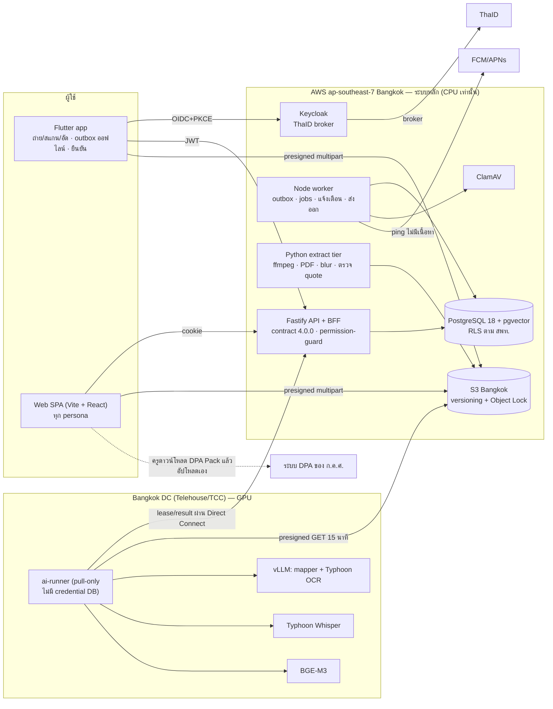

# plan.md — สถาปัตยกรรมและแผนพัฒนา SEIP v1 (เว็บ + Flutter + AI ในประเทศ)

> **ส่งหลักฐานเพียงครั้งเดียว ใช้ได้กับหลายตัวชี้วัด จัดการโดย AI หลังบ้าน**

| รายการ | ค่า |
|---|---|
| สถานะ | **Draft v1.0** — รอ owner อนุมัติพร้อม ADR-0010 ถึง ADR-0018 ใน P0 |
| วันที่ | 2026-10-12 (12 ต.ค. 2569) |
| เอกสารคู่กัน | `docs/project/PRD.md` (ทำอะไร/ทำไม) · `docs/architecture/design-brief-2026-10.md` (รายละเอียดเทคนิคฉบับเต็ม ภาษาอังกฤษ) · `docs/decisions/ADR-0010` – `ADR-0018` |
| Baseline ของโค้ด | `origin/feat/cleanup-L2-e2e-depth` @ `ff9293c` (นำหน้า `develop` 30 commits และยังไม่ merge) |

เอกสารนี้ตอบคำถาม **"สร้างอย่างไร และสร้างอะไรก่อน"** ตาม PRD. ตัวเลขทุกตัวที่มีคำว่า *assumption* หรือ *unverified* เป็นค่าตั้งต้น และต้องยืนยันก่อนใช้ตัดสินใจ

---

## 1. การตัดสินใจหลัก

### 1.1 การตัดสินใจของ owner (2026-10-12, ผูกพัน)

| ID | การตัดสินใจ |
|---|---|
| D1 | AI ทั้งหมดประมวลผลในไทยด้วย **open model ที่ host เอง**. ห้ามใช้ AI ต่างประเทศ/cloud AI. ระบบหลักอยู่ในไทย |
| D2 | ผู้ซื้อคือ **สพท. (B2G)** ซึ่งเป็น controller. โรงเรียนเป็น tenant และ SEIP เป็น processor. Portfolio ติดตัวครูเมื่อย้ายโรงเรียน |
| D3 | v1 = **evidence hub** + มุมมองกรรมการ + ส่งออกไประบบ DPA. **การให้คะแนนเลื่อนไป v2** |
| D4 | มือถือใช้ **Flutter** และออกแบบเว็บกับมือถือคู่ขนานกัน |
| D5 | ไม่มีอะไรเดิมที่ต้องเก็บไว้ ให้ยึดวัตถุประสงค์เป็นหลัก |

### 1.2 สถาปัตยกรรมที่เลือก: **"EVOLVE"** — ต่อยอดโค้ด TypeScript เดิม

มีสามแบบเข้าแข่งขัน และ judge สี่มุมให้คะแนน (แต่ละมุมเต็ม 40):

| ข้อเสนอ | เป้าหมาย | Compliance | Delivery | ต้นทุน/ความเป็นไปได้ | **รวม** |
|---|---|---|---|---|---|
| **EVOLVE** (ต่อยอด TS/Fastify, PG18 บน AWS Bangkok, GPU runner ในไทย) | 29 | 28 | **27** | **26** | **110** |
| Re-Platform (เขียน backend ใหม่เป็น Python) | **32** | **32** | 16 | 23 | 103 |
| Sovereign Appliance (k3s ที่ศูนย์ข้อมูล สพท.) | 26 | 31 | 20 | 18 | 95 |

**เหตุผลที่ EVOLVE ชนะ**
- เป็นแบบเดียวที่งานบนเส้นทางวิกฤตส่วนใหญ่คือการทำผลิตภัณฑ์ ไม่ใช่การเขียนระบบใหม่
- Re-Platform ต้องเขียน backend ใหม่ (~5,000 บรรทัด และพอร์ตเทสต์ ~210 กรณี) โดยมีนักพัฒนาคนเดียว ได้ 3/10 ทั้งด้าน reuse และด้านความเป็นไปได้ที่จะสร้างเสร็จ
- จุดแข็งของอีกสองแบบถูก **นำมาผนวก** ทั้งหมด:
  - prompt ที่ใส่ตัวชี้วัดครบ 18 ตัว
  - cascade จาก fast ไป dense
  - อัปโหลดเสียงก่อนวิดีโอ (audio-first)
  - RLS backstop, MFA บังคับ, Object Lock
  - กรรมการไม่เห็นความมั่นใจของ AI
  - Thai-owned hosting profile
  - egress deny พร้อมหลักฐานการทดสอบ

### 1.3 ข้อเท็จจริงที่เปลี่ยนการตัดสินใจ (ตรวจแล้ว 2026-10-12)

1. **โค้ดบน L2 ไม่เคยผ่าน CI เลย** (18/18 runs ล้มด้วย MySQL `ERROR 1419` ที่ migration constraints). เทสต์ผ่านเฉพาะบน Laragon ที่รันด้วย root → ย้ายไป **PostgreSQL 18** (ADR-0012)
2. **MinIO หยุดเผยแพร่ image รุ่น community** (ต.ค. 2025). ตอนนี้ CI แดง 3 gates และการติดตั้งใหม่ทุกครั้งพังตั้งแต่ `docker compose up` → **S3 Bangkok + SeaweedFS** (ADR-0013)
3. **AWS และ GCP ใน Bangkok ไม่มี GPU** → วาง GPU node ใน **Direct Connect location ที่ Bangkok** (Telehouse หรือ TCC) ข้อมูลจึงไม่ออกนอกไทยโดยโครงสร้าง (ADR-0011)
4. **ClamAV สแกนไฟล์เกิน 2 GB ไม่ได้** → วิดีโอผ่าน ffprobe + transcode ที่ server แทน (ADR-0018)
5. **open model ภาษาไทยที่ license สะอาดมีแล้ว** (Gemma 4 31B, Qwen3.6-27B, SEA-LION v4.5) **แต่คุณภาพในงานของ SEIP ยังไม่มีใครวัด** → ต้อง bake-off ก่อนเปิดใช้ AI (ADR-0010/0019)
6. **dependency audit แดง** (17 ช่องโหว่ใน lockfile รวม react-router) → แก้ใน P0

---

## 2. สถาปัตยกรรมภาพรวม

### 2.1 องค์ประกอบหลัก (รุ่นที่ pin เต็มอยู่ใน design brief §2)

| องค์ประกอบ | เทคโนโลยี | ที่ตั้ง | ADR |
|---|---|---|---|
| เว็บ | Vite 8 + React 19 + React Router 8 + TanStack Query, pdf.js, Uppy (multipart) | nginx static, Bangkok | 0016 |
| มือถือ | Flutter 3.47.7, drift + SQLite3MultipleCiphers, background_downloader, flutter_appauth | Play Store / App Store | 0016 |
| API + BFF | Node 24, Fastify 5.12, Prisma 7.10, openid-client | ECS Fargate, Bangkok | 0014, 0016 |
| ตัวตน | Keycloak 26.x (หนึ่ง Organization ต่อ สพท.) + ThaID | Fargate, Bangkok | 0014 |
| Worker | Node worker เดิม + job lease (`SKIP LOCKED`), DLQ, outbox consumer | Fargate | 0012 |
| Extract | Python 3.12: ffmpeg 8.1, pypdfium2, pikepdf, PyThaiNLP, YuNet (เบลอหน้า), rapidfuzz | Fargate | 0010, 0018 |
| เอกสาร | Gotenberg (LibreOffice + Chromium, ไม่มี egress) ฟอนต์ TH Sarabun New | Fargate | — |
| ฐานข้อมูล | RDS PostgreSQL 18 Multi-AZ + pgvector (ถ้าไม่มี PG18 ใช้ PG17) | Bangkok | 0012 |
| ไฟล์ | S3 Bangkok (SSE-KMS, Object Lock) · SeaweedFS สำหรับ dev/CI | Bangkok | 0013 |
| AI | vLLM (mapper fast MoE → dense 27–31B), Typhoon OCR 1.5, Typhoon Whisper, BGE-M3 | GPU 1 การ์ด RTX PRO 6000 (96 GB) ที่ Telehouse/TCC | 0010, 0011 |

### 2.2 ที่อยู่ของข้อมูล (D1)

| ข้อมูล | อยู่ที่ | ใครแตะได้ |
|---|---|---|
| ไฟล์ต้นฉบับ, derivative, transcript/OCR, ผลลัพธ์ AI, ฐานข้อมูล, backup | **ในไทยทั้งหมด** (AWS Bangkok + DC ไทย + backup site ที่สองในไทย) | ผู้ให้บริการ (processor) ภายใต้สัญญากับ สพท. |
| Input ของ AI | GPU node ใน Bangkok รับผ่าน presigned GET อายุ 15 นาที **ไม่เก็บอะไรไว้เลย** | ai-runner เท่านั้น |
| Push notification | FCM/APNs (**นอกประเทศ**) แต่ **payload ไม่มีเนื้อหา** มีแค่ ping | ต้องให้ owner ยืนยันการตีความ D1 (AQ-01, PRD OQ-27/34) |
| ข้อมูลที่นักพัฒนา (Claude Code/GitHub) เห็น | **ข้อมูลสังเคราะห์เท่านั้น** | ต้องให้ owner ยืนยัน (AQ-15) |

Egress ของ AI tier ถูกปิดเป็นค่าเริ่มต้น (nftables) และ CI probe พิสูจน์ทุกครั้ง เพื่อเป็นหลักฐานที่ตรวจสอบได้ว่าทำตาม D1

---

## 3. AI pipeline (สรุป — รายละเอียดใน design brief §AI pipeline)

1. **Intake**: server คำนวณ SHA-256/ขนาดใหม่, ClamAV (≤1.9 GB), ffprobe และตรวจซ้ำ (SHA-256 ซ้ำ → ใช้ผลเดิมโดยไม่เรียก AI)
2. **Extract → segment ที่อ้างถึงได้**:
   - PDF: ใช้ text layer ถ้าผ่านการตรวจคุณภาพภาษาไทย ถ้าไม่ผ่านใช้ Typhoon OCR
   - Office: แปลงเป็น PDF ด้วย Gotenberg
   - ภาพ/keyframe: VLM เขียนคำบรรยายภาษาไทย
   - วิดีโอ: Typhoon Whisper พร้อม timestamp
   - ทุก segment มี ID อ้างอิงได้ เช่น `P3-B2`, `T00:12:30–00:13:10`
3. **Mapping**:
   - เรียก mapper หนึ่งครั้ง prompt ใส่ตัวชี้วัด **ครบ 18 ตัว** ที่ระดับวิทยฐานะของครู (~2k tokens)
   - output บังคับด้วย xgrammar JSON schema: `indicator_code` และ `segment_id` เป็น enum
   - ถ้าความมั่นใจต่ำ, locator ผิด, พบสัญญาณ injection หรือวิดีโอยาวเกิน 30 นาที → cascade ไป dense model
4. **Validate (ใน Bangkok)**: ตรวจ quote ด้วย fuzzy match บนข้อความไทยที่ normalise แล้ว. Locator ที่แสดงมาจาก segment ที่เก็บไว้เสมอ. Calibrate ด้วย isotonic
5. **ครูยืนยัน**:
   - suggestion เก็บแยกในตาราง `ai_suggestion` และ **ไม่ auto-confirm**
   - ปุ่ม "ยอมรับทั้งหมดที่ชัดเจน" เปิดทีละตัวชี้วัด เมื่อ precision ≥ 0.85 บน ≥ 50 ชิ้นจาก pilot
6. **Quality gate** (ADR-0019 หลัง bake-off):
   - gold set ~600 ชิ้น ติดป้ายโดยผู้ประเมิน 3 คน + คนที่ 4 ตัดสิน
   - ประเภทหลักฐานที่ไม่ผ่าน gate → เปิดใช้โดย **ปิด AI**
   - ตัวชี้วัดที่ precision < 0.50 → ซ่อน
7. **ความปลอดภัย**:
   - หลักฐานถือเป็น input ที่ไม่น่าเชื่อถือ
   - ตรวจ hidden text เทียบ text layer กับ OCR
   - pikepdf ลบ JavaScript ใน PDF
   - ใส่ canary สำหรับ injection ใน gold set

**ต้นทุน GPU ต่อชิ้นไม่ใช่ตัวแปรหลัก** ตัวแปรหลักคือ **พีคที่ตรงกันทั้งประเทศช่วงก่อน 30 ก.ย.** วิธีรับมือมี 4 ทาง: priority queue ที่แบ่งคิวยุติธรรมรายโรงเรียน, พักการ cascade ไป dense model ช่วงพีค, สลับ ASR เป็นรุ่น turbo และเตือนครูให้ทยอยอัปโหลดตั้งแต่ พ.ค.

---

## 4. แบ่งงานเว็บ / มือถือ ตาม persona

| Persona | Flutter (v1) | เว็บ (v1) |
|---|---|---|
| **ครู / ผู้บริหารที่ถูกประเมิน** | ถ่ายภาพ, สแกนเอกสารเป็น PDF, อัดวิดีโอ (720p เป็นค่าเริ่มต้น หรือเลือกส่งต้นฉบับ), voice note, รับไฟล์ share จาก LINE/Drive/Photos, outbox ออฟไลน์ที่เข้ารหัส, อัปโหลดเบื้องหลังที่ต่อได้, กล่องคำแนะนำ AI (ยอมรับ/ปฏิเสธพร้อมเหตุผล), ยืนยันวันที่ปฏิบัติงาน, วงความครอบคลุมรายตัวชี้วัด, การแจ้งเตือน | ทุกอย่างที่มีในมือถือ + อัปโหลดทีละมาก, ตารางหลักฐาน × ตัวชี้วัด, แก้ PA1 + ประเด็นท้าทาย, ดู/แก้ transcript, **สร้าง DPA Pack** พร้อม pre-flight, PA2 workbook, portability export |
| **ผอ. / ผู้ดูแลระบบโรงเรียน** | กล่อง validate/return (ต้อง step-up MFA), สรุปความครอบคลุมของบุคลากร | สมาชิกและบทบาท, วงรอบและการตั้งกรรมการ (เตือนตามกติกาคุณสมบัติ), **split view รายตัวชี้วัด**, PA2, อัปโหลด PA3 ที่ลงนามแล้ว |
| **กรรมการ** (เห็นเฉพาะผู้ที่ได้รับมอบหมาย) | รายการหลักฐานแบบอ่านอย่างเดียว, เล่นวิดีโอแล้วกระโดดไปตำแหน่งที่อ้าง | **Split view**: rubric ระดับของผู้ถูกประเมินคู่กับหน้า PDF ที่ไฮไลต์หรือวิดีโอที่ seek ไปตำแหน่งที่อ้าง พร้อมปุ่ม validate/return. **ไม่มีคะแนน ไม่แสดงความมั่นใจหรือเหตุผลของ AI** |
| **ผู้ดูแลเขต / HR / DPO** | — | โรงเรียน, นำเข้า HR (dry-run diff ก่อน), framework version และสายการแก้ไข, slot profile ของ DPA, retention, dashboard (เฉพาะจำนวน), คำขอใช้สิทธิตาม PDPA, ROPA/audit export, controller-exit export |
| **Operator** | — | คิวงาน, dead jobs, model registry, รายงาน gate. **มองไม่เห็นเนื้อหาหลักฐาน** |

**ไม่ใช้ Flutter Web และไม่ใช้ Next.js** (ADR-0016). Budget ของเว็บ: JS บน critical path ≤ 300 KB gzip และ LCP < 2.5 s บน Fast-3G

---

## 5. การเปลี่ยนแปลง data model (สรุป — รายละเอียดใน design brief §Data model delta)

| หมวด | สิ่งใหม่ / ที่เปลี่ยน | ADR |
|---|---|---|
| ตัวตนและความเป็นเจ้าของ | `person` (key = KMS HMAC ของเลขประจำตัวประชาชน), `employment`, `evidence_grant`, `controller_area_id` บนหลักฐาน, `device_session` | 0014, 0015 |
| หลักฐาน | `evidence_item` เป็นของบุคคล (file / link / note), `performed_from/to` + แหล่งที่มาของวันที่, `upload_session` (multipart), สถานะสื่อ (probe/transcode/scan), `scanned_at` | 0016, 0018 |
| AI | `ai_job` (lease, backoff, DLQ), `content_segment` (หน้า/bbox/ช่วงเวลา + ธง PII), `ai_suggestion` (ความมั่นใจ, quote, locator, `model_id`, `prompt_version`, `input_sha256`, `superseded_by`), `human_feedback` (เหตุผลที่ปฏิเสธ), `model_registry`, embeddings (`halfvec` + HNSW) | 0010, 0012 |
| การกำกับ mapping | สถานะ `owner_confirmed` → `validated` / `returned` / `revoked` | 0015 |
| กฎการประเมินเป็นข้อมูล | `framework_amendment`, `indicator_crosswalk`, `programme`, `pass_rule`, `committee_eligibility_rule`, `eligibility_rule`, `dpa_slot_profile` — ทุกแถวมี `effective_from`, แหล่งอ้างอิง และธง `verified` | 0017 |
| ส่งออก | `export_package` (DPA Pack, PA2), `submission_ledger`, legal hold | 0013, 0017 |
| แจ้งเตือน | `notification`, `notification_preference`, `device_push_token` | 0016 |
| ลบ | trigger ของ MySQL (`active_uk_key`, `pa_uk_key`) และค่า 70% ที่ hard-code ใน DDL | 0012, 0017 |

Prisma ใช้ raw-SQL migration สำหรับ partial index, RLS และ vector และใช้ TypedSQL สำหรับ query vector

---

## 6. สิ่งที่เก็บ / แก้ / เขียนใหม่ / ลบ จาก L2 (สรุป)

| ประเภท | ตัวอย่าง |
|---|---|
| **เก็บไว้** | rubric seed (792 แถว — 72 แถวของครูผู้ช่วยเป็น placeholder), `permission-guard`, `role-resolution`, `invite-token`, `clamav.ts` (fail-closed), audit helper, `local-heuristic-mapping` (เป็นโหมดสำรองและ floor), เครื่องมือ contract-first, lib/component ของเว็บที่มีเทสต์ |
| **แก้** | `schema.prisma` + migrations (rebaseline บน PG18), OpenAPI → **4.0.0** + `internal-ai.yaml`, route ของ evidence/mappings/auth/members/cycles (cycles เอาส่วนให้คะแนนออก), worker (job graph, SHA-256, CDR, outbox consumer), หน้าเว็บ (React 19 + Router 8, กล่องคำแนะนำ, Uppy, split view), `useAuth` → cookie BFF |
| **Freeze (v2)** | route การให้คะแนนและการอนุมัติรายงาน ซ่อนหลัง `FEATURE_SCORING=false` แต่เทสต์ยังรันใน CI job "frozen" |
| **ใหม่** | `apps/mobile` (Flutter), `apps/extract` + `apps/ai-runner` (Python), Keycloak realm-as-code, IaC (OpenTofu) |
| **ลบ** | MinIO ใน compose/CI, migration ของ MySQL, การออก token เองหลัง P1, ไฟล์ของกระบวนการ multi-agent ที่ ADR-0004 ยกเลิกแล้ว |

**Branching**:
1. แตก `feat/SEIP-P0-pg-rebaseline` จาก `ff9293c`
2. merge เข้า `develop` ด้วย merge commit ปกติ **ห้าม force-push** `develop` หรือ `main`
3. ติด tag ก่อนลบอะไร: `archive/v0-mysql-l2` → `ff9293c` และ `archive/develop-pg-2026-07` → `3a74160`
4. PR #1 ถูกแทนที่ ส่วน PR #3 (เอกสารชุดนี้) merge แยก

---

## 7. Roadmap (vertical slices — แต่ละเฟสจบด้วยของที่รันได้จริงบนเว็บและ Flutter)

| เฟส | ช่วงเวลา | เป้าหมาย | Exit criteria หลัก |
|---|---|---|---|
| **P0 รากฐานบน PostgreSQL** | 13–30 ต.ค. 2569 (3 สัปดาห์) | L2 รันครบวงจรบน PG18 + SeaweedFS โดย CI เขียวทุก gate | **CI เขียวครบ 13 gates เป็นครั้งแรก** (migration รันด้วย role ที่ไม่ใช่ superuser) และเขียวอีกครั้งหลังอัปเกรด Prisma 7 · EICAR ถูก block · Flutter บน emulator เรียก API ผ่าน Dart client ที่ generate · owner อนุมัติ ADR-0010–0018 · ส่ง RFQ แล้ว |
| **P1 ตัวตน บุคคล tenancy** | 2–20 พ.ย. 2569 · **ตัดสินใจเรื่อง GPU ภายใน 27 พ.ย.** | ครูที่ สพท. นำเข้าล็อกอินด้วย ThaID (sandbox) บนเว็บและ Flutter | step-up MFA ทำงาน · revoke อุปกรณ์มีผลภายใน ≤ 60 s · RLS ปฏิเสธการอ่านข้าม สพท. ใน raw SQL · staging รันใน Bangkok · บันทึกการตัดสินใจ GPU เป็น addendum ของ ADR-0011 |
| **P2 บันทึกครั้งเดียว อัปโหลดได้ทุกที่** | 23 พ.ย.–11 ธ.ค. 2569 | ถ่ายบนมือถือราคาประหยัดแบบออฟไลน์ หรืออัปโหลดหลายไฟล์บนเว็บ | วิดีโอ 1 GB อัปโหลดต่อได้หลังเปิดโหมดเครื่องบินและหลังแอปถูกปิด · SHA-256 ตรง · ได้ไฟล์ 720p · ส่งซ้ำ 20 ครั้งตอนออฟไลน์ไม่เกิดรายการซ้ำเลย · Object Lock กันการลบ |
| **P3 AI ในประเทศ v0** | 14 ธ.ค. 2569–22 ม.ค. 2570 | ทุกการอัปโหลดได้คำแนะนำภาษาไทยพร้อม quote/locator ที่ตรวจแล้ว | locator ถูกต้อง ≥ 95% บน smoke set 50 ชิ้น · p95 ≤ 15 นาทีที่โหลด 300 ชิ้น/ชม. บน 1 การ์ด · **egress audit ไม่พบ traffic ของ AI ออกนอกไทยเลย** · e2e ผ่านใน CI ผ่าน replay stub |
| **P4 มุมมองกรรมการ + แจ้งเตือน** | 25 ม.ค.–12 ก.พ. 2570 | ผอ./กรรมการตรวจรายตัวชี้วัด แล้ว validate/return | หน้าที่อ้างแสดงภายใน ≤ 3 s (p95) · push ถึงภายใน 60 s · แจ้งเตือนเมื่อตั้งกรรมการวิทยฐานะต่ำกว่าเกณฑ์ · axe ไม่พบปัญหาระดับ serious · **ลงนาม DPIA v1** |
| **Alpha 3 โรงเรียน** | ตั้งแต่ 15 ก.พ. 2570 (คู่กับ P5–P6) | ครูจริงใช้ครบวงจรกับหลักฐานจริง | ครูใช้งาน ≥ 30 คน · ประมวลผลหลักฐานจริง ≥ 300 ชิ้น · ไม่มีเหตุการณ์ด้าน residency หรือความปลอดภัย |
| **P5 DPA export + framework + model gate** | 15 ก.พ.–12 มี.ค. 2570 | DPA Pack และ PA2 workbook · เปิด/ปิด AI ตามผลวัด | ครูนำแพ็กขึ้นระบบ DPA เองได้ภายใน ≤ 30 นาที · รายงาน gate รายประเภทหลักฐาน · เขียน **ADR-0019** |
| **P6 Hardening** | 15 มี.ค.–23 เม.ย. 2570 (+ buffer ถึง 14 พ.ค.) | ระบบรับโหลด ความล้มเหลว และการโจมตีได้ | **go/no-go ภายใน 7 พ.ค.** · RTO ≤ 4 ชม. · ไม่มี finding ระดับ high จาก pentest · แอปขึ้นทั้งสอง store · DPO ของ สพท. ลงนาม |
| **Pilot 1 สพท. (20–40 โรงเรียน)** | **17 พ.ค.–30 ก.ย. 2570** | พิสูจน์ใน PA/DPA ฤดูจริงว่าช่วยประหยัดเวลาครู | median อัปโหลด→ยืนยัน < 2 นาที (PDF/ภาพ) · ≥ 40% ของหลักฐานจับคู่ ≥ 2 ตัวชี้วัด · peak p95 ≤ 15 นาที · SUS ≥ 70 |
| **P7 ตัดสินใจขยาย** | ต.ค.–พ.ย. 2570 | วาง TOR ทั้งเขตปีงบ 2571 และขอบเขต v2 | ADR อัปเดต · ร่าง TOR · backlog ของ v2 |

ขอบเขตเต็มของแต่ละเฟสอยู่ใน design brief §Roadmap

### 7.1 Cut list (ถ้าเฟสล่าช้า ตัดอะไรออก — กำหนดไว้ล่วงหน้า)

| Trigger | เงื่อนไข | สิ่งที่ตัด / เลื่อน |
|---|---|---|
| T1 | P1 ไม่จบภายใน 4 ธ.ค. | IdP สำรองและ device-code fallback เลื่อนไป v1.1 |
| T2 | P2 ไม่จบภายใน 23 ธ.ค. | อัปโหลดแบบ audio-first เลื่อนไป v1.1 |
| T3 | P3 ไม่จบภายใน 5 ก.พ. | Alpha ใช้ `local_heuristic` + จับคู่ด้วยมือ · รายการกรรมการบนมือถือและ portability import เลื่อนไป v1.1 |
| T4 | P5 ไม่จบภายใน 26 มี.ค. | ส่งเฉพาะแพ็กครูประเภท 9.1.1 · แพ็กผู้บริหารและ PA2 workbook เลื่อนไป v1.1 |
| T5 | go/no-go ไม่ผ่าน | เลื่อน pilot ไปไม่เกิน 7 มิ.ย. 2570 |

---

## 8. FR → เฟส (ครบทุก FR ใน PRD §7)

> mapping นี้อิงจากขอบเขตของแต่ละเฟส และต้องทบทวนตอนวางแผนแต่ละเฟส. ถ้า FR ใดย้ายเฟส ให้แก้ตารางนี้ด้วย

| เฟส | FR |
|---|---|
| **P0** | FR-020 (fail-closed scan บน PG), FR-046 (partial unique แทน trigger), FR-110 (audit append-only บน PG) |
| **P1** | FR-019, FR-050, FR-051, FR-090, FR-091, FR-092, FR-093, FR-094, FR-095, FR-096, FR-097, FR-098, FR-099, FR-099a |
| **P2** | FR-001, FR-002, FR-003, FR-004, FR-005, FR-006, FR-007, FR-008, FR-009, FR-010, FR-011, FR-012, FR-013, FR-014, FR-015, FR-017, FR-018, FR-021, FR-033 |
| **P3** | FR-022, FR-023a, FR-023b, FR-024, FR-025, FR-026, FR-027, FR-028, FR-029, FR-030, FR-031, FR-032, FR-034, FR-035, FR-040, FR-041, FR-042, FR-043, FR-048, FR-053, FR-063, FR-083 |
| **P4** (ก่อน Alpha เพราะเริ่มมีข้อมูลจริง) | FR-044, FR-045, FR-047, FR-052, FR-054, FR-056, FR-057, FR-060, FR-061, FR-062a, FR-062b, FR-062c, FR-064, FR-065, FR-089, FR-089a, FR-100, FR-101, FR-102, FR-103, FR-111, FR-112, FR-113, FR-114, FR-116, FR-117, FR-121, FR-122 |
| **P5** | FR-055, FR-070, FR-071, FR-072, FR-073, FR-074, FR-075, FR-076, FR-077, FR-078, FR-080a, FR-081, FR-082, FR-084, FR-085, FR-086, FR-087, FR-088 |
| **P6** | FR-016, FR-115, FR-118, FR-119, FR-120 |
| **v2** | FR-080b, FR-130, FR-131, FR-132, FR-133, FR-134 |

FR ด้านสิทธิตาม PDPA ที่จำเป็นก่อนมีข้อมูลจริง (คัดค้าน, notice, ROPA และการเข้าถึงของ operator) อยู่ใน P4 เพราะ Alpha เริ่มรับข้อมูลจริงตั้งแต่ 15 ก.พ. ก่อนหน้านั้นใช้**ข้อมูลสังเคราะห์เท่านั้น**

---

## 9. ความเสี่ยงหลัก

| ID | ความเสี่ยง | โอกาส | ผลกระทบ | การลดความเสี่ยง |
|---|---|---|---|---|
| R1 | open model ไม่ผ่าน AI gate สำหรับ rubric ภาษาไทย (คาดว่าต่ำกว่าแนวหน้า 5–15 F1 ยังไม่ได้วัด) | กลาง | สูง | bake-off สองตระกูล (Pack Q/G), ใส่ตัวชี้วัดครบ 18 ตัว, cascade, gate รายประเภท, มีโหมด suggest-on-request |
| R2 | นักพัฒนาคนเดียวต้องดูแล TS + Dart + Python + infra (~24 สัปดาห์ทำงาน) | สูง | สูง | vertical slice, ใช้บริการ managed, generate client, replay stub, ผู้รับจ้าง Flutter (ไม่บังคับ ~0.4M), cut list |
| R3 | ราคาและเวลาส่งมอบ GPU, ลงทุนก่อนมีหลักฐาน (RTX PRO 6000 ราคาขึ้นจาก $8.6k เป็น $16k ใน 17 เดือน) | กลาง | สูง | pre-bake-off บน LANTA → เช่าหรือซื้อ 1 การ์ดภายใน 27 พ.ย. · การ์ดที่ 2 หลังผ่าน P5 เท่านั้น |
| R4 | ThaID RP ช้าหรือถูกปฏิเสธ, app-switch บนมือถือมีปัญหา | กลาง | กลาง | ให้ สพท. เป็น RP · activation code + passkey/TOTP · spike ใน P1 |
| R5 | PDPA: สื่อของนักเรียน, เลขประจำตัวประชาชน, การย้ายข้าม controller, gold set | กลาง | สูง | DPIA v1 ก่อน Alpha · notice ตาม ม.24(4) + กระบวนการคัดค้าน · เบลอ/ปิดชื่อในสำเนาติดป้าย · train เฉพาะข้อมูลที่ได้รับความยินยอม |
| R6 | พีค 30 ก.ย. พร้อมกันทั้งประเทศ ล้น GPU หรือแบนด์วิดท์ของโรงเรียน | สูง | กลาง | priority queue + fair share · peak profile · audio-first · เตือนให้ทยอยอัปโหลดตั้งแต่ พ.ค. |
| R7 | กฎ ก.ค.ศ. และรูปแบบ DPA ยังไม่ verified หรือเปลี่ยน | สูง | กลาง | เก็บกฎเป็นข้อมูลที่มีธง verified และกฎที่ยังไม่ verified ทำงานเป็นคำเตือน · owner อ่านต้นฉบับ (AQ-07) |
| R8 | ถูกปฏิเสธเรื่อง hosting/จัดซื้อ (สกมช. impact สูง, CLOUD Act, e-bidding) | กลาง | สูง | site หลักและ backup อยู่ในไทย · Thai-owned profile ทดสอบทุกสัปดาห์ (ย้ายได้ใน 3–4 สัปดาห์) |
| R9 | migration (PG, Prisma 7, Keycloak, person ownership) ทำพฤติกรรมเดิมพัง | กลาง | กลาง | แบ่ง P0 เป็นขั้นที่ CI เขียวทุกขั้น · พอร์ตเทสต์ ไม่เขียนใหม่ |
| R10 | อัปโหลดเบื้องหลังไม่เสถียรบนบาง OEM/iOS · store ล่าช้า | กลาง | กลาง | multipart แบบ server-persisted + ListParts · เริ่ม developer verification ตั้งแต่ P0 |
| R11 | automation bias: ครูกดยอมรับ AI โดยไม่ดู | กลาง | สูง | กรรมการไม่เห็นความมั่นใจของ AI · blind holdout 5% · pre-tick ปิดจนผ่าน gate · แจ้งเตือนเมื่ออัตรายอมรับสูงผิดปกติ |
| R12 | ข้อโต้แย้งเรื่องแหล่งที่มา/license ของโมเดล (ต้นกำเนิด Qwen, เงื่อนไข OpenTyphoon) | กลาง | กลาง | Pack G ผ่าน gate เดียวกัน · ตรวจ license ก่อน ADR-0019 · mirror weights ไว้ |
| R13 | ราคา colocation/DX และหลักฐาน ISO 27001 ยังไม่ทราบ | กลาง | กลาง | RFQ ใน P0 · มี VPN สำรอง · การเช่าโอนความเสี่ยงด้าน facility ไปให้ผู้ให้เช่า |

---

## 10. ต้นทุน (สรุป — ตารางเต็มและแหล่งราคาใน design brief §Cost)

อัตรา 33 บาท/USD รวม VAT **ไม่รวมเวลาของนักพัฒนา**. ราคา AWS ตรวจจาก price list ของ ap-southeast-7 แล้ว. ราคาฮาร์ดแวร์และ colocation เป็น **assumption จนกว่าจะได้ใบเสนอราคา**

| รายการ | ซื้อ GPU 1 การ์ด | เช่า GPU 1 การ์ด |
|---|---|---|
| AWS production + staging (ปี pilot) | 0.50M | 0.50M |
| GPU server / ค่าเช่า (ก.พ.–ก.ย.) | capex 1.6M (1.3–2.1M) | opex 0.56M |
| Colocation + DX circuit | 0.25M | 0.10M |
| Gold set, bake-off, pentest, กฎหมาย, เตรียม ISO 27001, support 0.5 FTE, dev workstation, store fees | ~1.75M | ~1.75M |
| ผู้รับจ้าง Flutter (ไม่บังคับ) | 0.40M | 0.40M |
| **รวมปี pilot** | **≈ 4.5M** | **≈ 3.2M** |

- สพท. จ่ายค่าบริการ pilot **≤ 0.5M บาท** (วิธีเฉพาะเจาะจงหรือ MOU) → **ผู้ให้บริการลงทุนเองปีแรกราว 2.7–4.0M บาท**
- **ระยะคงที่** (สพท. 6,000 คน, 5 เขตใช้แพลตฟอร์มร่วมกัน): **≈ 1.78M บาท/เขต/ปี ≈ 300 บาท/คน/ปี** ลดเหลือ ≈ 250 บาท/คน ได้ถ้าเช่า GPU เฉพาะช่วงพีค
- **ยังไม่ได้พิสูจน์ว่า สพท. มีงบจ่ายได้** (AQ-03) การขยายทั้งเขตต้องผ่าน e-bidding ปีงบ 2571

---

## 11. คำถามที่ owner ต้องตอบ (เรียงตามความเร่ง)

| ID | คำถาม | ขวางอะไร |
|---|---|---|
| **AQ-01** | AWS Bangkok (บริษัทสหรัฐฯ ตั้งอยู่ในไทย) และ push ผ่าน FCM/APNs ที่ไม่มีเนื้อหา ถือว่าทำตาม D1 หรือไม่ | ADR-0011 |
| **AQ-03** | สพท. นำร่องคือเขตไหน · LOI/DPA ลงนามเมื่อไร · ใช้สัญญา ≤ 500k หรือ MOU | P2 (ข้อมูลจริง), Alpha |
| **AQ-05** | GPU เช่าหรือซื้อ · Telehouse หรือ TCC | P3 (ตัดสินภายใน 27 พ.ย.) |
| **AQ-07** | อ่านต้นฉบับจากเครือข่ายในไทย ได้แก่ ล1222/2568 (แนบ 1–5), ล679/2566, ล1144/2567, ว15/2565, คู่มือ DPA 2569 | เปลี่ยนกฎเป็น verified (P5) |
| **AQ-14** | มีงบผู้รับจ้าง Flutter (~0.4M) หรือไม่ | ความเสี่ยง R2 |
| **AQ-15** | ยืนยันว่า Claude Code/GitHub เห็นเฉพาะข้อมูลสังเคราะห์ และการดีบัก production ทำโดยเจ้าหน้าที่ในไทยเท่านั้น | D1 |
| AQ-02, 04, 06, 08–13, 16 | ระดับ impact ของ สกมช., ThaID RP, license ของโมเดล, gold set, controller model, retention, ความต้องการของกรรมการ, แนวปฏิบัติเรื่อง AI ของ ก.ค.ศ., ขนาดไฟล์ DPA, การให้คะแนน PA ปัจจุบัน | ดู design brief §Open questions |

---

## 12. สิ่งที่ต้องทำทันทีเมื่อ owner อนุมัติ (P0 สัปดาห์ที่ 1)

1. แตก `feat/SEIP-P0-pg-rebaseline` จาก `ff9293c` และติด archive tags
2. rebaseline migration บน PG18 (partial unique, ไม่มี trigger) และสร้าง role `seip_migrator`/`seip_app`
3. แทน MinIO ด้วย SeaweedFS ใน CI และ compose
4. รีเฟรช lockfile (รวมอัปเกรด react-router) จน `npm audit` ไม่มี high
5. ทำให้ **ทั้ง 13 gates เขียว** เป็นครั้งแรก

หลังจากนั้น (สัปดาห์ 2–3): อัปเกรด Prisma 7, ร่าง contract 4.0.0, spike Dart client, โครง Flutter, replay stub, ส่ง RFQ, ส่ง LOI ให้ สพท. และเริ่ม developer verification กับ Apple/Google
